# BRO-AMM: A Bonded Reconciliation Oracle AMM as a Low-Risk DeFi Primitive

## Abstract

Low-risk decentralised AMM DeFi primite today stays un-implemented promise as no protocol can guarantee passive LP saftey by protocol design. In all existing AMMs we review as well as prominent papers, liquidity providers in automated market makers lose value to arbitrageurs who trade against stale on-chain prices (loss-versus-rebalancing, LVR) by protocol design. BRO-AMM (Bonded Reconciliation Oracle AMM) is a Uniswap v4 hook that prices each swap at execution and reconciles it after the block against signed oracle prices. It is build around intuirively obvious first principle - a post-factum observation of chain history and market oracles can be objective truth about conditions and can be brought on-chain as quality metric of every swap towards LPs. Arbitrage is treated as a paid job: a price-correcting swap keeps a market-discovered allowance per unit of volume, and extraction beyond it is recaptured for liquidity providers from stake posted before trading, so that what an arbitrageur can pay block builders for position is bounded by that allowance. Traders who overpay mint a per-pair reputation token (REP) whose stake grants fee discounts. All value settles in each pool's own pair, and the work of settlement is paid in gas from a tank that every swap prefunds. We review L1 (Ethereum) and one L2 (Arbitrum) to validate our assumptions in both L1 and L2 realities. On six months of Ethereum and Arbitrum data, a fixed schedule applied with perfect information recaptures 70–73% of extraction at a benign-flow overcharge below 0.1 bp; with the allowance discovered on-chain, liquidity providers of the ETH/USDC 0.05% pool on Ethereum mainnet and the WETH/USDC pool on Arbitrum gain, in simulation and in the worst of three cost scenarios, about half of what they lose to extraction on the same data (51% and 49%; 2.5 bp and 0.6 bp of traded volume), even when arbitrageurs may trade from fresh unstaked accounts; mainnet LPs' net result turns from a loss into a gain, and payments for position fall by 77–87%. Settlement costs 0.18× the gas of the swaps it settles.

## 1. Introduction

LVR is a permanent, non-mean-reverting cost for liquidity providers (LPs). For a constant-product pool it accrues at $\sigma^2/8$ of the pool's value per unit of time, where $\sigma$ is the volatility of the external price over that unit (Milionis et al., 2022), about 11% a year at a daily volatility of 5%; measured arbitrage losses exceed the fees LPs earn in many of the largest Uniswap pools (Fritsch and Canidio, 2024), and in our sample LPs of the mainnet ETH/USDC pool ended \$1.58 M down after fees (§5.2). Arbitrage itself is necessary: it keeps the pool's price aligned with the market. The problem is its price. Arbitrageurs capture the full gap between pool and market, and on Ethereum they pass much of it to block builders in competition for position, a cost ultimately borne by LPs and blockchain community at large - as this system does not allow large scale adoption of AMM as reliable, low risk, DeFi building block that passive retail & institutionals can park capital in to, moreover fixed fee tiers fragment liquidity without resolving the trade-off.

This matters beyond the returns of LPs. Buterin (2025) argues that low-risk DeFi — payments and savings, well-understood tools such as synthetic assets and fully collateralised lending, "and the ability to exchange between these assets" — can be for Ethereum what search was for Google. Exchange is the primitive the others rely on, and it is low-risk only if supplying liquidity is: an LP who expects to lose a predictable share of liquidity to arbitrage each year is not holding a savings-grade position. We therefore design an exchange whose risks to LPs are bounded and stated. Execution stays synchronous and permissionless; nothing is lent or leveraged; all value settles in the pool's own pair, with no third asset or numeraire; extraction is collected from stake posted in advance; and the reputation asset is solvent at par against the surplus LPs have already received (Theorem 1), so that, as long as the pool meets its target in every epoch, a collapse in its price removes surplus, not principal. The mechanism does add a dependency: a signed oracle, whose error we bound by a tolerance rather than eliminate (§5.7). Oracle risk and contract risk are the very risks that Buterin names as having held low-risk DeFi back, and we list them explicitly among our assumptions (§3.4).

We pursue two goals: to return as much of the arbitrage surplus as possible to LPs while charging uninformed flow as little as possible, and to replace the hard-coded fee by a variable the system sets itself. The contributions are:

1. a per-swap quality score $Q_{\mathrm{LP}}$, measured against signed bid/ask prices at an empirically measured decision instant (§3);
2. a payout rule for arbitrage — a per-unit cap with an allowance discovered on-chain — under which what an arbitrageur can bid for position is bounded by an allowance the pool discovers, with an optional lane that settles corrections at execution and removes the dependence on arbitrage stake (§4.2–4.4, §4.10);
3. a per-pair reputation asset and a collateral design that make the charge collectable after the fact (§4.5–4.6);
4. a settlement layer that is pair-native and costs a fraction of the swaps it settles (§4.7);
5. an evaluation on Ethereum and Arbitrum covering scoring validity, recapture, payout rules, oracle error and settlement cost (§5).

## 2. Related work

Approaches to LVR either remove the information asymmetry or redistribute its surplus (Appendix A). Milionis et al. (2022) define LVR and suggest backward-looking fee adjustment and the sale of arbitrage rights as directions; BRO-AMM is a concrete, farming-resistant instance of the first.

Auction designs — am-AMM (Adams et al., 2024), McAMM (Josojo, 2022) and Angstrom (Sorella Labs) — sell the right to arbitrage or manage the pool and return the proceeds to LPs; Angstrom additionally clears ordinary orders at a uniform price, but relies on app-specific sequencing, whereas BRO-AMM is a plain hook. 

Diamond (McMenamin et al., 2022) and V0LVER (McMenamin and Daza, 2023) reduce liquidity for arbitrageurs only, and argue against oracle dependence; we accept a trusted signed oracle and quantify the consequences of its error (§5.7). 

The closest design is Hindsight (OoJae), a v4 hook that escrows each swap's output for about ten seconds and sets its fee afterwards from the realised markout against a volatility-adjusted threshold, refunding benign flow. BRO-AMM differs in keeping execution synchronous — the trader receives its output at once, and charges are collected from stake posted in advance — and in scoring at the decision instant rather than against later prices, which mix extraction with drift (§3.2). 

MEV taxes (Robinson and White, 2024) charge a fee increasing in the priority fee and capture competitive MEV under honest priority ordering; they do not hold under builder auctions on Ethereum and cannot reach extraction in the middle of a block. 

Reputation systems (zScore: Udupi et al., 2025; Karma: Status Network) and optimal dynamic fees (Baggiani et al., 2025; Ghasemlu, 2026) set fees or access by behaviour or market state but specify neither an oracle-reconciled scoring rule nor resistance to concentration of the discount.

## 3. Methodology

### 3.1 Reconciliation as fundamental finalisation requirement

No blockchain finalises as quickly as a centralised order book observes prices. Even a price signed into the transaction leaves a lag between the signature and execution that can be exploited. The ground truth about a swap is therefore available only after the fact, and an AMM that prices against it must span at least two blocks: the swap, and its reconciliation.

Reconciliation is to prices what finality is to blocks. Consensus protocols separate inclusion from finality: Nakamoto consensus makes a block final only probabilistically, as further blocks are built on it (Garay et al., 2015); Ethereum produces a block every 12 s but finalises a checkpoint only after two epochs of attestations, about 13 minutes (Buterin et al., 2020); and an optimistic rollup such as Arbitrum treats its results as final only once a challenge period has passed (Kalodner et al., 2018). BRO-AMM applies the same separation to price. A swap executes at once and provisionally, as a block is included; its price becomes final at reconciliation, once the signed prices for its block are available and agreed. As in those protocols, slowness is what makes agreement possible (§4.7).

### 3.2 The quality score

Let a pool trade token 0 against token 1. For a swap, let $\Delta_0$ and $\Delta_1$ be the amounts of the two tokens the pool receives (negative when it pays out), fees included, and let the notional be the swap's size in units of token 0. Then

```math
Q_{\mathrm{LP}} = \frac{\Delta_0 + P_{\mathrm{dir}}(t^*)\,\Delta_1}{\text{notional}} \tag{1}
```

where $t^*$ is the decision instant defined in §3.3 and $P_{\mathrm{dir}}(t^*)$ is the directional benchmark at that instant, the price of token 1 in units of token 0 — the liquidity-weighted bid when the pool sells the risky asset and the ask when it buys it — so that swaps executed inside the bid–ask band are never scored as extractive (Chainlink Data Streams supplies both sides). The score is invariant to the choice of numeraire, needs no sign convention by trade direction, and is evaluated at horizon zero, where extraction occurs, rather than against later prices that mix extraction with drift. Negative values are losses to LPs.

### 3.3 Reference latency factor

The score (1) compares a swap with the external price at the moment its sender decided to trade, which is neither when the transaction was submitted nor when the block was stamped. On Ethereum a block's timestamp labels the start of its slot, and arbitrageurs keep re-pricing their bundles until the proposer takes the winning bid, so their last decision falls after the timestamp; on Arbitrum the sequencer orders transactions by arrival, so a decision lies close to its inclusion (Appendix G.1). Rather than assume a latency, we measure it. A swap that corrects the pool trades until the pool price net of the fee meets the external price at which it can hedge, at the instant it decides; the offset from the block timestamp that minimises this residual identifies the decision latency $L$, and we score at $t^* = \text{block timestamp} + L$ (Figure 5). $L$ is 1.5 s on mainnet and 0.75 s on Arbitrum, and is a parameter of each pool, re-estimated periodically (Appendix G.1).

Every swap in a block is scored at the same instant and over a one-second window around it. A per-block anchor is position-invariant: no position maps to a more lenient benchmark, whereas a clock derived from a transaction's index within the block would be set by whoever orders the block, and could be sold (Appendix B). On chains whose blocks are shorter than their timestamps, the $N$ blocks carrying timestamp $S$ (in whole seconds) are spread over that second, the block of rank $j = 0, \dots, N - 1$ in block-number order being placed at $S + (j + \tfrac{1}{2})/N$; the error of at most $\pm 1/(2N)$ s is absorbed by the scoring window.

### 3.4 Assumptions and threat model

- **A1 (oracle).** Signed bid and ask prices exist for every block, are retained for about a month, and are correct up to a bias and noise bounded by the tolerance $\varepsilon$ (§5.7); a compromised oracle is outside the model. Only swaps that use the optional correction lane (§4.10) read the oracle at execution.
- **A2 (chain).** The hook executes atomically with the swap and the chain exposes its base fee; reorganisations beyond finality are not considered.
- **A3 (ordering).** No ordering is assumed to be honest. The only ordering property used is whether a chain runs builder auctions or a first-come-first-served sequencer (§4.4).
- **A4 (arbitrage).** Arbitrageurs are rational, with private, time-varying costs; at least one is active, and competition among them is not assumed.
- **A5 (liveness).** At least one keeper settles each epoch before its deadline.

The adversary may be any trader, LP, arbitrageur, builder, sequencer or keeper, or a coalition of them; it may create any number of accounts, split trades, buy position and trade REP. Accounts carry no identity, and a new account pays $f_{\max}$. The mechanism aims for five properties: a swap's score does not depend on its position in the block (G1); splitting a trade reduces neither its charge nor its parked stake (G2); charges are collected from stake posted before the trade, otherwise from the pool's reserve, never from another trader (G3); outstanding REP never exceeds the surplus LPs have received (G4, Theorem 1); and no keeper can alter a charge (G5). Contract bugs and relational attacks such as sandwiches, which per-swap scoring cannot see, are outside the model.

## 4. Mechanism

BRO-AMM separates the execution of a swap from its pricing. A swap executes at once, at a fee set by the stake its sender has posted; after the block, it is scored against signed prices and settled against that stake. A swap that corrects the pool's price keeps an allowance per unit of volume, and whatever it extracts beyond the allowance is charged to its stake for the LPs; traders whose payments exceed the LPs' target earn the stake that lowers their fees. The subsections follow a swap through this cycle, and Table 1 collects the notation.

| Symbol | Meaning |
|---|---|
| $Q_{\mathrm{LP}}$, $t^*$, $L$ | quality score (1); decision instant $t^* = \text{block timestamp} + L$; measured decision latency |
| $r$, $V$ | an account's staked REP and its volume in the epoch |
| $f_{\min}$, $f_{\max}$, $\rho$ | fee band and capacity scale of the coverage curve (2); $\rho$ is also the base parking rate |
| $f$, $u$, $p(u)$, $s$ | pool fee; volume of a swap of notional $v$ executed so far, in token 0; the pool's marginal price after $u$; direction of mispricing (3a) |
| $\mathrm{edge}(u)$, kept, charge | marginal edge beyond the fee (3a); allowance kept and charge recaptured by a correcting swap (3b) |
| $m$, $m_0$, $\varepsilon$, $\sigma_o$ | job allowance per unit of volume (3b), its starting value, the oracle tolerance, and the standard deviation of the oracle's random error |
| $\ell$, $k$, $\Delta_{\mathrm{block}}$ | parked share of volume (5), its speed, and the pool's price move so far in the block |
| $N$, $\theta^*$, $\tau$ | pool's net income per epoch (4), LPs' target take-rate, and protocol take |
| $P_{\mathrm{int}}$, $P_{\mathrm{mkt}}$, $\delta$ | internal mint and burn rate of REP, its market price, and the buyback margin (§4.9) |
| $S_t$, $Q_t$ | cumulative surplus and outstanding REP after epoch $t$ (Appendix E) |
| $G$, epoch | gas withheld per swap for settlement; per-pool settlement period |
| $D$, $g$, $h$ | pool depth per unit of log price; a gap to the benchmark; an arbitrageur's cost rate (§4.2) |

*Table 1. Notation. Activation and exit delays of stake, the controller's steps and thresholds, and the keeper bounty and deadline are further parameters.*

### 4.1 Execute, then reconcile

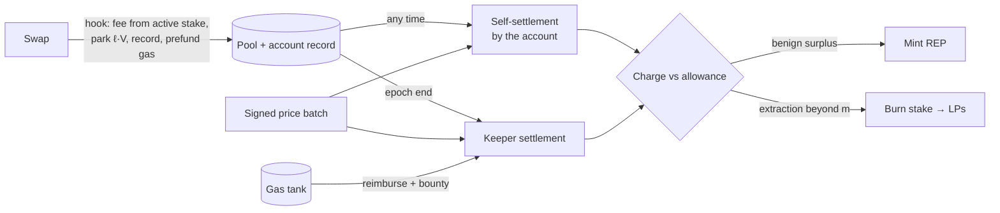

*Figure 1. Lifecycle of a swap.*

At execution the hook reads the trader's active REP stake, charges the fee given by the coverage curve, parks part of the stake, records the swap and prefunds its share of settlement gas; no oracle is consulted, so trading remains synchronous and permissionless. At reconciliation, the swap is scored against signed prices and settled against stake only: benign surplus mints REP, and extraction beyond the job allowance is burned from stake. Because a departed counterparty's cash cannot be recalled, stake is both the fee determinant and the collateral.

### 4.2 Fees: the coverage curve

Let $r$ be an account's staked REP, valued at the internal rate $P_{\mathrm{int}}$ of §4.5, and $V$ its volume in the epoch. Staked reputation grants discounted capacity $r/\rho$ per epoch, and the fee on covered volume is

```math
f(r, V) = f_{\min} + (f_{\max} - f_{\min})\, e^{-r/(\rho V)} \tag{2}
```

where $f_{\min}$ and $f_{\max}$ are the floor and ceiling of the pool's fee band and $\rho > 0$ is the capacity scale: stake worth $\rho V$ reduces the premium above $f_{\min}$ by a factor $e$. The curve (Figure 2) is convex and decreasing in $r$ (diminishing returns, which discourages concentration), asymptotic to $f_{\min}$ (LPs always earn a floor) and homogeneous of degree zero (it prices the coverage ratio, not wealth). Volume beyond capacity pays $f_{\max}$.

The fee is the part of a swap's payment settled at execution; after the block the swap is settled again, in either direction. For a swap of notional $v$,

```math
\text{payment} \;=\; \underbrace{f(r, V)\, v}_{\text{at execution}} \;+\; \underbrace{\min\{C(m),\, r\} \;-\; R(\theta^*)}_{\text{after the block}}, \qquad C(m),\ R(\theta^*) \ge 0,
```

where $C(m)$, defined in (3b), is the charge for extraction beyond an allowance $m$ per unit of volume (§4.3), collectable only up to the account's stake $r$, and $R(\theta^*)$ is the REP minted for payments above the LPs' target take-rate $\theta^*$ (§4.5). Most swaps carry neither.

A fresh account has $r = 0$, so nothing it owes can be collected, and only the fee limits it: against a gap $g$ it profits only on the part beyond $f_{\max}$ and its own cost rate $h$, taking $D\,(g - f_{\max} - h)^2/2$ in a pool of depth $D$ per unit of log price (Appendix G.2). $f_{\max}$ is therefore set above the largest shock the pool must withstand, not by benign flow, which reaches $f_{\min}$ through stake held directly or by an intermediary (§4.8); because the curve is exponential, the stake needed to escape a high $f_{\max}$ grows only with its logarithm. §5.5 measures the leakage.

*Figure 2. The coverage curve for three fee bands.*

### 4.3 Arbitrage as a paid job

Payments for position — priority gas auctions (Daian et al., 2020), builder bids on Ethereum, express-lane bids on rollups — are a toxic by-product of an AMM that leaves the whole gap between its price and the market to whoever corrects it first: mainnet arbitrageurs in our sample paid \$6.57 M for position (§5.4). BRO-AMM instead prices the correction as a job, so that LPs' return does not depend on how the underlying chain orders transactions — unless the AMM becomes part of that chain's consensus itself.

Correcting the pool is a service with a cost to whoever performs it — a hedge on the external venue, that venue's fees, inventory risk and gas — and in a competitive market that cost, not the size of the gap, is its price. The pool therefore pays a correcting swap a *job allowance* $m$ per unit of volume and recaptures for LPs whatever the swap gains beyond it. Formally:

Consider a swap of notional $v$ in a pool with fee $f$, and let $\hat P = P_{\mathrm{dir}}(t^*)$ be its benchmark from (1). For $u \in [0, v]$, let $p(u)$ be the pool's marginal price, in the units of $\hat P$, after the first $u$ units of token 0 of the swap have executed, so that $p(0)$ is the pre-trade price. Let $s = \operatorname{sgn} \ln\big(\hat P / p(0)\big)$ be the direction in which the pool is mispriced; the swap is *price-correcting* if it moves $p$ in direction $s$. Its marginal edge is the log-distance from the pool's marginal price to the benchmark, net of the fee and of a tolerance $\varepsilon \ge 0$ for oracle error (§5.7):

```math
\mathrm{edge}(u) = \max\!\big(s \ln\big(\hat P / p(u)\big) - f - \varepsilon,\; 0\big) \tag{3a}
```

which is non-increasing in $u$ for a price-correcting swap and is zero once the pool has entered the band of width $f + \varepsilon$ around the benchmark or passed it. With the job allowance $m \ge 0$, the swap keeps and is charged, in units of token 0,

```math
\text{kept} = \int_0^{v} \min\big(\mathrm{edge}(u), m\big)\, du, \qquad \text{charge} = \int_0^{v} \max\big(\mathrm{edge}(u) - m, 0\big)\, du \tag{3b}
```

and the charge is recaptured for LPs (Figure 3). Each unit keeps at most $m$ of its own edge, so the arbitrageur stops where the pool meets the band; capping the trade's average edge instead would pay it to overshoot (Appendix F.1). Judging each unit by its own edge also makes splitting a trade pointless and, since every swap in a block is scored against the same benchmark (§3.3), leaves position deciding only which arbitrageur gets the job: the most it would pay for position is its margin over cost, $(m - h)\,v$, which the controller of §4.4 drives toward zero. The allowance includes gas, since reimbursing gas separately would require pricing the chain's native token in the pool's pair (Appendix F.2).

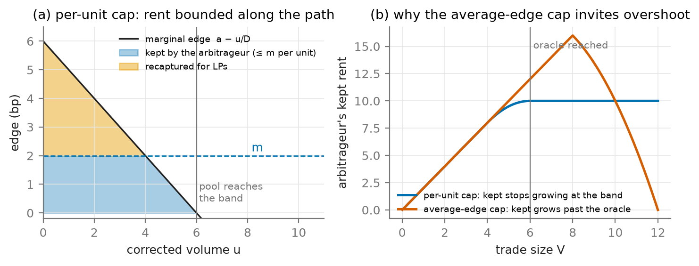

*Figure 3. Rent kept and recaptured under the per-unit cap (3b): the edge falls as the swap moves the pool, and each unit keeps at most $m$.*

### 4.4 Discovering the allowance

The allowance should equal the competitive cost of correcting the pool, which is private to arbitrageurs and changes over time: set too low, no one corrects the pool; set too high, the excess is rent. BRO-AMM discovers $m$ by feedback from what reconciliation observes, much as EIP-1559 sets Ethereum's base fee from observed demand for block space (Roughgarden, 2020).

**Staleness.** A block is *correctable* if it starts with the pool's price further than $f + m + \varepsilon$ from the benchmark, and *left stale* if no point of it brings the pool within that band; only blocks with a swap in the pool are counted. Each hour, if at least five correctable blocks were left stale and they exceed 2% of the hour's correctable blocks, the controller doubles $m$. Judging by outcome rather than by a block's first swap prevents a builder from faking staleness with a dust swap (Appendix G.3).

**Competition.** Lowering $m$ requires care, since below the cheapest arbitrageur's cost no correction is profitable at any gap (Figure 4). On chains that order transactions by arrival, the controller lowers $m$ by 5% at the end of a day only if more than a quarter of the day's correcting swaps came from senders other than the most frequent one — evidence that several arbitrageurs can still profit — and so settles between the cheapest and the second-cheapest cost. Under builder auctions the cheapest arbitrageur wins every block it can, so wins concentrate regardless of competition, and $m$ instead falls by 5% on any day with fewer than 1% of correctable blocks left stale.

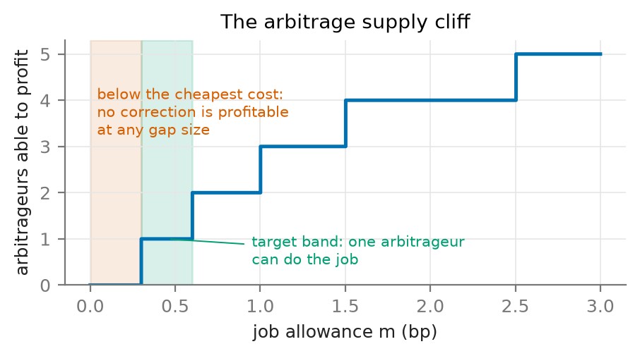

*Figure 4. Number of arbitrageurs able to profit as a function of the allowance, for the cost population used in §5.4.*

The allowance rises fast and falls slowly because a stale pool harms users at once; it starts at $m_0$ and stays within [0.02, 50] bp. Its inputs are all part of reconciliation (Appendix G.3), and §5.4 evaluates it.

### 4.5 The reputation asset

Per epoch, the pool's net income — what the LPs gained on the epoch's swaps, fees included, plus the charges recaptured — is compared with the LPs' target:

```math
N = \sum Q_{\mathrm{LP}} \cdot \text{notional} + \sum \text{charges}, \qquad \text{minted} = \frac{(1 - \tau)\max\big(N - \theta^* \sum V,\, 0\big)}{P_{\mathrm{int}}} \tag{4}
```

where the sums run over the epoch's swaps, $Q_{\mathrm{LP}} \cdot \text{notional}$ is each swap's gain to LPs by (1), fees included, charges are those recaptured under (3b), $\sum V$ is the pool's volume, $\theta^*$ the LPs' target take-rate and $\tau$ the protocol take. The surplus mints REP to the accounts whose payments exceeded the target on their own volume, pro rata to the excess, at a fixed internal rate $P_{\mathrm{int}}$; extraction beyond the allowance burns stake at the same rate, so no market price of REP enters either formula. Minting is self-funding — a wash trader's mint is prepaid by its own overpayment — and self-enforcing: over-earning mints capacity that lowers fees, under-earning halts minting. REP is minted below the surplus it claims by the protocol take $\tau$, which funds the per-pool reserve. Staked REP is a slashable trading licence, preferable to escrowed cash because it earns its holder the discount, is costly only to extractors, and appreciates with the pool's benign volume.

### 4.6 Stake, parking and collection

Only staked REP affects fees, which precludes flash-renting the discount. A trade parks $\ell V$ of active stake until it is settled, with

```math
\ell = \rho + k\, \Delta_{\mathrm{block}} \tag{5}
```

where $k \ge 0$ is the parking speed and $\Delta_{\mathrm{block}}$ is the pool's price move so far in the block: corrections after a market jump move the pool quickly and park more. Splitting a trade cannot reduce $\Delta_{\mathrm{block}}$, whereas rules keyed to trade size can be defeated by splitting. Charges are collected first from the trade's parked stake, then from the rest of the account's stake (which cannot be withdrawn while settlements are pending), and finally from the per-pool reserve. Charges are never taken from other traders' stake.

### 4.7 Settlement

The hook extends each swapper's record — post-trade price, active liquidity and token deltas, chained by hash in the account's storage — so that an account's unsettled swaps form a self-contained segment. An account may settle itself at any time against the signed prices for its blocks, which releases its parked stake; at the end of each epoch a keeper settles every account still in flight. Both paths advance the same pointer, and a keeper's entry for an account that has already settled is skipped rather than reverted. Flights still unsettled when the oracle's retention window expires are burned in full.

Settlement is paid in gas, not in the pool's assets. Every swap prefunds $G \times$ `block.basefee` into a gas tank — a count of gas units times a value the chain exposes, with no price involved. The amount is in the native token, so the hook debits it from a gas credit that the account or its router has deposited in that token, or, in pools holding the wrapped native token, takes it from the swap's leg in that token; neither requires an exchange rate. From the tank, keepers are reimbursed with an escalating bounty, directly or through an ERC-4337 paymaster. Since every pool contributes in the same unit, one tank can serve many pools. Two rules keep it inexpensive: settlement is never forced into the current block, and each pool chooses its epoch length. Where charges are computed on-chain, an open race among keepers is efficient; where they are proven off-chain, a designated leader avoids duplicated proving. A leader cannot alter a charge, which is fixed by the record and the signed prices.

Because reconciliation is not time-critical, the prices it applies can themselves pass through consensus first — for instance co-signed by LPs and stakers, the two sides those prices affect — which an oracle read at execution cannot afford (Appendix G.4).

The per-swap work of settlement — a multiply-add against a verified price, a comparison and a state write — is smaller than executing the swap, so settlement is bounded by the pool's own execution footprint. §5.8 measures it.

### 4.8 Launch and intermediaries

At launch no account holds REP. Benign flow needs none: it pays $f_{\max}$ until an epoch's surplus over the LPs' target mints the first REP. Correction does need stake, since an arbitrageur without it also pays $f_{\max}$ and, with $f_{\max}$ sized to the shocks the pool must withstand (§4.2), small gaps would go uncorrected. As on other venues, a pool therefore launches with appointed arbitrageurs or market makers holding an initial allocation of REP, sold at no less than its mint rate with the proceeds seeding the reserve; §5.5 sizes the stake they need, and the correction lane of §4.10 removes the dependence on it. Intermediaries — solvers, RFQ desks — can hold stake and pass the discount to users. The protocol never identifies arbitrageurs: arbitrage is a role carried by a swap, and any swap that moves the pool toward the oracle is paid the allowance on it. The charge is computed per correcting swap rather than per account, so an intermediary cannot net customers' overpayments against its own extraction.

### 4.9 When REP trades below its mint rate

REP is burned for charges at the internal rate $P_{\mathrm{int}}$ at which it was minted, while its market price $P_{\mathrm{mkt}}$ may fall below it, letting a trader cover charges at par with collateral that cost less. Three properties bound the consequences (Appendix E). The pool is solvent at par: REP is minted only from surplus above the LPs' target, less the take $\tau$, so even if every unit were burned for extraction, LPs would return that surplus and, provided no epoch fell short of the target, end at $\theta^*$ — a crash in REP's price removes surplus, not principal. Extractors provide a demand floor, buying REP below $P_{\mathrm{int}}$ while they have extraction to cover. And below par, REP is the pool's debt trading at a discount, which the reserve, funded by $\tau$, can retire by buying and burning REP below $P_{\mathrm{int}}$, within a capacity of $\tau S_t$ for cumulative surplus $S_t$.

### 4.10 An optional correction lane

Any AMM leaves gaps smaller than its fee uncorrected, so a pool with a high fee lags the market within a band as wide as that fee. On Uniswap this is a choice of fee tier; in BRO-AMM it becomes critical for a decentralised pool that has not been bootstrapped, because $f_{\max}$ is high by design (§4.2). Arbitrageurs who hold stake avoid it, and a pool normally launches with appointed ones (§4.8); without them, every correction pays $f_{\max}$, and the pool stays decoupled from the market for any gap below it (§5.5). We therefore propose an optional lane that settles corrections at execution, independently of stake. It is self-contained and leaves ordinary swaps oracle-free.

A swap may attach a signed report for a recent instant. The hook verifies it, checks that the swap moves the pool toward the reported price, charges the swap $f_{\min}$, and settles the charge (3b) in the same transaction against the reported price, so that the swap keeps at most $m$ per unit and pays the rest to LPs. Nothing is left to collect afterwards, so the lane needs no stake, and a fresh account gains nothing by using it. The lane must be open at all times and must charge per unit; reduced flat fees, hysteresis and gating all fail (Appendix F.4). Its cost is an oracle dependency for the swaps that use it: reports must be fresh, and verifying one adds about a quarter of a swap's gas.

### 4.11 A worked example

Consider an ETH/USDC pool with illustrative parameters $f_{\min} = 1$ bp, $f_{\max} = 30$ bp, $\rho = 5$ bp, $\theta^* = 2$ bp, $m = 2$ bp, $\varepsilon = 0$, $\tau = 2.5\%$, and an internal rate of 1 USDC per REP; both swaps below are \$10,000 and fall in one epoch.

*Alice*, an uninformed trader holding 5 REP, swaps in a quiet block. Her coverage ratio is $5/(0.0005 \times 10{,}000) = 1$, so by (2) she pays $1 + 29e^{-1} = 11.67$ bp, or \$11.67. Her markout before fees is zero, so her $Q_{\mathrm{LP}}$ is $+11.67$ bp. With no price move in the block she parks $\ell V = 5\,\text{bp} \times \$10{,}000$, all 5 of her REP, until settlement.

*Bob*, an arbitrageur holding 15 REP (coverage ratio 3), corrects the pool after a market move, paying $1 + 29e^{-3} = 2.44$ bp. Along his trade the edge beyond the fee falls linearly from 10 bp to zero, so he extracts 5 bp on average — \$5.00 — and his $Q_{\mathrm{LP}}$ is $-5$ bp. Writing $u$ as a fraction of his notional, by (3b) he keeps $\int_0^1 \min\big(10(1 - u), 2\big)\, du = 1.80$ bp of it, and the remaining 3.20 bp, \$3.20, is charged. The block had already moved by 10 bp, so by (5) with $k = 0.5$ he parked $\ell = 5 + 5 = 10$ bp of his volume, \$10 of stake; the charge burns 3.20 REP from it, and the other 6.80 are released at settlement.

At reconciliation, by (4), $N = 11.67 - 5.00 + 3.20 = \$9.87$ against a target of $2\,\text{bp} \times \$20{,}000 = \$4.00$, leaving a surplus of \$5.87. Only Alice paid more than the target on her own volume (Bob's net is −1.8 bp), so she receives $(1 - 0.025) \times 5.87 = 5.72$ REP. Her next \$10,000 swap, with 10.72 REP staked, pays $1 + 29e^{-2.14} = 4.40$ bp. Bob kept his allowance of \$1.80; his position did not change the benchmark he was scored against (§3.3), so the most he would rationally have bid for it is his margin over his cost. The LPs received \$6.67 in the pool's assets; Bob's charge was settled in REP, which retires claims on surplus the LPs already hold (Theorem 1).

## 5. Evaluation

### 5.1 Data and method

We study the Uniswap v3 ETH/USDC 5 bp pool on Ethereum mainnet and the corresponding WETH/USDC pool on Arbitrum from 1 March to 31 August 2026 (Table 2). The benchmark is Binance ETHUSDT corrected by USDCUSDT, with a touch-level bid/ask proxy built from aggressor-flagged trades. A stable–stable control pool on each chain, where no extraction is expected, scored a median absolute $Q_{\mathrm{LP}}$ of 0.9–1.1 bp (95th percentile 2.3 bp), inside the band within which the USDC/USDT peg itself moves (99th percentile 12.8 bp on mainnet). Payout rules are compared in a block-level simulation that replays the real oracle path and non-arbitrage flow, with optimising arbitrageurs whose costs range from 0.3 to 2.5 bp and are multiplied by four or eight from June (Appendix C).

| | Ethereum mainnet | Arbitrum One |
|---|---|---|
| Swaps | 990,555 | 5,237,793 |
| Blocks (with a pool swap) | 1.32 M (595 k) | 63.4 M (1.87 M) |
| Volume | \$19.6 B | \$11.2 B |

*Table 2. Sample, March–August 2026.*

### 5.2 Decision latency and scoring validity

The decision latency is 1.5 s on mainnet and 0.75 s on Arbitrum (Figure 5), each bracketed by estimates biased early and late. A window trailing the block timestamp would instead score arbitrageurs against prices from before their trades, turning mainnet's measured LP loss of \$1.58 M into an apparent gain of \$5.26 M.

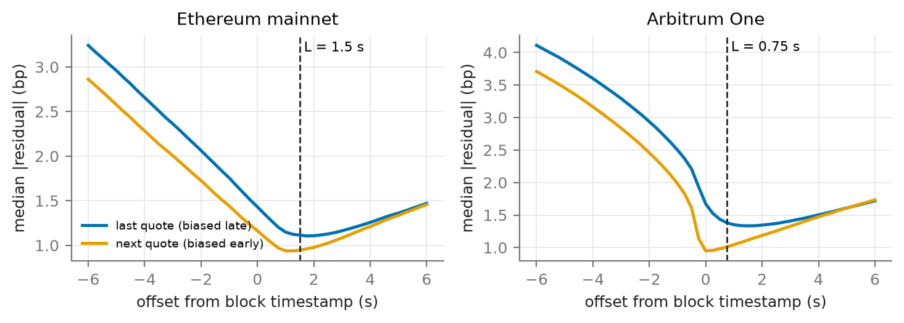

*Figure 5. Median fee-adjusted residual between the pool's post-swap price and the hedgeable external quote, by offset from the block timestamp.*

Against price-independent labels — retail routers as benign, top-of-block repeat searchers as toxic — the score separates the classes with AUC 0.889 on mainnet and 0.814 on Arbitrum, rising to 0.983 and 0.897 for the largest swaps (Figure 6). The toxic label uses block position, so we also report a label that does not: any non-router sender with at least 100 swaps, at any position. Against it the AUC is 0.704 on mainnet and 0.828 on Arbitrum, and 0.971 and 0.883 for the largest swaps. The position-free label includes benign repeat senders, which lowers its AUC on mainnet; on Arbitrum it is higher, because extraction there sits deep in the block, where the position-derived label cannot see it. Extraction follows the ordering regime: on mainnet, where builders sell position, 61% of it occurs in the first three positions of a block; on Arbitrum's first-come-first-served sequencer, 69% occurs at position ten or later (Figure 7). LPs lost \$9.68 M to extraction on mainnet and ended \$1.58 M down after fees; on Arbitrum they lost \$1.34 M on smaller fills and ended \$0.86 M up.

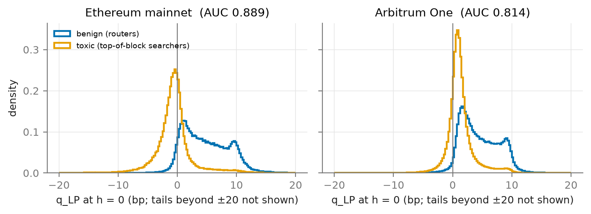

*Figure 6. Distribution of $Q_{\mathrm{LP}}$ by label.*

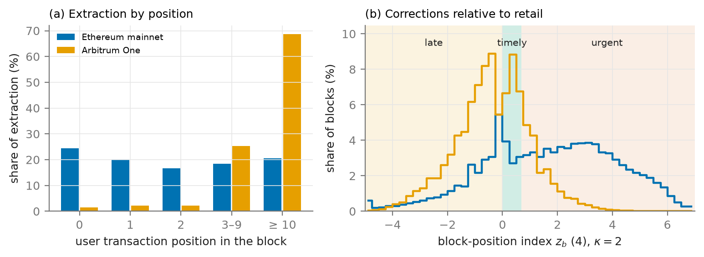

*Figure 7. Share of extraction by transaction position in the block.*

### 5.3 Recapture

With perfect information — the benchmark known exactly and a fixed allowance — a schedule charging extraction beyond an allowance of 2 bp, capped at $f_{\max}$, recaptures 73% of extraction on mainnet and 70% on Arbitrum while preserving 97–99% of profitable arbitrage and overcharging benign flow by less than 0.1 bp (Figure 8). The schedule was set a priori, not fitted; selected on March–May, it is also the best schedule on June–August.

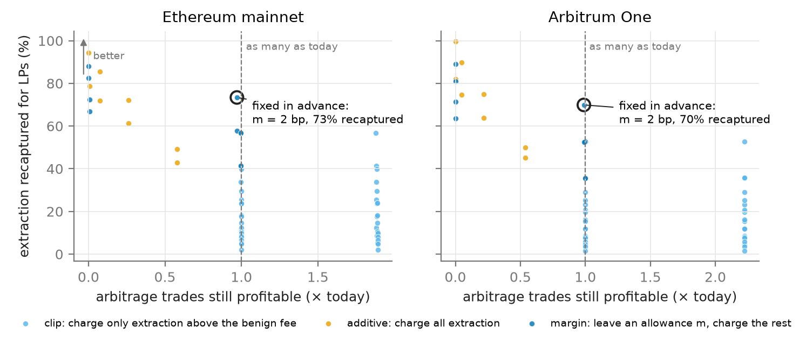

*Figure 8. Recapture against profitable arbitrage preserved, for all schedules evaluated.*

### 5.4 Payout rule and allowance discovery

A rule must keep the pool as rebalanced as today: the share of blocks within the fee plus 1 bp of the oracle may fall by at most 0.5 points, and the price users trade against may be at most 0.1 bp staler. The per-unit cap with an on-chain controller raises LPs' net position by \$5.01 M on mainnet (blind decay, as builder auctions require) and \$0.66–0.71 M on Arbitrum in the worst cost scenario; judging staleness by the first swap of a block, as an earlier version did, gives \$4.81 M on mainnet. Payments for position fall from \$6.57 M to \$1.41 M on mainnet and from \$0.94 M to \$0.12 M on Arbitrum in stable costs: they remain, as §4.3 predicts, but bounded by the allowance. An average-edge cap fails the constraint through overshoot (Appendix F.1). Blind decay stalls rebalancing whenever it crosses the cheapest cost — about every two weeks — whereas decay gated on sender diversity holds just above it (Figure 9), at 7–8% less worst-case gain. Results hold for arbitrage populations from a monopoly to ten arbitrageurs and for depth halved or doubled (Appendix C).

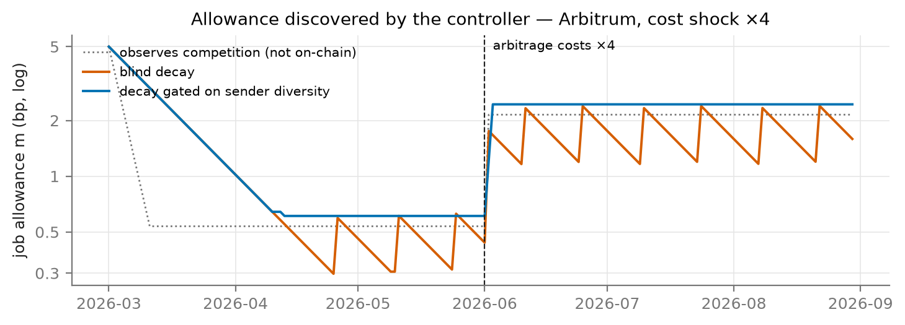

*Figure 9. Allowance over time under three controllers, Arbitrum, with arbitrage costs quadrupled from June.*

### 5.5 Unstaked accounts, arbitrage stake and the correction lane

The results above assume that arbitrageurs hold enough stake; we relax this in three steps.

**Fresh accounts.** When every arbitrageur may instead trade from an unstaked account at $f_{\max}$, keeping its whole edge, LPs' worst-case gain falls on mainnet from \$5.01 M to \$3.53 M at $f_{\max}$ = 30 bp and recovers to \$4.93 M at 500 bp; on Arbitrum it is unaffected at 500 bp. With the market's shocks scaled by two and by four, fresh accounts take at most 1.5% of LPs' gain at 500 bp and none at 1,000 bp (Figure 13b).

**Arbitrage stake.** When arbitrageurs pay the coverage-curve fee on a finite stake, the pool freezes without any. It stays rebalanced in every scenario once the stake reaches about 25 times $\rho$ times the mean daily arbitrage volume if one staker covers all arbitrageurs (\$0.91 M on mainnet, \$0.34 M on Arbitrum), and about 50 times if each holds its own; stake accumulated from zero over the first month leaves the pool stale for 50–86 hours (Figure 13a). This is the stake appointed arbitrageurs bring at launch (§4.8).

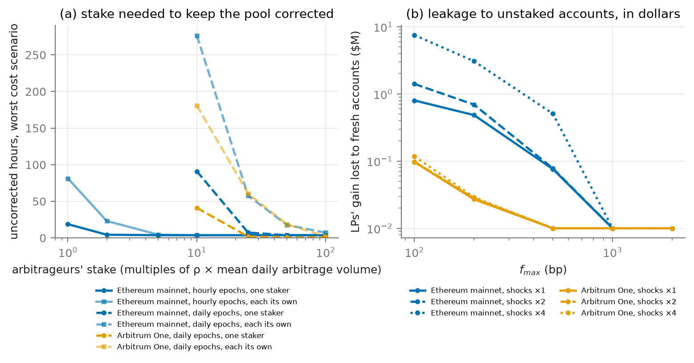

*Figure 13. (a) Uncorrected hours against arbitrageurs' stake, held by one staker or separately; dotted: arbitrageurs fully covered; zero is drawn at 0.1. (b) LPs' gain lost to fresh unstaked accounts against $f_{\max}$, for the market's shocks scaled by one, two and four.*

**Correction lane.** Without arbitrage stake, and with $f_{\max}$ high enough to defeat fresh accounts, the pool stays decoupled from the market. The lane of §4.10 keeps it rebalanced on both chains and reproduces the fully staked result (Table 3); report freshness is the binding requirement. Rejected alternatives are reported in Appendix F.

| No arbitrage stake, $f_{\max}$ = 500 bp | Mainnet | Arbitrum | Rebalanced |
|---|---|---|---|
| Arbitrageurs fully staked (reference) | \$5.01 M | \$0.66 M | yes |
| No lane | frozen | frozen | no |
| Lane, per-unit charge (3b), report gas 0–24% of a swap | \$4.90–4.93 M | \$0.65–0.75 M | yes |
| Same, $f_{\max}$ = 2,000 bp | \$4.98–5.01 M | \$0.65–0.75 M | yes |
| Same, report one second old | \$4.23 M | \$0.26 M | mainnet no |

*Table 3. LPs' worst-case gain over today across the three cost scenarios.*

### 5.6 Collateral

The charge per trade is small at the median (0.17 bp) but heavy-tailed (99.9th percentile 21 bp, maximum 358 bp; trades above 50 bp carry 27% of the total), so parking alone collects 70–90% and the account's remaining stake and the reserve collect the rest. Parking keyed to the in-block price move resists splitting; parking keyed to trade size loses half its collection when a correction is split ten ways.

### 5.7 Oracle error

Scoring with a degraded oracle leaves benign flow essentially unaffected (overcharge below 0.3 bp) but makes part of the charges on arbitrage unjustified (Figure 10). The tolerance $\varepsilon$ is the remedy: $\varepsilon$ equal to the bias removes a bias exactly, $\varepsilon$ of about twice the noise removes most random error, and each basis point of $\varepsilon$ forgoes about 8% of recapture — hence $\varepsilon \approx \max(\lvert \text{bias} \rvert, 2\sigma_o)$, where $\sigma_o$ is the standard deviation of the oracle's random error. Staleness is the binding error on fast chains: a one-second-old feed halves recapture on Arbitrum, so rollups require a sub-second pull oracle.

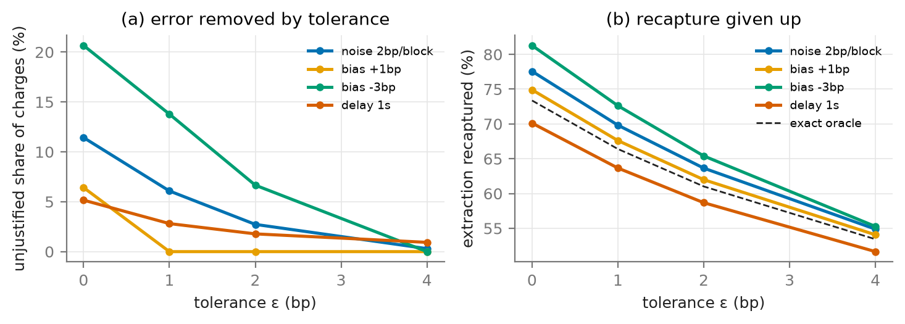

*Figure 10. Mainnet: (a) unjustified share of charges and (b) recapture, as functions of the tolerance $\varepsilon$, for four oracle errors.*

### 5.8 Settlement cost and keeper economics

We measured every component on-chain or in Foundry (Appendix D). The hook adds 17,112 gas to a v4 swap; a keeper's epoch costs 26,000 gas plus 14,300 per account; self-settlement costs 46,000 gas plus 6,000 per swap; a Groth16 proof verifies for 227,226 gas. With prices signed once per batch and settled hourly, settlement costs 0.18× the execution gas of the settled swaps on mainnet and 0.19× on Arbitrum (Figure 11). A succinct proof lowers this only to 0.14–0.15×, because the hook and the per-account writes remain; viability does not depend on proofs.

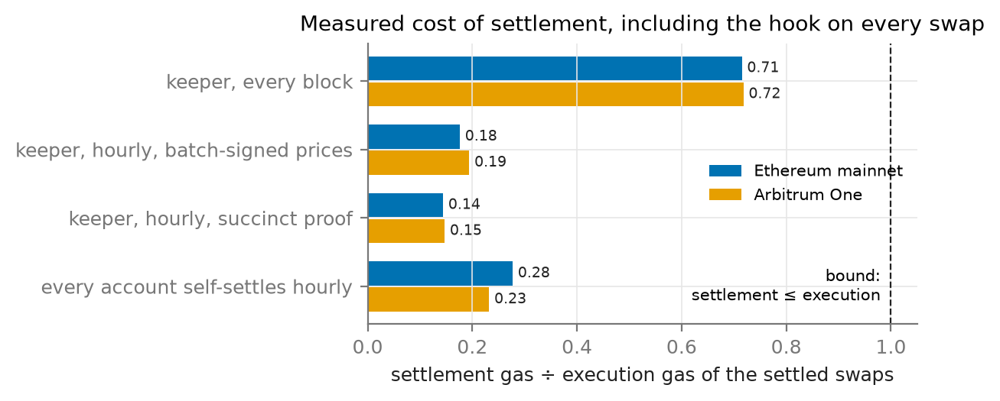

*Figure 11. Settlement gas relative to the execution gas of the settled swaps.*

Funding keepers from the gas tank requires a modest contribution per swap (Figure 12). A tank shared by seven mainnet pools stays solvent with 2.3 k gas per swap at daily epochs (1.2% of a swap's gas) and 1.4 k when keepers choose the block; Arbitrum needs 0.64 k. Alone, the smallest pool would need 80 k gas per swap at hourly epochs; within the shared tank it pays the common rate. In simulation, 2–8% of accounts preferred to settle themselves, carrying up to half of the volume and cutting their stake by 15–24%; an open keeper race settled on-chain epochs within 1.3 minutes, and a designated leader removed the duplicated proving that a race of similar keepers incurs.

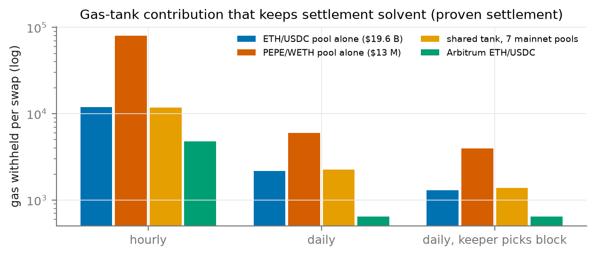

*Figure 12. Smallest per-swap gas contribution that keeps the gas tank solvent.*

### 5.9 Limitations

The benchmark is a Binance touch proxy, so oracle error is modelled rather than measured. The simulation assumes linear daily depth, fixed user flow, a population of arbitrage costs, one arbitrage action per block and, in §5.5, arbitrage stake held at its level; sender diversity presumes arrival ordering, whereas Arbitrum sold a 200 ms express lane throughout our sample. Labels are heuristics. Gas was measured with mock tokens, and swaps crossing a liquidity boundary are outside the closed-form charge. Keeper costs are assumed, and the census applies the study pool's recapture rate to the other pairs. REP below its mint rate is analysed (§4.9) but not simulated.

**Future work.** A single REP shared by all pools would let standing earned in one pool count in another. But an LP of its own pool can mint REP at the cost of the protocol take alone, and a shared token would let REP minted against one pool's surplus be charged against another's; we have not found a design that prevents this without giving up LPs' claim to their surplus or permissionless entry.

## 6. Conclusion

BRO-AMM is offered as a low-risk DeFi primitive for exchange. It shows that loss-versus-rebalancing can be recaptured by a plain Uniswap v4 hook, without delaying execution, without consulting an oracle at trade time and without relying on honest ordering. Execution remains synchronous; pricing is completed after the block against signed prices, at a decision instant that is measured from the data and shared by every swap in the block, so that no position buys a more lenient benchmark. Arbitrage is retained as a paid job whose allowance is discovered on-chain, extraction beyond the allowance is collected from stake posted before trading, and benign traders earn the stake that lowers their fees.

On six months of Ethereum and Arbitrum data, a fixed schedule applied with perfect information recaptured 70–73% of extraction while overcharging benign flow by less than 0.1 bp; with the allowance discovered on-chain, the mechanism raised LPs' worst-case position by \$4.93 M on mainnet and \$0.66 M on Arbitrum, with fresh unstaked accounts allowed, while keeping the pool as well rebalanced as today and cutting payments for position by 77–87%; an optional correction lane delivers the same result without any arbitrage stake, and settled for 0.18–0.19 of the swaps' execution gas, paid from a tank that every swap prefunds. Its binding requirements are a sub-second oracle on fast chains and a tolerance matched to the feed's error. Its residual risks are the signed oracle, the contracts themselves and the market for REP; the last is bounded by solvency at par but not yet observed. Oracle error measured on the signed feed itself, the behaviour of REP in a live market, and a reputation shared across pools remain open.

## References

Adams, A., Moallemi, C. C., Reynolds, S., and Robinson, D. (2024). am-AMM: An auction-managed automated market maker. arXiv:2403.03367.

Baggiani, L., Herdegen, M., and Sánchez-Betancourt, L. (2025). Optimal dynamic fees in automated market makers. arXiv:2506.02869.

Breidenbach, L., Cachin, C., Coventry, A., Juels, A., and Miller, A. (2021). Chainlink off-chain reporting protocol. https://research.chain.link/ocr.pdf

Buterin, V. (2025). Low-risk defi can be for Ethereum what search was for Google. https://vitalik.eth.limo/general/2025/09/21/low_risk_defi.html

Buterin, V., Hernandez, D., Kamphefner, T., Pham, K., Qiao, Z., Ryan, D., Sin, J., Wang, Y., and Zhang, Y. X. (2020). Combining GHOST and Casper. arXiv:2003.03052.

Buterin, V., Weiss, Y., Tirosh, D., Nacson, S., Forshtat, A., Gazso, K., and Hess, T. (2021). ERC-4337: Account abstraction using alt mempool. Ethereum Improvement Proposals. https://eips.ethereum.org/EIPS/eip-4337

Chainlink. Data Streams: liquidity-weighted bid and ask prices. https://docs.chain.link/data-streams/concepts/liquidity-weighted-prices

Daian, P., Goldfeder, S., Kell, T., Li, Y., Zhao, X., Bentov, I., Breidenbach, L., and Juels, A. (2020). Flash Boys 2.0: Frontrunning in decentralized exchanges, miner extractable value, and consensus instability. In *IEEE Symposium on Security and Privacy*. arXiv:1904.05234.

Eskandari, S., Salehi, M., Gu, W. C., and Clark, J. (2021). SoK: Oracles from the ground truth to market manipulation. In *Proceedings of the 3rd ACM Conference on Advances in Financial Technologies (AFT '21)*. arXiv:2106.00667.

Fritsch, R., and Canidio, A. (2024). Measuring arbitrage losses and profitability of AMM liquidity. arXiv:2404.05803.

Garay, J., Kiayias, A., and Leonardos, N. (2015). The Bitcoin backbone protocol: Analysis and applications. In *Advances in Cryptology – EUROCRYPT 2015*, LNCS 9057, pp. 281–310. Springer.

Ghasemlu, F. (2026). Optimal dynamic fees for automated market makers: A stochastic control approach to loss-versus-rebalancing. arXiv:2606.21769.

Groth, J. (2016). On the size of pairing-based non-interactive arguments. In *Advances in Cryptology – EUROCRYPT 2016*, LNCS 9666, pp. 305–326. Springer.

Heimbach, L., Pahari, V., and Schertenleib, E. (2024). Non-atomic arbitrage in decentralized finance. In *IEEE Symposium on Security and Privacy*. arXiv:2401.01622.

Josojo (2022). MEV capturing AMM (McAMM). Ethereum Research. https://ethresear.ch/t/mev-capturing-amm-mcamm/13336

Kalodner, H., Goldfeder, S., Chen, X., Weinberg, S. M., and Felten, E. W. (2018). Arbitrum: Scalable, private smart contracts. In *27th USENIX Security Symposium*.

Mamageishvili, A., Kelkar, M., Schlegel, J. C., and Felten, E. W. (2023). Buying time: Latency racing vs. bidding for transaction ordering. In *5th Conference on Advances in Financial Technologies (AFT 2023)*. arXiv:2306.02179.

McMenamin, C., and Daza, V. (2023). An AMM minimizing user-level extractable value and loss-versus-rebalancing. arXiv:2301.13599.

McMenamin, C., Daza, V., and Mazorra, B. (2022). Diamonds are forever, loss-versus-rebalancing is not. arXiv:2210.10601; published as "An automated market maker minimizing loss-versus-rebalancing".

Messias, J., and Torres, C. F. (2025). The express lane to spam and centralization: An empirical analysis of Arbitrum's Timeboost. arXiv:2509.22143.

Milionis, J., Moallemi, C. C., Roughgarden, T., and Zhang, A. L. (2022). Automated market making and loss-versus-rebalancing. arXiv:2208.06046.

OoJae. Hindsight: Ex-post markout-settled fees for Uniswap v4. UHI10 Hookathon. https://github.com/OoJae/hindsight-hook

Öz, B., Kraner, B., Vallarano, N., Kruger, B. S., Matthes, F., and Tessone, C. J. (2023). Time moves faster when there is nothing you anticipate: The role of time in MEV rewards. arXiv:2307.05814.

Robinson, D., and White, D. (2024). Priority is all you need. Paradigm. https://www.paradigm.xyz/writing/priority-is-all-you-need

Roughgarden, T. (2020). Transaction fee mechanism design for the Ethereum blockchain: An economic analysis of EIP-1559. arXiv:2012.00854.

Schwarz-Schilling, C., Saleh, F., Thiery, T., Pan, J., Shah, N. B., and Monnot, B. (2023). Time is money: Strategic timing games in proof-of-stake protocols. In *5th Conference on Advances in Financial Technologies (AFT 2023)*. arXiv:2305.09032.

Sorella Labs. A new era of DeFi with app-specific sequencing. https://sorellalabs.xyz/writing/a-new-era-of-defi-with-ass

Status Network. Karmic tokenomics. https://docs.status.network/overview/tokenomics/karmic-tokenomics

Succinct Labs. SP1 zero-knowledge virtual machine. https://github.com/succinctlabs/sp1

Udupi, H., Sahoo, A., Akshay, S. P., Gurukiran, S., Paul, P., and Martens, P. C. (2025). zScore: A universal decentralised reputation system for the blockchain economy. arXiv:2503.05718.

Uniswap Labs. Uniswap v4 core. https://github.com/Uniswap/v4-core

---

## Appendix A. Related work in detail

**Milionis, Moallemi, Roughgarden and Zhang (2022).** Define LVR with a closed form and propose (a) fees set by comparing LVR with fee income over a backward-looking window and (b) the sale of arbitrage rights to capture LVR for LPs. Both are directions, not specified or farming-robust mechanisms; BRO-AMM's oracle reconciliation instantiates (a).

**am-AMM (Adams, Moallemi, Reynolds and Robinson, 2024).** A Harberger-lease auction for the role of pool manager, who sets the fee and may arbitrage at zero fee; surplus accrues to LPs. By its authors' account it offers fewer sandwich protections than a fixed-fee AMM and depends on a single manager; the convex coverage curve of §4.2 is in part an argument against winner-take-all structures.

**Diamond and V0LVER (McMenamin, Daza and Mazorra, 2022; McMenamin and Daza, 2023).** Reduce liquidity only for arbitrageurs and rebate a share of LVR; V0LVER extends protection to user-level MEV. The authors regard oracle dependence as unsatisfactory; BRO-AMM accepts a trusted signed oracle and bounds the effect of its error (§5.7).

**Angstrom (Sorella Labs).** A live v4 hook that auctions the top-of-block arbitrage right, distributes the proceeds to in-range LPs and clears other orders at a uniform price, which removes the positions a sandwich needs. It relies on app-specific sequencing by a decentralised operator set; BRO-AMM requires no sequencer.

**zScore (Udupi et al., 2025) and Karma (Status Network).** zScore scores accounts' on-chain behaviour and points to v4 hooks as a vehicle for reputation-dependent fees; it does not specify an oracle-reconciled per-swap rule or an anti-farming curve. Karma is a soulbound token for access and rate limiting, not LVR-specific pricing; REP is deliberately transferable.

**Optimal dynamic fees (Baggiani, Herdegen and Sánchez-Betancourt, 2025; Ghasemlu, 2026).** Derive optimal fees as functions of the pool's state — inventory and external price moves, or volatility through a stochastic-control formulation; they set one fee for all flow and do not address a reputation-eligibility curve that must resist concentration.

**Hindsight (OoJae).** A Uniswap v4 hook built for the UHI10 Hookathon and deployed on Unichain Sepolia. It escrows the swap's output delta as ERC-6909 claims for a maturity window of about ten seconds; permissionless keepers then settle, refunding a benign trade to about 5 bp and forfeiting the bond of an informed one to LPs, where informed means a realised markout above a threshold that grows with the volatility of a trailing window. A reputation multiplier discounts the bond for accounts with a benign history. It shares BRO-AMM's idea of settling the fee after the fact, but withholds the trader's proceeds and judges toxicity by subsequent prices rather than by the price at the decision instant.

**MEV taxes (Robinson and White, 2024).** A fee increasing in the priority fee captures competitive MEV under strict priority ordering — plausible on OP-Stack sequencers, not under Ethereum builder auctions — and cannot reach extraction in the middle of a block. BRO-AMM's ex-post reconciliation does not depend on honest ordering.

## Appendix B. Measurement details

**Benchmark composition.** Pair quotes composed from two single-asset feeds are taken as round trips: for ETH/USDC from ETH/USD and USDC/USD, the pair ask is $\mathrm{ETH}_{\mathrm{ask}} / \mathrm{USDC}_{\mathrm{bid}}$ and the pair bid is $\mathrm{ETH}_{\mathrm{bid}} / \mathrm{USDC}_{\mathrm{ask}}$. Liquidity-weighted quotes are conservative for large trades but lenient for small trades in volatile moments, when the touch is the true counterfactual; as pool liquidity approaches reference depth, the quotes can be extended with the pool's own liquidity into a size-aware price.

**Decision latency.** The bid/ask proxy is about 0.75 s stale at the median. Running the latency fit with the last quote before each instant biases it late, with the next quote after it biases it early; $L$ is the midpoint. Mainnet bracket: 1.25–1.75 s; Arbitrum: 0–1.5 s. Timing noise inside the centred 1 s window: 0.80 bp (mainnet) and 1.72 bp (Arbitrum) at the 90th percentile.

**Index-based clocks.** Normalising transaction index into intra-block time is unsafe where position is sold: ordering by arrival gives the best-informed top-of-block traders the oldest price and forgives about 72% of top-of-block extraction; reversing the orientation moves the purchase to the cheap bottom of the block; clocks counting only the pool's own swaps can be bought with dust swaps (\$0.03 of gas bought \$11 of forgiveness per arbitrage in our data). Such clocks are safe only where ordering is enforced by time.

**Labels.** Benign: transactions sent to a curated set of retail routers (on Arbitrum, the curated routers present there plus contracts used by at least 300 senders with at most 20 swaps each). Toxic: the first swap in a direction among a block's first four user transactions by a non-router sender with at least 100 swaps; position-free variant: any swap by a non-router sender with at least 100 swaps. Sandwich legs were labelled toxic in an earlier version; they number 50 swaps on mainnet and 2 on Arbitrum and do not affect the AUC, and a front-running leg pays above the market by construction (median $Q_{\mathrm{LP}}$ +9.3 bp on mainnet), so it would score as an overpayer. Arbitrum blocks open with a system transaction, so positions count user transactions. The "largest swaps" slice is the top 4.55% by notional on each chain (\$100 k on mainnet, \$7 k on Arbitrum).

## Appendix C. Simulation design

Every block is replayed in order — mainnet's 1.32 M, and all 63.4 M Arbitrum blocks at their reconstructed sub-second times, with the oracle read at each block's own time plus $L$. Pool depth is linear within a day, estimated from real swaps. In each block, arbitrageurs with hedging costs {0.3, 0.6, 1.0, 1.5, 2.5} bp choose the trade that maximises profit under the payout rule; the winner pays the runner-up's profit for position (second-price). The block's real non-arbitrage swaps are then replayed at observed size and direction. Costs are multiplied by four or eight from 1 June.

**Rebalancing constraint.** A rule is admissible only if, in every cost scenario, the share of blocks within the fee plus 1 bp of the oracle is at most 0.5 points below today's and the volume-weighted gap at which users trade is at most 0.1 bp above today's. This test is independent of block time; a count of uncorrected blocks is not, because a standing gap is counted once per block.

**Worst-case LP gain over the three cost scenarios** (per-unit cap unless stated; staleness judged by the block's first swap, as in an earlier version — the outcome rule of §4.4 gives \$5.01 M for blind decay on mainnet, §5.4):

| Controller | Mainnet | Arbitrum |
|---|---|---|
| Observes competition (not implementable on-chain) | +\$5.11 M | +\$0.75 M |
| Blind decay | +\$4.81 M | +\$0.71 M |
| Decay gated on sender diversity | — | +\$0.66 M |
| Fixed allowance, 5 bp | +\$3.68 M | +\$0.42 M |
| Reimbursing gas in addition to the allowance | +\$5.07 M | +\$0.71 M |

**Controller.** The rule of §4.4, with $\varepsilon$ = 0.5 bp. Under blind decay, rebalancing stalled for 0.6–3.1 h in total on mainnet and 4.7–7.1 h on Arbitrum over six months; gated decay removed the stalls when costs were stable.

**Sensitivity.** With a monopolist, two or ten arbitrageurs, all costs halved or doubled, and depth halved or doubled, every controller variant kept the pool rebalanced on both chains. A monopolist never reveals competition, so gated decay holds the allowance at its starting value $m_0$, which then bounds the rent.

## Appendix D. Settlement measurements

**Components.**

| Component | Gas | Source |
|---|---|---|
| Single-swap transaction (median) | 188,705 mainnet / 136,171 Arbitrum | 400 receipts per chain |
| Data Streams report verification | 55,879 mainnet / 62,544 Arbitrum (37,544 each further in a tx) | traced historical calls; no on-chain fee |
| Hook: parking, collateral check, record | +17,112 per swap | v4 pool manager, Foundry, isolated transactions |
| Self-settlement | 46,000 + 6,000 per swap | Foundry |
| Keeper epoch | 26,000 + 14,300 per account (4,400 per skipped entry) | Foundry |
| Groth16 proof verification (SP1) | 227,226 | Foundry |
| ERC-4337 sponsorship overhead | +87,000–98,000 per settlement transaction | EntryPoint v0.7 |

**Settlement designs**, six months, including the hook on every swap:

| Design | Mainnet (× execution) | Arbitrum (× execution) |
|---|---|---|
| Keeper every block, one report per block | \$96.7 k (0.72) | \$21.2 k (0.72) |
| Keeper hourly, batch-signed prices | \$24.9 k (0.18) | \$5.7 k (0.19) |
| Keeper hourly, succinct proof | \$20.5 k (0.14) | \$4.3 k (0.15) |
| Every account self-settles hourly | \$38.7 k (0.28) | \$6.8 k (0.23) |
| Execution of the swaps | \$148 k | \$30 k |

**Keeper market.** Five keepers with differing costs and availability, over every hourly epoch. With on-chain settlement, an open race paid \$12.0 k on mainnet (no wasted work) against \$12.5 k for a designated leader. With proven settlement and similar keepers, a race wasted \$829 of duplicated proving — more than Arbitrum's settlement gas — whereas a leader wasted \$28 at a higher payment. A colluding leader can delay the LPs' credit by at most one epoch, worth under \$0.01.

**Small pools** (protocol take needed to fund keepers, hourly, at a recapture rate of 3.6 bp of volume): \$19.6 B pool 0.10–0.16%; \$0.24–0.67 B pools 0.5–1.2%; \$13 M pool 11–16%, falling to 1.5–2.5% at daily epochs. Funded jointly, all seven pools need 0.11–0.19%.

## Appendix E. REP below its mint rate

Index epochs by $i = 1, 2, \dots$. In epoch $i$ let $V_i$ be the pool's volume, $N_i$ its net income (4), $X_i$ the charges covered by burning REP, $B_i = X_i / P_{\mathrm{int}}$ the units burned for them, and $Y_i$ the units the reserve buys back and burns (§4.9). Write $\Delta S_i = \max(N_i - \theta^* V_i,\, 0)$ for the epoch's surplus, $D_i = \max(\theta^* V_i - N_i,\, 0)$ for its shortfall, and $S_t$, $D_t$, $X_t$, $Y_t$ for the cumulative sums up to epoch $t$. Let $Q_t$ be the outstanding REP after epoch $t$, with $Q_0 = 0$. The take $\tau\,\Delta S_i$ of each epoch's surplus goes to the reserve, so the LPs' cumulative income in the pool's assets, excluding the reserve and charges settled in REP, is $C_t = \sum_{i \le t} (N_i - X_i) - \tau S_t$.

**Theorem 1 (solvency at par).** For every $t$,

(i) $P_{\mathrm{int}}\, Q_t = (1 - \tau)\, S_t - X_t - P_{\mathrm{int}}\, Y_t$, and hence $X_t \le (1 - \tau)\, S_t$;

(ii) $C_t \ge \theta^* \sum_{i \le t} V_i - D_t$.

In particular, if no epoch falls short of the target ($D_t = 0$), LPs' income in the pool's assets is at least $\theta^* \sum_{i \le t} V_i$, even if every unit of REP ever minted is burned as collateral for extraction.

*Proof.* (i) By (4), epoch $i$ mints $(1 - \tau)\,\Delta S_i / P_{\mathrm{int}}$ units and burns $B_i + Y_i$; no other operation changes $Q$. Hence $Q_t = \sum_{i \le t} \big[(1 - \tau)\,\Delta S_i / P_{\mathrm{int}} - B_i - Y_i\big]$, and multiplying by $P_{\mathrm{int}}$ gives the identity. Since burns are taken only from existing units, $Q_t \ge 0$, so $X_t \le (1 - \tau)\, S_t - P_{\mathrm{int}}\, Y_t \le (1 - \tau)\, S_t$. (ii) For each epoch, $N_i - \theta^* V_i = \Delta S_i - D_i$, so $\sum_{i \le t} N_i = \theta^* \sum_{i \le t} V_i + S_t - D_t$. Hence $C_t = \theta^* \sum_{i \le t} V_i - D_t + \big[(1 - \tau)\, S_t - X_t\big] \ge \theta^* \sum_{i \le t} V_i - D_t$ by (i). $\blacksquare$

The bound is cumulative and pool-level, and an initial sale of REP at no less than $P_{\mathrm{int}}$ per unit (§4.8) preserves it, its proceeds entering the reserve. It does not hold for an LP cohort that entered after the surplus was collected and withdrawn, and it concerns extraction covered by REP; extraction beyond an account's stake is covered by the reserve (§4.6), which is itself funded from the LPs' surplus, so such coverage restores the target only up to the reserve's balance.

An individual LP that extracts from its own pool to burn REP gains little by comparison, since most of that extraction is borne by the other LPs. Solvency is a property of the pool, not of each LP: LPs who join after the surplus was distributed inherit the outstanding REP without the surplus behind it, so REP outstanding per LP share is a quantity entering LPs should price.

**Demand floor.** An extractor with expected extraction $E$ beyond the allowance over the period it holds REP values a unit at $\min(P_{\mathrm{int}}, E/Q_e)$, where $Q_e$ is the REP it would hold: the full rate while extraction can absorb the units, less when it cannot. Aggregate extractor demand therefore supports $P_{\mathrm{mkt}}$ near $P_{\mathrm{int}}$ only while expected extraction is large relative to circulating REP.

**Buyback.** Let the reserve buy and burn REP whenever $P_{\mathrm{mkt}} < (1 - \delta)\, P_{\mathrm{int}}$, for a margin $\delta$ covering trading costs. Each unit retired at $P_{\mathrm{mkt}}$ removes a liability of up to $P_{\mathrm{int}}$, so the reserve converts a discount on the pool's debt into LP value, and its bid adds a second floor independent of extraction demand. Because the REP market trades against the pool's own assets, the buyback requires no external numeraire. The reserve's capacity to buy is bounded by $\tau S_t$, so the buyback stabilises moderate discounts but cannot support par against a large, sustained overhang.

## Appendix F. Designs considered and rejected

**F.1 Average-edge cap.** A simpler rule would cap rent on the trade's *average* edge, $\bar e = \frac{1}{v}\int_0^v \mathrm{edge}(u)\,du$, letting the swap keep $\min(\bar e, m)$ on every unit, $\min(\bar e, m)\,v$ in total. The two rules differ most for a trade that continues past the band. Under the per-unit cap, a unit traded beyond the band has no edge and earns nothing, so the arbitrageur stops where the pool meets the band. Under the average-edge cap, the large edge of the first units keeps $\bar e$ above $m$ for a while after the band is crossed, so every further unit still earns $m$, even units that push the pool past the benchmark to a price that is wrong in the other direction. The arbitrageur is therefore paid to overshoot, until the average falls to $m$ (Figure 3b). In simulation an average-edge allowance of 1 bp raised LPs' net position by \$5.55 M on mainnet, against \$6.15 M for the per-unit cap at the same allowance, but overshot the benchmark in 24,092 blocks, nearly doubled arbitrage volume (\$24.5 B against \$13.4 B) and left users trading against prices 17.7 bp stale on average, against 12.75 bp today, failing the rebalancing constraint (Figure 14).

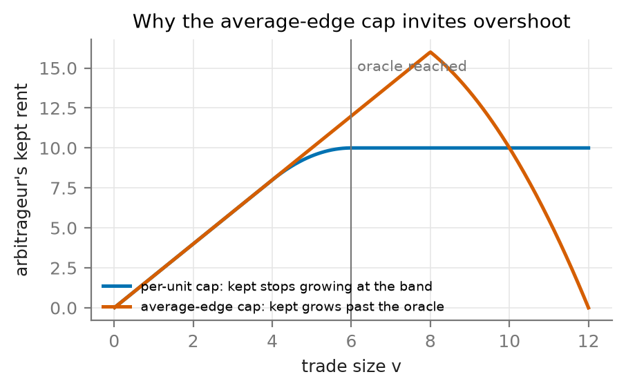

*Figure 14. Rent kept as a function of trade size under the per-unit cap and the average-edge cap: the first stops growing at the band, the second keeps growing past the benchmark.*

**F.2 Reimbursing gas separately.** The chain exposes its base fee at execution, so the arbitrageur's gas could be reimbursed on top of the allowance rather than folded into it. An allowance paid per unit of volume cannot cover the gas of the smallest corrections, so reimbursement helps: in simulation it raised LPs' worst-case gain from \$4.81 M to \$5.07 M on mainnet and left it unchanged on Arbitrum (Appendix C). We forgo it because crediting gas, paid in the native token, against a charge in the pool's tokens needs an exchange rate the pair does not contain (§4.3).

**F.3 Controller variants.** Measuring staleness as the share of time a gap is open, over every block, mistook mainnet's 12 s of fresh drift for staleness and drove $m$ to 21–31 bp. An allowance growing with the standing gap silenced the signal that raises $m$ and lengthened stalls (20–61 h on Arbitrum).

**F.4 Flat fees and switching in the correction lane.** With no arbitrage stake, the lane of §4.10 was tested with reduced flat fees in place of the per-unit charge, and with the lane switched on and off. A flat fee $\varphi$ charged on the whole swap lets the arbitrageur trade only until the gap equals $\varphi$ plus its cost. Discounting to the plain pool fee therefore keeps the pool rebalanced but recaptures nothing: the pool behaves as it does today. A clearing fee $g - m$ fixed at the gap where the swap starts corrects only about $m$ of it. Discounts that grow with the gap leave small gaps facing fees near $f_{\max}$ and freeze the pool; discounts that shrink with the gap leave a residual fee at small gaps that the pool cannot cross. A hysteresis switch on the gap — the discount turned on once the gap exceeds a threshold and kept on until the pool returns to the band — behaves like the plain pool fee when its threshold is small and leaves the pool stale when it is larger. Opening the lane only for an hour after staleness is detected leaves the gaps that open while it is closed uncorrected.

| No arbitrage stake, $f_{\max}$ = 500 bp | Mainnet | Arbitrum | Rebalanced |
|---|---|---|---|
| Flat fee discounted to $f_{\min}$ | \$0.00 M | \$0.00 M | yes |
| Flat clearing fee $g - m$ | \$3.26 M | \$0.42 M | no |
| Discount growing with the gap | frozen | frozen | no |
| Discount shrinking with the gap | frozen | −\$1.25 M | no |
| Hysteresis on the gap, threshold 2 bp | \$0.00 M | \$0.00 M | yes |
| Hysteresis on the gap, threshold 5 bp, clearing fee | \$0.87 M | −\$0.53 M | no |
| Per-unit charge, lane open only within an hour of staleness | \$3.91 M | \$0.64 M | no |

*Table 4. LPs' worst-case gain over today across the three cost scenarios, for rejected variants of the correction lane; Table 3 gives the adopted design.*

**F.5 Allowance bonuses.** Raising the allowance beyond the arbitrageur's cost is rent, and rent is competed away for position. A flat premium of 0.5 bp tripled payments to builders in an early simulation. A bonus proportional to the market's jump within a block, paid only for corrections in that block so that waiting forfeits it, cost LPs 17–31% of their worst-case gain on mainnet and 11–17% on Arbitrum at REP's mint rate, while payments for position roughly doubled; with REP valued below its mint rate it did not prevent stalls. Keying the bonus to the standing gap instead, which rewards waiting, did no better.

**F.6 Premium mint.** An arbitrageur without stake pays $f_{\max}$; minting it REP at the internal rate for the premium above $f_{\min}$, net of its charge, lets its first trades buy the stake that lowers its later fees. Valued at par, this bootstrapped a pool from zero stake at $f_{\max}$ up to 2,000 bp on both chains, matching the fully staked result. But an arbitrageur that values REP at a fraction $v$ of par bears a hurdle of about $(1 - v)(f_{\max} - f_{\min})$ per unit of volume, and the pool tolerated little discount: at $v$ = 0.99 it passed the rebalancing test only at $f_{\max}$ = 500 bp, losing 15% of LPs' gain; at $v$ = 0.98 it failed; and at $v$ = 0.95 it froze for $f_{\max} \ge$ 1,000 bp. Liveness would rest on REP trading at its mint rate, which §4.9 does not guarantee; the correction lane does not depend on it.

## Appendix G. Extended discussion

**G.1 The decision instant.** On Ethereum, a block's timestamp is the start of its slot, a label fixed before the block's content is chosen. Ordinary swaps are typically signed and broadcast through the public mempool seconds before inclusion. Arbitrage between centralised and decentralised exchanges is non-atomic: the arbitrageur hedges on the centralised exchange and sends its on-chain leg privately to block builders, and a few searchers closely tied to builders account for most of its volume (Heimbach et al., 2024). Builders bid for the block in the MEV-Boost auction, and arbitrageurs re-price their bundles as the external price moves until the proposer takes the winning header — which proposers delay into the slot to collect higher bids (Schwarz-Schilling et al., 2023; Öz et al., 2023). An arbitrageur's last decision therefore falls after the timestamp, by about the time the winning bid is taken.

By contrast, L2s such as Arbitrum have no public mempool. Arbitrum's sequencer orders transactions by arrival into blocks of about 250 ms whose timestamps have a resolution of one second. Since April 2025, a sealed-bid second-price auction held every minute sells an express lane, and all other transactions are delayed by 200 ms (Timeboost; Mamageishvili et al., 2023). Three entities won almost all of these auctions (Messias and Torres, 2025). An arbitrageur reacting to an external move is sequenced within its network latency plus at most that delay, so its decision lies close to its inclusion, wherever in the block that happens to be.

Rather than assume a latency, we measure it. A swap that corrects the pool trades until the pool price net of the fee meets the external price at which it can hedge, at the instant it decides; the offset from the block timestamp that minimises this residual over correcting swaps therefore identifies the decision latency $L$, and we score at $t^* = \text{block timestamp} + L$ (Figure 5). The estimate is 1.5 s on mainnet (bracketed by 1.25–1.75 s), consistent with bids taken one to two seconds into the slot, and 0.75 s on Arbitrum (0–1.5 s), where the staleness of our price proxy dominates the bracket and its earliest estimate places the match at block time itself, as arrival ordering implies. Benign flow shows no relation to the offset: it is uninformed, so its decision instant does not affect its score. The anchor matters for informed flow: anchoring at the timestamp scores arbitrageurs against prices from before they traded (§5.2). $L$ is a parameter of each pool, re-estimated periodically from reconciled correcting swaps and changed only within its bracket; scores are insensitive to $L$ inside the bracket (Appendix B), and an arbitrageur can shift the estimate only by stopping its trades away from the hedgeable price, at a loss to itself.

**G.2 Fresh accounts and $f_{\max}$.** An account that holds no stake has $r = 0$, so $\min\{C(m), r\} = 0$ whatever it owes, and the fee it pays at execution is all the pool ever receives from it. Consider two arbitrageurs facing the same gap $g$ between the pool and the benchmark. One holds enough stake to pay a fee near $f_{\min}$: it corrects the gap, keeps at most $m$ per unit of volume, and pays the rest as $C(m)$ after the block. The other trades from a fresh account: it pays $f_{\max}$, and with $r = 0$ none of the $C(m)$ it owes can be collected, but it profits only while the remaining gap exceeds $f_{\max}$ plus its own cost rate $h$. In a pool of depth $D$ per unit of log price, each unit it trades moves the pool by $1/D$ toward the benchmark, so after volume $u$ its margin on the next unit is $g - u/D - f_{\max} - h$: the full excess $g - f_{\max} - h$ on the first unit, falling linearly to zero, where it stops after a volume of $D\,(g - f_{\max} - h)$. A margin that falls linearly to zero averages half its starting value, so the account's take is $D\,(g - f_{\max} - h)^2/2$, assuming depth is roughly constant over the range the trade moves the pool.

Two conclusions follow. For any gap smaller than $f_{\max} + h$, the fresh account cannot trade at a profit at all; only on larger dislocations can its uncharged take exceed what a staked arbitrageur keeps, and that take grows with the square of the excess. $f_{\max}$ is therefore best read as the size of dislocation the pool is designed to withstand without leakage, and it should be set above the largest shock the pool expects; §5.5 measures the leakage as a function of $f_{\max}$ and shock size. A high $f_{\max}$ does not burden ordinary flow, which pays close to $f_{\min}$ through stake held directly or by an intermediary that trades on its behalf (§4.8), and escaping it takes little stake: because the curve is exponential, a coverage ratio of $\ln\big((f_{\max} - f_{\min})/\delta_f\big)$ brings the fee within $\delta_f$ of $f_{\min}$, a requirement that grows only with the logarithm of $f_{\max}$.

**G.3 The allowance controller.** A correctable block is one any arbitrageur whose cost is below $m$ would profit from correcting. In a pool whose allowance covers some arbitrageur's cost, correctable blocks are almost never left stale; when $m$ lies below every arbitrageur's cost, they always are. Staleness is defined by outcome rather than by the block's first swap because ordering is adversarial (A3): a builder could otherwise place a dust swap in the wrong direction ahead of each correction, make every block look stale and ratchet $m$ upward at the cost of dust; under the outcome rule it would have to keep every correcting swap out of the block, forgoing what those swaps pay for inclusion. A gap that persists through blocks without swaps is observed at the pool's next swap. The competition signal resists manipulation: an arbitrageur that fakes competition with extra addresses only lowers its own allowance, and hiding competition requires a cartel that any arbitrageur with a cost below $m$ can break. The controller's inputs — the resting price at the start of each block, the pool's price after each swap, the signed benchmark and the sender of each correcting swap — are all part of reconciliation; it needs neither the arbitrageurs' costs nor transaction indices.

**G.4 Oracle attestation.** Because reconciliation is not time-critical, the prices it uses can themselves be subject to consensus, which an oracle read at execution cannot afford. Oracle networks already aggregate the reports of independent nodes and sign the result once (Breidenbach et al., 2021); BRO-AMM can add a second, independent layer, applying a batch only after a threshold of attesters has co-signed it, or after a challenge window has passed without dispute. A corrupted feed must then also corrupt that threshold. The natural attesters are the parties exposed to the batch, but they are not neutral: LPs gain from prices that inflate charges and traders from prices that deflate them. Attestation therefore needs both sides — LPs weighted by liquidity and stakers weighted by stake — and what an epoch settles to when they disagree must not give either side a free option; we leave the design of dispute resolution to future work (for a survey of oracle designs and attacks, see Eskandari et al., 2021). The cost is latency rather than gas: a few signature checks per epoch, against a settlement deadline that is already long. Only epoch-based reconciliation can absorb that delay, a further reason to price after the fact.
