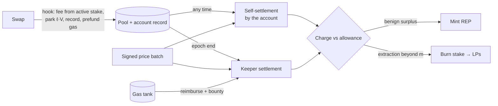
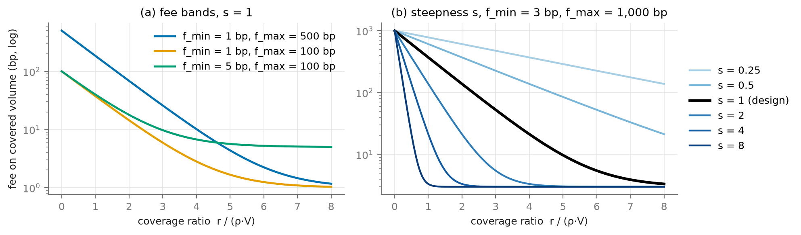
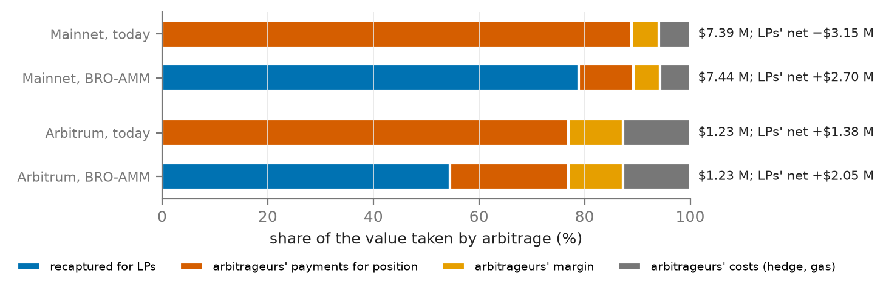
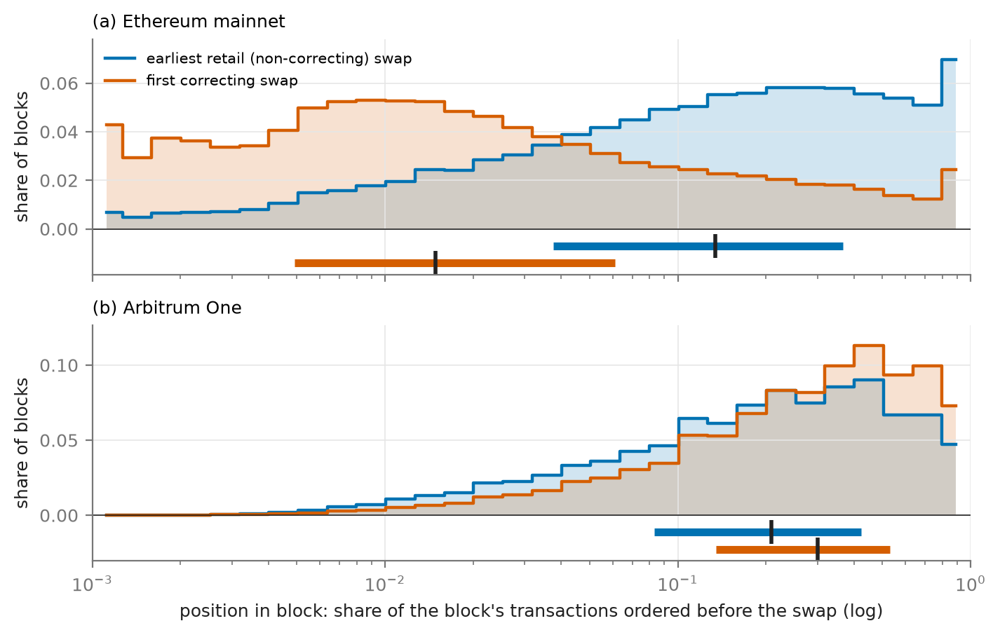

# BRO-AMM: A Bonded Reconciliation Oracle AMM as a Low-Risk DeFi Primitive

**Tims Pecerskis** · tim\@peeramid.xyz

## Abstract

Liquidity providers (LPs) in automated market makers lose value to arbitrageurs trading against stale on-chain prices, and no existing AMM bounds this loss by design, so passive liquidity is not yet a low-risk DeFi primitive. BRO-AMM (Bonded Reconciliation Oracle AMM) is a Uniswap v4 hook built on one principle: after a block, chain history and signed market prices establish what each swap did to LPs, and that record can settle it. A price-correcting swap keeps an allowance per unit of volume, discovered on-chain; extraction beyond it is recaptured for LPs from stake posted before trading, which also bounds what arbitrageurs can pay for block position. Traders who overpay mint a reputation token (REP) that lowers their fees. On six months of Ethereum ETH/USDC data, a pool charging 3 bp instead of 5 bp leaves LPs ahead of today in every simulated scenario, by \$5.8–6.5M, while retail pays about 3.3 bp all-in and arbitrageurs' payments to block builders fall by 83–86%; an appendix adapts the design to Arbitrum's sequencer. Settlement costs 0.18× the gas of the swaps it settles.

## 1. Introduction

LVR is a permanent, non-mean-reverting cost for liquidity providers (LPs). For a constant-product pool it accrues at $\sigma^2/8$ of the pool's value per unit of time, where $\sigma$ is the volatility of the external price over that unit [@milionis2022lvr], about 11% a year at a daily volatility of 5%; measured arbitrage losses exceed the fees LPs earn in many of the largest Uniswap pools [@fritsch2024arbitrage], and in our sample LPs of the mainnet ETH/USDC pool ended \$1.58 M down after fees (§5.2). Arbitrage itself is necessary: it keeps the pool's price aligned with the market. The problem is its price. Arbitrageurs capture the full gap between pool and market, and on Ethereum they pass much of it to block builders in competition for position, a cost ultimately borne by LPs and blockchain community at large - as this system does not allow large scale adoption of AMM as reliable, low risk, DeFi building block that passive retail & institutionals can park capital in to, moreover fixed fee tiers fragment liquidity without resolving the trade-off.

This matters beyond the returns of LPs. @buterin2025lowrisk argues that low-risk DeFi — payments and savings, well-understood tools such as synthetic assets and fully collateralised lending, "and the ability to exchange between these assets" — can be for Ethereum what search was for Google. Exchange is the primitive the others rely on, and it is low-risk only if supplying liquidity is: an LP who expects to lose a predictable share of liquidity to arbitrage each year is not holding a savings-grade position. We therefore design an exchange whose risks to LPs are bounded and stated. Execution stays synchronous and permissionless; nothing is lent or leveraged; all value settles in the pool's own pair, with no third asset or numeraire; extraction is collected from stake posted in advance; and the reputation asset is solvent at par against the surplus LPs have already received (Theorem 1), so that, as long as the pool meets its target in every epoch, a collapse in its price removes surplus, not principal. The mechanism does add a dependency: a signed oracle, whose error we bound by a tolerance rather than eliminate (§5.7). Oracle risk and contract risk are the very risks that Buterin names as having held low-risk DeFi back, and we list them explicitly among our assumptions (§3.4).

We pursue two goals: to return as much of the arbitrage surplus as possible to LPs while charging uninformed flow as little as possible, and to replace the hard-coded fee by a variable the system sets itself. The contributions are:

1. a per-swap quality score $Q_{\mathrm{LP}}$, measured against signed bid/ask prices at an empirically measured decision instant (§3);
2. a payout rule for arbitrage — a per-unit cap with an allowance discovered on-chain — under which what an arbitrageur can bid for position is bounded by an allowance the pool discovers, with an optional lane that settles corrections at execution and removes the dependence on arbitrage stake (§4.2–4.4, §4.8);
3. a per-pair reputation asset and a collateral design that make the charge collectable after the fact (§4.5–4.6);
4. a settlement layer that is pair-native and costs a fraction of the swaps it settles (§4.7);
5. an evaluation on Ethereum covering scoring validity, recapture, payout rules, oracle error and settlement cost (§5), with an arrival-ordered rollup, Arbitrum, in Appendix I.

## 2. Related work

Approaches to LVR either remove the information asymmetry or redistribute its surplus (Appendix A). @milionis2022lvr define LVR and suggest backward-looking fee adjustment and the sale of arbitrage rights as directions; BRO-AMM is a concrete, farming-resistant instance of the first.

Auction designs — am-AMM [@adams2024amamm], McAMM [@josojo2022mcamm] and Angstrom [@sorellaAngstrom] — sell the right to arbitrage or manage the pool and return the proceeds to LPs; Angstrom additionally clears ordinary orders at a uniform price, but relies on app-specific sequencing, whereas BRO-AMM is a plain hook. 

Diamond [@mcmenamin2022diamonds] and V0LVER [@mcmenamin2023amm] reduce liquidity for arbitrageurs only, and argue against oracle dependence; we accept a trusted signed oracle and quantify the consequences of its error (§5.7). 

The closest design is Hindsight [@oojaeHindsight], a v4 hook that escrows each swap's output for about ten seconds and sets its fee afterwards from the realised markout against a volatility-adjusted threshold, refunding benign flow. BRO-AMM differs in keeping execution synchronous — the trader receives its output at once, and charges are collected from stake posted in advance — and in scoring at the decision instant rather than against later prices, which mix extraction with drift (§3.2). 

MEV taxes [@robinson2024priority] charge a fee increasing in the priority fee and capture competitive MEV under honest priority ordering; they do not hold under builder auctions on Ethereum and cannot reach extraction in the middle of a block. 

Reputation systems, zScore [@udupi2025zscore] and Karma [@statusKarma], and optimal dynamic fees [@baggiani2025fees; @ghasemlu2026fees] set fees or access by behaviour or market state but specify neither an oracle-reconciled scoring rule nor resistance to concentration of the discount.

## 3. Methodology

### 3.1 Reconciliation as fundamental finalisation requirement

No blockchain finalises as quickly as a centralised order book observes prices. Even a price signed into the transaction leaves a lag between the signature and execution that can be exploited. The ground truth about a swap is therefore available only after the fact, and an AMM that prices against it must span at least two blocks: the swap, and its reconciliation.

Reconciliation is to prices what finality is to blocks. Consensus protocols separate inclusion from finality: Nakamoto consensus makes a block final only probabilistically, as further blocks are built on it [@garay2015backbone]; Ethereum produces a block every 12 s but finalises a checkpoint only after two epochs of attestations, about 13 minutes [@buterin2020gasper]; and an optimistic rollup such as Arbitrum treats its results as final only once a challenge period has passed [@kalodner2018arbitrum]. BRO-AMM applies the same separation to price. A swap executes at once and provisionally, as a block is included; its price becomes final at reconciliation, once the signed prices for its block are available and agreed. As in those protocols, slowness is what makes agreement possible (§4.7).

### 3.2 The quality score

Let a pool trade token 0 against token 1. For a swap, let $\Delta_0$ and $\Delta_1$ be the amounts of the two tokens the pool receives (negative when it pays out), fees included, and let the notional be the swap's size in units of token 0. Then

```math
Q_{\mathrm{LP}} = \frac{\Delta_0 + P_{\mathrm{dir}}(t^*)\,\Delta_1}{\text{notional}} \tag{1}
```

where $t^*$ is the decision instant defined in §3.3 and $P_{\mathrm{dir}}(t^*)$ is the directional benchmark at that instant, the price of token 1 in units of token 0 — the liquidity-weighted bid when the pool sells the risky asset and the ask when it buys it — so that swaps executed inside the bid–ask band are never scored as extractive; Chainlink Data Streams supplies both sides [@chainlinkDataStreams]. The score is invariant to the choice of numeraire, needs no sign convention by trade direction, and is evaluated at horizon zero, where extraction occurs, rather than against later prices that mix extraction with drift. Negative values are losses to LPs.

### 3.3 Reference latency factor

The score (1) compares a swap with the external price at the moment its sender decided to trade, which is neither when the transaction was submitted nor when the block was stamped. On Ethereum a block's timestamp labels the start of its slot, and arbitrageurs keep re-pricing their bundles until the proposer takes the winning bid, so their last decision falls after the timestamp; on Arbitrum the sequencer orders transactions by arrival, so a decision lies close to its inclusion (Appendix G.1). Rather than assume a latency, we measure it. A swap that corrects the pool trades until the pool price net of the fee meets the external price at which it can hedge, at the instant it decides; the offset from the block timestamp that minimises this residual identifies the decision latency $L$, and we score at $t^* = \text{block timestamp} + L$ (Figure 5 in Appendix B). $L$ is 1.5 s on mainnet and 0.75 s on Arbitrum, and is a parameter of each pool, re-estimated periodically (Appendix G.1).

Every swap in a block is scored at the same instant and over a one-second window around it. A per-block anchor is position-invariant: no position maps to a more lenient benchmark, whereas a clock derived from a transaction's index within the block would be set by whoever orders the block, and could be sold (Appendix B). On chains whose blocks are shorter than their timestamps, the $N$ blocks carrying timestamp $S$ (in whole seconds) are spread over that second, the block of rank $j = 0, \dots, N - 1$ in block-number order being placed at $S + (j + \tfrac{1}{2})/N$; the error of at most $\pm 1/(2N)$ s is absorbed by the scoring window.

### 3.4 Assumptions and threat model

- **A1 (oracle).** Signed bid and ask prices exist for every block, are retained for about a month, and are correct up to a bias and noise bounded by the tolerance $\varepsilon$ (§5.7); a compromised oracle is outside the model. Only swaps that use the optional correction lane (§4.8) read the oracle at execution.
- **A2 (chain).** The hook executes atomically with the swap and the chain exposes its base fee; reorganisations beyond finality are not considered.
- **A3 (ordering).** No ordering is assumed to be honest. The only ordering property used is whether a chain runs builder auctions or a first-come-first-served sequencer (§4.4).
- **A4 (arbitrage).** Arbitrageurs are rational, with private, time-varying costs; at least one is active, and competition among them is not assumed.
- **A5 (liveness).** At least one keeper settles each epoch before its deadline.

The adversary may be any trader, LP, arbitrageur, builder, sequencer or keeper, or a coalition of them; it may create any number of accounts, split trades, buy position and trade REP, and an LP may trade against its own pool to mint REP and then withdraw (§4.5). Accounts carry no identity, and a new account pays $f_{\max}$. The mechanism aims for five properties: a swap's score does not depend on its position in the block (G1); splitting a trade reduces neither its charge nor its parked stake (G2); charges are collected from stake posted before the trade, otherwise from the pool's reserve, never from another trader (G3); outstanding REP is always backed by surplus held in escrow, so no LP inherits it unbacked (G4, Theorem 1); and no keeper can alter a charge (G5). Contract bugs and relational attacks such as sandwiches, which per-swap scoring cannot see, are outside the model.

## 4. Mechanism

BRO-AMM separates the execution of a swap from its pricing. A swap executes at once, at a fee set by the stake its sender has posted; after the block, it is scored against signed prices and settled against that stake. A swap that corrects the pool's price keeps an allowance per unit of volume, and whatever it extracts beyond the allowance is charged to its stake for the LPs; traders whose payments exceed the LPs' target earn the stake that lowers their fees. The subsections follow a swap through this cycle, and Table 1 collects the notation; Appendix H follows two swaps through it with numbers.

| Symbol | Meaning |
|---|---|
| $Q_{\mathrm{LP}}$, $t^*$, $L$ | quality score (1); decision instant $t^* = \text{block timestamp} + L$; measured decision latency |
| $r$, $V$ | an account's staked REP and its volume in the epoch |
| $f_{\min}$, $f_{\max}$, $\rho$ | fee band and capacity scale of the coverage curve (2); $\rho$ is also the base parking rate |
| $f$, $u$, $p(u)$, $s$ | pool fee; volume of a swap of notional $v$ executed so far, in token 0; the pool's marginal price after $u$; direction of mispricing (3a) |
| $\mathrm{edge}(u)$, kept, charge | marginal edge beyond the fee (3a); allowance kept and charge recaptured by a correcting swap (3b) |
| $m$, $m_0$, $\varepsilon$, $\sigma_o$ | job allowance per unit of volume (3b), its starting value, the oracle tolerance, and the standard deviation of the oracle's random error |
| $n^{\mathrm{c}}_H$, $n^{\mathrm{s}}_H$, $K_d$, $K_{\min}$, $u_d$, $\bar u$ | correctable and stale blocks in hour $H$; senders with at least 5% of corrections on day $d$ and its threshold; share of urgent corrections on day $d$ and its threshold (§4.4) |
| $a$, $\lambda$ | protected retail volume share ahead of a correction and its penalty weight (§4.3) |
| $\pi_b$, $\pi^{\mathrm{r}}_b$, $z_b$, $\kappa$ | block positions of the closing correction and of the earliest protected retail swap; block-position index (4) and its urgency boundary (§4.4) |
| $\ell$, $k$, $\Delta_{\mathrm{block}}$ | parked share of volume (7), its speed, and the pool's price move so far in the block |
| $N$, $\theta^*$, $\tau$ | pool's net income per epoch (6), LPs' target take-rate, and protocol take |
| $P_{\mathrm{int}}$, $P_{\mathrm{mkt}}$, $\delta$ | internal mint and burn rate of REP, its market price, and the buyback margin (§4.9) |
| $G_i$, $H_i$, $\Delta S_i$ | cumulative income above the target, its high-water mark, and the epoch's surplus (6) |
| $S_t$, $Q_t$, $E_t$, $D_t$ | cumulative surplus, outstanding REP, escrow and current shortfall after epoch $t$ (Appendix E) |
| $G$, epoch | gas withheld per swap for settlement; per-pool settlement period |
| $D$, $g$, $h$ | pool depth per unit of log price; a gap to the benchmark; an arbitrageur's cost rate (§4.2) |

*Table 1. Notation. Activation and exit delays of stake, the controller's steps and thresholds, and the keeper bounty and deadline are further parameters.*

### 4.1 Execute, then reconcile



*Figure 1. Lifecycle of a swap.*

At execution the hook reads the trader's active REP stake, charges the fee given by the coverage curve, parks part of the stake, records the swap and prefunds its share of settlement gas; no oracle is consulted, so trading remains synchronous and permissionless. At reconciliation, the swap is scored against signed prices and settled against stake only: benign surplus mints REP, and extraction beyond the job allowance is burned from stake. Because a departed counterparty's cash cannot be recalled, stake is both the fee determinant and the collateral.

### 4.2 Fees: the coverage curve

Let $r$ be an account's staked REP, valued at the internal rate $P_{\mathrm{int}}$ of §4.5, and $V$ its volume in the epoch. Staked reputation grants discounted capacity $r/\rho$ per epoch, and the fee on covered volume is

```math
f(r, V) = f_{\min} + (f_{\max} - f_{\min})\, e^{-r/(\rho V)} \tag{2}
```

where $f_{\min}$ and $f_{\max}$ are the floor and ceiling of the pool's fee band and $\rho > 0$ is the capacity scale: stake worth $\rho V$ reduces the premium above $f_{\min}$ by a factor $e$. The curve (Figure 2) is convex and decreasing in $r$ (diminishing returns, which discourages concentration), asymptotic to $f_{\min}$ (LPs always earn a floor) and homogeneous of degree zero (it prices the coverage ratio, not wealth). Volume beyond capacity pays $f_{\max}$.

The fee is the part of a swap's payment settled at execution; after the block the swap is settled again, in either direction. For a swap of notional $v$,

```math
\text{payment} \;=\; \underbrace{f(r, V)\, v}_{\text{at execution}} \;+\; \underbrace{\min\{C(m),\, r\} \;-\; R(\theta^*)}_{\text{after the block}}, \qquad C(m),\ R(\theta^*) \ge 0,
```

where $C(m)$, defined in (3b), is the charge for extraction beyond an allowance $m$ per unit of volume (§4.3), collectable only up to the account's stake $r$, and $R(\theta^*)$ is the REP minted for payments above the LPs' target take-rate $\theta^*$ (§4.5). Most swaps carry neither.

A fresh account has $r = 0$, so nothing it owes can be collected, and only the fee limits it: against a gap $g$ it profits only on the part beyond $f_{\max}$ and its own cost rate $h$, taking $D\,(g - f_{\max} - h)^2/2$ in a pool of depth $D$ per unit of log price (Appendix G.2). $f_{\max}$ is therefore set above the largest shock the pool must withstand, not by benign flow, which reaches $f_{\min}$ through stake held directly or by an intermediary (§4.8); because the curve is exponential, the stake needed to escape a high $f_{\max}$ grows only with its logarithm. §5.5 measures the leakage.



*Figure 2. The coverage curve for three fee bands.*

### 4.3 Arbitrage as a paid job

Payments for position — priority gas auctions [@daian2020flashboys], builder bids on Ethereum, express-lane bids on rollups — are a toxic by-product of an AMM that leaves the whole gap between its price and the market to whoever corrects it first: mainnet arbitrageurs in our sample paid \$6.57 M for position (§5.4). BRO-AMM instead prices the correction as a job, so that LPs' return does not depend on how the underlying chain orders transactions — unless the AMM becomes part of that chain's consensus itself.

Correcting the pool is a service with a cost to whoever performs it — a hedge on the external venue, that venue's fees, inventory risk and gas — and in a competitive market that cost, not the size of the gap, is its price. The pool therefore pays a correcting swap a *job allowance* $m$ per unit of volume and recaptures for LPs whatever the swap gains beyond it. Formally:

Consider a swap of notional $v$ in a pool with fee $f$, and let $\hat P = P_{\mathrm{dir}}(t^*)$ be its benchmark from (1). For $u \in [0, v]$, let $p(u)$ be the pool's marginal price, in the units of $\hat P$, after the first $u$ units of token 0 of the swap have executed, so that $p(0)$ is the pre-trade price. Let $s = \operatorname{sgn} \ln\big(\hat P / p(0)\big)$ be the direction in which the pool is mispriced; the swap is *price-correcting* if it moves $p$ in direction $s$. Its marginal edge is the log-distance from the pool's marginal price to the benchmark, net of the fee and of a tolerance $\varepsilon \ge 0$ for oracle error (§5.7):

```math
\mathrm{edge}(u) = \max\!\big(s \ln\big(\hat P / p(u)\big) - f - \varepsilon,\; 0\big) \tag{3a}
```

which is non-increasing in $u$ for a price-correcting swap and is zero once the pool has entered the band of width $f + \varepsilon$ around the benchmark or passed it. With the job allowance $m \ge 0$, the swap keeps and is charged, in units of token 0,

```math
\text{kept} = \int_0^{v} \min\big(\mathrm{edge}(u), m\big)\, du, \qquad \text{charge} = \int_0^{v} \max\big(\mathrm{edge}(u) - m, 0\big)\, du \tag{3b}
```

and the charge is recaptured for LPs (Figure 3). Each unit keeps at most $m$ of its own edge, so the arbitrageur stops where the pool meets the band; capping the trade's average edge instead would pay it to overshoot (Appendix F.1). Judging each unit by its own edge also makes splitting a trade pointless and, since every swap in a block is scored against the same benchmark (§3.3), leaves position deciding only which arbitrageur gets the job: the most it would pay for position is its margin over cost, $(m - h)\,v$, which the controller of §4.4 drives toward zero. Position still matters to users, who trade against the stale price when they precede the correction. Reconciliation therefore scales the allowance a correction keeps by $1 - \lambda a$, where $a \in [0, 1]$ is the share of the block's *protected* retail volume executed before it and $\lambda \in [0, 1]$ is a penalty weight (0.25 in our simulations); protected swaps are those that do not correct the pool and pay a priority fee no higher than the 90th percentile of such swaps in the epoch, so that a trader cannot buy protection by bidding. The allowance includes the arbitrageur's gas: reimbursing it separately would pay out native token against a charge recaptured in the pool's tokens, and netting the two requires an exchange rate the pair does not contain. Settlement gas (§4.7) avoids this because it is collected and spent in the native token alone (Appendix F.2).


*Figure 3. Rent kept and recaptured under the per-unit cap (3b): the edge falls as the swap moves the pool, and each unit keeps at most $m$.*

### 4.4 Discovering the allowance

The allowance should equal the competitive cost of correcting the pool, which is private to arbitrageurs and changes over time: set too low, no one corrects the pool; set too high, the excess is rent. BRO-AMM discovers $m$ by feedback from what reconciliation observes, much as EIP-1559 sets Ethereum's base fee from observed demand for block space [@roughgarden2020eip1559].

**Block-position index.** Let $b$ be a block containing a swap in the pool, $p_b$ the pool's price at its start and $\hat P_b$ the benchmark. The block is *correctable* if $\lvert \ln(\hat P_b / p_b) \rvert > f + m + \varepsilon$. Let $\pi_b \in [0, 1]$ be the share of the block's transactions ordered before the first swap that leaves the pool within $f + m + \varepsilon$ of $\hat P_b$, and let $\pi^{\mathrm{r}}_b$ be the same share for the earliest protected retail swap of §4.3 in $b$ or, in a block without one, for the position a swap paying the epoch's 75th-percentile retail priority fee would take. The index of a correctable block is

```math
z_b = \ln\big(\pi^{\mathrm{r}}_b / \pi_b\big), \qquad z_b = -\infty \ \text{ if no swap in } b \text{ leaves the pool within } f + m + \varepsilon \text{ of } \hat P_b . \tag{4}
```

Reconciliation computes $z_b$ off-chain from the order of swaps in the block and the sign of each swap's $Q_{\mathrm{LP}}$, which identifies the swaps moving the pool toward the benchmark. A correctable block is *stale* if $z_b = -\infty$, *late* if $z_b < 0$ (protected retail traded at the stale price, which the penalty of §4.3 charges), *timely* if $0 \le z_b \le \ln \kappa$ and *urgent* if $z_b > \ln \kappa$, where $\kappa > 1$ is a separation factor. §5.2 measures both positions on today's pools. Both boundaries are relative to the block's own retail flow, not absolute indices, and priority fees are not used, since they miss payments made to builders outside the transaction.

**Controller.** The controller keeps both tails of the index's distribution thin. The lower tail measures supply: any arbitrageur whose cost lies below $m$ profits from correcting a correctable block, so stale blocks indicate that $m$ is below every active arbitrageur's cost. The upper tail measures competition: a lead over retail costs the arbitrageur a payment for position, which it makes only when a rival could otherwise take the job, so urgent blocks indicate that $m$ leaves a margin rivals bid away. Let $n^{\mathrm{c}}_H$ and $n^{\mathrm{s}}_H$ be the numbers of correctable and stale blocks in hour $H$, $n^{\mathrm{c}}_d$ and $n^{\mathrm{s}}_d$ those on day $d$, and $u_d$ the share of the day's corrected blocks that are urgent. At the end of each hour and of each day respectively, the controller sets

```math
m \leftarrow 2m \ \ \text{if } n^{\mathrm{s}}_H \ge 5 \text{ and } n^{\mathrm{s}}_H > 0.02\, n^{\mathrm{c}}_H ; \qquad
m \leftarrow \begin{cases} 0.8\, m & \text{if } u_d > \bar u, \\ 0.95\, m & \text{if } u_d \le \bar u \text{ and } n^{\mathrm{s}}_d < 0.01\, n^{\mathrm{c}}_d , \end{cases} \tag{5}
```

where $\bar u$ is an urgency threshold; our simulations use $\kappa = 2$ and $\bar u = 0.5$, which today's pools, where nearly every correction is contested, cannot calibrate (§5.9). Late blocks with finite $z_b$ do not move $m$: lateness is charged by the penalty, and raising $m$ on it only raised payments to builders (Appendix F.7). Staleness is judged by the outcome of a block rather than by its first swap, so that an adversarial ordering (A3) cannot manufacture it (Appendix G.3).

**Other orderings.** Each rollup orders transactions by its own sequencer rules, so the urgency signal is specific to builder auctions. Where a sequencer orders by arrival, a lead over retail is won by latency rather than by payment and says nothing about competition; the urgency condition in (5) is then replaced by a count of competing senders, and Appendix I develops and evaluates that design for Arbitrum.

The allowance rises fast and falls slowly because a stale pool harms users at once; it starts at $m_0$ and stays within [0.02, 50] bp. Its inputs are all part of reconciliation (Appendix G.3). If every arbitrageur able to correct the pool withdraws, the pool stays stale until another deploys, an exposure an ordinary pool shares; §5.4 measures it.

### 4.5 The reputation asset

In each epoch $i$ the pool's net income — what the LPs gained on the epoch's swaps, fees included, plus the charges recaptured — is compared with the LPs' target, cumulatively:

```math
N_i = \sum Q_{\mathrm{LP}} \cdot \text{notional} + \sum \text{charges}, \qquad \Delta S_i = \max\big(G_i - H_{i-1},\, 0\big), \qquad \text{minted}_i = \frac{(1 - \tau)\,\Delta S_i}{P_{\mathrm{int}}} \tag{6}
```

where the sums run over the epoch's swaps, $Q_{\mathrm{LP}} \cdot \text{notional}$ is each swap's gain to LPs by (1), fees included, charges are those recaptured under (3b), $G_i = \sum_{k \le i} (N_k - \theta^* V_k)$ is the cumulative income above the target for epoch volumes $V_k$ and the LPs' target take-rate $\theta^*$, $H_i = \max(H_{i-1}, G_i)$ with $H_0 = 0$ is its high-water mark, and $\tau$ is the protocol take. REP is thus minted only from income above everything earned before: a shortfall must be recovered before new surplus mints. Each account whose payments exceeded the target on its own volume receives REP, at a fixed internal rate $P_{\mathrm{int}}$, up to $(1 - \tau)$ of its own excess, pro rata when the surplus is smaller; surplus beyond the accounts' excess, such as recaptured charges, stays with the LPs. Extraction beyond the allowance burns stake at the same rate, so no market price of REP enters either formula, and the take $\tau$ funds the per-pool reserve.

The surplus behind minted REP does not go to the LPs: the hook holds it in a per-pool escrow, one balance per token, so that outstanding REP is always backed at its internal rate. When REP is burned to cover a charge, or bought back by the reserve below its internal rate (§4.9), the hook releases the matching escrow to the LPs present at that moment through the pool manager's `donate`, which credits in-range liquidity pro rata by the same accounting as swap fees, at constant gas; REP itself remains a fungible token. Escrow is what makes minting safe against the LPs themselves. Without it, an LP holding a share $s$ of active liquidity can wash volume through a fresh account at $f_{\max}$, receive $s$ of its own overpayment back as fees, mint REP against the rest and withdraw, leaving later LPs to bear the REP when it is burned; with $f_{\max}$ = 1,000 bp this pays once $s$ exceeds about 2.7% (Appendix E). With escrow the overpayment backs the REP instead of returning to its sender, and the wash loses money at any share. Staked REP is a slashable trading licence, preferable to escrowed cash for its holder because it earns the discount, is costly only to extractors, and appreciates with the pool's benign volume.

### 4.6 Stake, parking and collection

Only staked REP affects fees, which precludes flash-renting the discount. A trade parks $\ell V$ of active stake until it is settled, with

```math
\ell = \rho + k\, \Delta_{\mathrm{block}} \tag{7}
```

where $k \ge 0$ is the parking speed and $\Delta_{\mathrm{block}}$ is the pool's price move so far in the block: corrections after a market jump move the pool quickly and park more. Splitting a trade cannot reduce $\Delta_{\mathrm{block}}$, whereas rules keyed to trade size can be defeated by splitting. Charges are collected first from the trade's parked stake, then from the rest of the account's stake (which cannot be withdrawn while settlements are pending), and finally from the per-pool reserve. Charges are never taken from other traders' stake. A pool may also accept liquidity only in predefined ranges, with a single band for a stablecoin pair, and lock what is added until its epoch is reconciled; both are enforced by the hook on adding and removing liquidity, and stop a large share of active liquidity from being taken briefly with little capital.

### 4.7 Settlement

The hook extends each swapper's record — post-trade price, active liquidity and token deltas, chained by hash in the account's storage — so that an account's unsettled swaps form a self-contained segment. An account may settle itself at any time against the signed prices for its blocks, which releases its parked stake; at the end of each epoch a keeper settles every account still in flight. Both paths advance the same pointer, and a keeper's entry for an account that has already settled is skipped rather than reverted. Flights still unsettled when the oracle's retention window expires are burned in full.

Settlement is paid in gas, not in the pool's assets. Every swap prefunds $G \times$ `block.basefee` into a gas tank — a count of gas units times a value the chain exposes, with no price involved. The amount is in the native token, so the hook debits it from a gas credit that the account or its router has deposited in that token, or, in pools holding the wrapped native token, takes it from the swap's leg in that token; neither requires an exchange rate. From the tank, keepers are reimbursed with an escalating bounty, directly or through an ERC-4337 paymaster [@erc4337]. Since every pool contributes in the same unit, one tank can serve many pools. Two rules keep it inexpensive: settlement is never forced into the current block, and each pool chooses its epoch length. Where charges are computed on-chain, an open race among keepers is efficient; where they are proven off-chain, a designated leader avoids duplicated proving. A leader cannot alter a charge, which is fixed by the record and the signed prices.

Because reconciliation is not time-critical, the prices it applies can themselves pass through consensus first — for instance co-signed by LPs and stakers, the two sides those prices affect — which an oracle read at execution cannot afford (Appendix G.4).

The per-swap work of settlement — a multiply-add against a verified price, a comparison and a state write — is smaller than executing the swap, so settlement is bounded by the pool's own execution footprint. §5.8 measures it.

### 4.8 Launch, intermediaries and the correction lane

At launch no account holds REP, and an account without stake pays $f_{\max}$, so benign flow reaches the pool through intermediaries that hold stake on its behalf. Correction does need stake, since an arbitrageur without it also pays $f_{\max}$ and, with $f_{\max}$ sized to the shocks the pool must withstand (§4.2), small gaps would go uncorrected. As on other venues, a pool therefore launches with appointed arbitrageurs or market makers holding an initial allocation of REP, sold at no less than its mint rate with the proceeds seeding the reserve; §5.5 sizes the stake they need. Intermediaries — routers, solvers, RFQ desks — hold stake and pass the discount to users. Because the curve (2) is exponential, quoting near $f_{\min}$ is cheap: with $\rho$ = 5 bp, a router whose flow is benign minimises its cost at a stake of 0.6–0.9% of its volume per epoch, and its premium over $f_{\min}$, including a 10% cost of capital and an expected 50% annual loss on REP's price, stays below 0.12 bp for $f_{\max}$ between 500 and 2,000 bp (Appendix G.5). It cannot avoid the toxicity of its own flow, since extraction beyond the allowance is charged to its stake. The protocol never identifies arbitrageurs: arbitrage is a role carried by a swap, and any swap that moves the pool toward the oracle is paid the allowance on it. The charge is computed per correcting swap rather than per account, so an intermediary cannot net customers' overpayments against its own extraction.

**Launch without appointed arbitrageurs.** Any AMM leaves gaps smaller than its fee uncorrected. A pool launched permissionlessly has no staked arbitrageurs, so every correction pays $f_{\max}$, and since $f_{\max}$ is high by design, the pool stays decoupled from the market for every gap below it (§5.5). An optional *correction lane* removes this dependence. A swap may attach a signed report for a recent instant; the hook verifies it, checks that the swap moves the pool toward the reported price, charges $f_{\min}$, and settles the charge (3b) against the reported price in the same transaction, so that the swap keeps at most $m$ per unit and pays the rest to LPs. Nothing remains to collect afterwards, so the lane needs no stake and offers a fresh account no advantage. It must be open at all times and must charge per unit; reduced flat fees, hysteresis and gating all fail (Appendix F.4). Its cost is an oracle dependency for the swaps that use it: reports must be fresh, and verifying one adds about a quarter of a swap's gas. Ordinary swaps remain oracle-free.

### 4.9 REP's market price

REP is burned for charges at the internal rate $P_{\mathrm{int}}$ at which it was minted, while its market price $P_{\mathrm{mkt}}$ may fall below it, letting a trader cover charges at par with collateral that cost less. Three properties bound the consequences (Appendix E). The pool is solvent at par: REP is minted only from surplus above the LPs' target, less the take $\tau$, and that surplus is held in escrow, so even if every unit were burned for extraction, the escrow would pay the LPs and, at the high-water mark, leave them at $\theta^*$ — a crash in REP's price removes surplus, not principal. Extractors provide a demand floor, buying REP below $P_{\mathrm{int}}$ while they have extraction to cover. And below par, REP is the pool's debt trading at a discount, which the reserve, funded by $\tau$, can retire by buying and burning REP below $P_{\mathrm{int}}$, releasing $P_{\mathrm{int}}$ of escrow to the LPs for each unit, within a capacity of $\tau S_t$ for cumulative surplus $S_t$.

Above par, growing demand would price new intermediaries out of the discount. Minting caps it first: surplus $X$ paid above the target mints $(1 - \tau)X/P_{\mathrm{int}}$, so new REP costs $P_{\mathrm{int}}/(1 - \tau)$, and the take $\tau$ thus sets both the reserve's buying capacity below par and how far above par the price can hold. That cap holds only in epochs whose surplus clears the target, and an LP minting against its own pool pays less, since its share of the overpayment returns to it. The reserve caps the price firmly: whenever $P_{\mathrm{mkt}} > (1 + \delta) P_{\mathrm{int}}$, it mints REP and sells it at that price, placing $P_{\mathrm{int}}$ per unit in escrow and keeping the premium. A unit sold at no less than $P_{\mathrm{int}}$ leaves the pool solvent at par, as the launch sale does (Appendix E); the discount it grants lowers fees like any other REP, and an epoch it pushes below the target counts as a shortfall in Theorem 1. The sale also gives intermediaries a continuous primary source of REP, which surplus alone may not: the LPs' net take in our simulations is 0.9–1.8 bp of volume (§5.3), so a target $\theta^*$ above it would mint little.

## 5. Evaluation

### 5.1 Data and method

We study the Uniswap v3 ETH/USDC 5 bp pool on Ethereum mainnet from 1 March to 31 August 2026 (Table 2); Appendix I repeats the evaluation on the corresponding WETH/USDC pool on Arbitrum. The benchmark is Binance ETHUSDT corrected by USDCUSDT, with a touch-level bid/ask proxy built from aggressor-flagged trades. A stable–stable control pool, where no extraction is expected, scored a median absolute $Q_{\mathrm{LP}}$ of 0.9–1.1 bp (95th percentile 2.3 bp), inside the band within which the USDC/USDT peg itself moves (99th percentile 12.8 bp on mainnet). Designs are compared in a block-level simulation that replays the real oracle path and non-arbitrage flow against a population of optimising arbitrageurs with costs from 0.3 to 2.5 bp (Appendix C). Three cost scenarios hold these costs fixed or multiply them by four or by eight from June, and a *worst-case* figure is the least favourable of the three. *LPs' net* is the LPs' fee income less their losses to arbitrage over the six months, and *LPs' gain* its change from the same pool today. *Payments to builders* are what arbitrageurs pay block builders, directly or through priority fees, to have their corrections ordered first; they are part of what LPs lose to arbitrage. A design *keeps the pool rebalanced* if, relative to today, the share of blocks that end within the fee plus 1 bp of the benchmark falls by at most 0.5 percentage points and the volume-weighted staleness of the price users trade against rises by at most 0.1 bp.

| | Ethereum mainnet |
|---|---|
| Swaps | 990,555 |
| Blocks (with a pool swap) | 1.32 M (595 k) |
| Volume | \$19.6 B |

*Table 2. Sample, March–August 2026.*

### 5.2 Decision latency and scoring validity

The decision latency $L$ is 1.5 s (Figure 5 in Appendix B); scoring at the block timestamp instead would turn mainnet's measured LP loss of \$1.58 M into an apparent gain of \$5.26 M. Against labels that use no prices, retail aggregators as benign and repeat top-of-block searchers as toxic, $Q_{\mathrm{LP}}$ separates the classes with an area under the ROC curve (AUC) of 0.889, and 0.983 for the largest swaps; against a position-free label, any non-router sender with at least 100 swaps, the AUC is 0.704 (0.971 for the largest swaps), lower because the label admits benign repeat senders (Figure 6 in Appendix B). Builders sell position, and 61% of extraction occurs in the first three positions of a block; most corrections lead retail by more than a factor of two (Figures 7–8 in Appendix B).

### 5.3 BRO-AMM against today's pool

Because LPs keep most of what arbitrage took, a BRO-AMM pool can charge less than the pool it replaces and still leave its LPs better off. Table 3 compares today's 5 bp pool with BRO-AMM two fee units below it, at 3 bp, with urgency measured by block position (§4.4). Every correcting swap is charged under (3b), users' included, as the mechanism specifies. Retail reaches the pool through an intermediary holding REP (§4.8), so retail's price is the fee, plus the charges that today's retail-aggregator flow would incur on its own accidental corrections, measured on the data (Appendix G.5), plus the router's cost of holding REP; a stale price is not counted, since uninformed flow meets it in either direction.

| Six months, stable costs | Today, 5 bp | BRO-AMM, 3 bp |
|---|---|---|
| LPs' net | −\$3.15 M | \$3.37 M |
| LPs' gain over today, worst cost scenario | — | +\$5.76 M |
| Retail's price: fee + charges + REP holding | 5.00 bp | 3.31 bp |
| Staleness of the price users trade at | 12.75 bp | 11.54 bp |
| Arbitrageurs' payments to builders | \$6.57 M | \$1.09 M |
| Arbitrageurs' margin after costs | \$0.38 M | \$0.51 M |
| Recaptured from arbitrageurs | — | \$6.74 M |
| Charged to other correcting swaps | — | \$1.96 M |
| Blocks ending within the band | 99.54% | 99.96% |

*Table 3. Today's pool against BRO-AMM at a lower fee, Ethereum mainnet. Retail's charges and holding cost are upper bounds: charges are measured against the mid price on today's, staler flow, and holding assumes daily epochs and an expected 50% annual loss on REP's price.*

In every cost scenario, LPs end ahead of today by \$5.76–6.52 M, retail pays about 1.7 bp less, users trade against fresher prices, arbitrageurs' payments to builders fall by 83–86%, and the pool is as well rebalanced as today. Arbitrageurs keep slightly more than today. Most of what other correcting swaps are charged comes from informed flow that is not arbitrage by our labels: unlabelled flow would pay 7 bp of its volume, retail aggregators 0.1–0.2 bp (Appendix G.5). The sensitivity studies below and in the appendices leave users' corrections uncharged, which understates LPs' result by about \$1.9 M. LPs' net here mints no REP; with a target of 2 bp and the high-water minting of (6), REP rebated to payers above the target would take \$0.27 M of it (Appendix E).



*Figure 4. Division of the value taken by arbitrage at today's 5 bp fee, stable costs: recaptured for LPs, paid by arbitrageurs for position (to block builders on mainnet), kept by arbitrageurs as margin, or spent on their hedging and gas. Totals and LPs' net position at right.*

At today's 5 bp fee the same mechanism moves value rather than creating it: arbitrage takes about as much from the pool as before, but most of what arbitrageurs paid block builders for position is recaptured for LPs, while arbitrageurs' margin is unchanged (Figure 4, Table 5 in Appendix C). If users route away, the pool keeps a share of their flow, and LPs beat today even with none of it, by \$1.24 M in the worst case (Appendix C).

**How far the fee can fall.** LPs beat today at every fee down to 0.5 bp and stay positive down to 3 bp; if the cheaper quote draws other venues' flow and LPs follow with liquidity, their net per unit of liquidity at 3 bp rises from \$1.41 M to \$1.95 M at three times today's flow (Appendix C). On an arrival-ordered rollup the headroom is narrower: on Arbitrum users already close many small gaps for the fee alone, and the pool beats today at 4 bp but not at 3 bp (Appendix I).

**Risks of competing.** LPs' daily result under BRO-AMM varies more than today (standard deviation \$65–66 k against \$32 k), because recapture arrives on volatile days, but its downside is smaller: at 3 bp the worst day loses \$103 k and the worst week \$324 k, against \$211 k and \$722 k today (Appendix C). A lower fee leaves more correctable blocks uncorrected, within the rebalancing constraint. For a router, holding REP costs at most 0.12 bp of its volume, and retail-aggregator flow incurs 0.19 bp of charges at 3 bp, up to 1.6 bp on the worst day; unscreened flow incurs 2–8 bp, so a router's risk is the toxicity of the flow it accepts (Appendix G.5).

As a reference measured on the data rather than simulated, a fixed schedule applied with the benchmark known exactly, charging extraction beyond 2 bp up to $f_{\max}$, recaptures 73% of extraction while preserving 97–99% of profitable arbitrage and overcharging benign flow by less than 0.1 bp (Figure 10 in Appendix C). The schedule was fixed in advance; selected on March–May, it remains the best schedule on June–August.

### 5.4 Allowance discovery and robustness

The per-unit cap keeps the pool rebalanced under every controller below, whereas capping the average edge fails through overshoot (Appendix F.1). The controller determines how close the allowance stays to arbitrageurs' cost (Figure 11 in Appendix C). Without a competition signal, decay crosses the cheapest arbitrageur's cost about every two weeks and stalls rebalancing until a staleness raise restores it. The simulation orders transactions by payment, with 45% of arbitrageurs paying builders outside the transaction (Appendix F.7); measuring urgency by block position classifies 32% of corrected blocks as late, 23% as timely and 45% as urgent, and gives LPs a worst-case gain of \$5.38 M, against \$4.82 M without a signal and \$5.45 M with urgency observed exactly.

The controller withstands the loss of its cheapest arbitrageurs. When the cheapest leaves for a week, or the two cheapest withhold corrections for three days, and idle arbitrageurs take an hour or a day to redeploy, the pool stays rebalanced, LPs' gain stays within \$5.35–5.86 M while withholding moves the withholders' income by at most \$0.03 M (Appendix F.7). The gains persist for arbitrage populations from a monopoly to ten arbitrageurs and for depth halved or doubled (Appendix C).

### 5.5 Arbitrage without stake

The results above assume that arbitrageurs hold enough stake. We relax this in three steps. The position model does not yet combine with finite stake, so this section uses decay without a signal, which bounds the final design from below; its worst-case gain with full stake is \$5.01 M.

**Fresh accounts.** If any arbitrageur may instead trade from an unstaked account at $f_{\max}$ and keep its whole edge, LPs' worst-case gain falls from \$5.01 M to \$3.53 M at $f_{\max}$ = 30 bp and recovers to \$4.93 M at 500 bp. With the market's shocks scaled by two and by four, fresh accounts take at most 1.5% of LPs' gain at 500 bp and none at 1,000 bp (Figure 12b in Appendix C).

**Arbitrage stake.** If arbitrageurs pay the coverage-curve fee on a finite stake, the pool freezes without any. It remains rebalanced in every scenario once the stake reaches about 25 times $\rho$ times the mean daily arbitrage volume if one staker covers all arbitrageurs (\$0.91 M), and about 50 times if each holds its own; stake accumulated from zero over the first month leaves the pool stale for 50–88 hours (Figure 12a in Appendix C). This is the stake that appointed arbitrageurs bring at launch (§4.8).

**Correction lane.** Without arbitrage stake, and with $f_{\max}$ high enough to defeat fresh accounts, the pool never rebalances. The correction lane of §4.8 restores the fully staked result (Table 4); the freshness of the signed report is the binding requirement. Appendix F.4 reports the alternatives that failed.

| No arbitrage stake, $f_{\max}$ = 500 bp | LPs' gain | Rebalanced |
|---|---|---|
| Arbitrageurs fully staked (reference) | \$5.01 M | yes |
| No lane | frozen | no |
| Lane, per-unit charge (3b), report gas 0–24% of a swap | \$4.90–4.93 M | yes |
| Same, $f_{\max}$ = 2,000 bp | \$4.98–5.01 M | yes |
| Same, report one second old | \$4.23 M | no |

*Table 4. LPs' worst-case gain over today across the three cost scenarios.*

### 5.6 Collateral

The charge per trade is small at the median (0.17 bp) but heavy-tailed (99.9th percentile 21 bp, maximum 358 bp; trades above 50 bp carry 27% of the total), so parking alone collects 70–90% and the account's remaining stake and the reserve collect the rest. Parking keyed to the in-block price move resists splitting; parking keyed to trade size loses half its collection when a correction is split ten ways.

### 5.7 Oracle error

A degraded oracle leaves benign flow essentially unaffected (overcharge below 0.3 bp) but makes part of the charges on arbitrage unjustified (Figure 9 in Appendix B). A tolerance $\varepsilon \approx \max(\lvert \text{bias} \rvert, 2\sigma_o)$, where $\sigma_o$ is the standard deviation of the oracle's random error, removes most unjustified charges at about 8% of recapture per basis point. Staleness binds on fast chains, where a one-second-old feed halves recapture (Appendix I).

### 5.8 Settlement cost and keeper economics

The hook adds 17,112 gas to a v4 swap; a keeper's epoch costs 26,000 gas plus 14,300 per account, and self-settlement 46,000 gas plus 6,000 per swap (Appendix D). Settled hourly against batch-signed prices, settlement costs 0.18× the execution gas of the settled swaps; a succinct proof lowers this only to 0.14–0.15×, so viability does not depend on proofs (Figure 13 in Appendix D). A gas tank shared by seven mainnet pools stays solvent with 2.3 k gas per swap at daily epochs, 1.2% of a swap's gas (Figure 14 in Appendix D). In simulation, 2–8% of accounts preferred to settle themselves, and an open keeper race settled on-chain epochs within 1.3 minutes.

### 5.9 Limitations

The benchmark is a Binance touch proxy, so oracle error is modelled rather than measured. The simulation assumes linear daily depth, fixed user flow, a population of arbitrage costs, one arbitrage action per block and, in §5.5, arbitrage stake held at its level. Block position is modelled through priority fees and payments to builders rather than replayed, the urgency thresholds $\kappa$ and $\bar u$ are not calibrated on live data, and arbitrageurs' redeployment is a fixed delay. Labels are heuristics. Gas was measured with mock tokens, and swaps crossing a liquidity boundary are outside the closed-form charge. Keeper costs are assumed, and the census applies the study pool's recapture rate to the other pairs. The REP market and intermediaries are analysed (§4.8–4.9, Appendix G.5) but not simulated, and minting, rebates and escrow are evaluated on the simulated daily income rather than within the simulation; users are simulated as fully covered at the pool's fee, and retail's charges are measured on today's flow rather than simulated.

**Future work.** A single REP shared by all pools would let standing earned in one pool count in another. But an LP of its own pool can mint REP at the cost of the protocol take alone, and a shared token would let REP minted against one pool's surplus be charged against another's; we have not found a design that prevents this without giving up LPs' claim to their surplus or permissionless entry.

## 6. Conclusion

BRO-AMM is offered as a low-risk DeFi primitive for exchange. It shows that loss-versus-rebalancing can be recaptured by a plain Uniswap v4 hook [@uniswapV4core], without delaying execution, without consulting an oracle at trade time and without relying on honest ordering. Execution remains synchronous; pricing is completed after the block against signed prices, at a decision instant that is measured from the data and shared by every swap in the block, so that no position buys a more lenient benchmark. Arbitrage is retained as a paid job whose allowance is discovered on-chain, extraction beyond the allowance is collected from stake posted before trading, and benign traders earn the stake that lowers their fees.

On six months of Ethereum data, a fixed schedule applied with perfect information recaptured 73% of extraction while overcharging benign flow by less than 0.1 bp. With the allowance discovered on-chain, simulation shows the value that arbitrage takes moving from arbitrageurs' payments to builders to LPs, enough for a pool to undercut the one it replaces: at 3 bp against today's 5 bp, LPs end ahead of today in every cost scenario, by \$5.8–6.5 M over six months, retail pays about 3.3 bp all-in, users trade at fresher prices, arbitrageurs' payments to builders fall by 83–86%, and the pool stays as well rebalanced as today. On Arbitrum, where the sequencer orders by arrival, a count of competing senders replaces urgency and the pool undercuts today at 4 bp (Appendix I). An optional correction lane removes the dependence on arbitrage stake, and settlement costs 0.18 of the swaps' execution gas, paid from a tank that every swap prefunds. Its binding requirements are a sub-second oracle on fast chains and a tolerance matched to the feed's error. Its residual risks are the signed oracle, the contracts themselves and the market for REP; the last is bounded by solvency at par but not yet observed. Oracle error measured on the signed feed itself, the behaviour of REP in a live market, and a reputation shared across pools remain open.

## Code and data availability

The hook contracts, the measurement and simulation pipeline, and the results behind every table and figure are available at <https://github.com/peersky/ammbro>. Raw chain and exchange data are not redistributed; the repository records their checksums and the pipeline that rebuilds them.

## Acknowledgements

We thank Chainstack for RPC infrastructure support, and the Chainlink team for consultations on the Data Streams report format and its capabilities.

## References

::: {#refs}
:::

---

## Appendix A. Related work in detail

**@milionis2022lvr.** Define LVR with a closed form and propose (a) fees set by comparing LVR with fee income over a backward-looking window and (b) the sale of arbitrage rights to capture LVR for LPs. Both are directions, not specified or farming-robust mechanisms; BRO-AMM's oracle reconciliation instantiates (a).

**am-AMM [@adams2024amamm].** A Harberger-lease auction for the role of pool manager, who sets the fee and may arbitrage at zero fee; surplus accrues to LPs. By its authors' account it offers fewer sandwich protections than a fixed-fee AMM and depends on a single manager; the convex coverage curve of §4.2 is in part an argument against winner-take-all structures.

**Diamond and V0LVER [@mcmenamin2022diamonds; @mcmenamin2023amm].** Reduce liquidity only for arbitrageurs and rebate a share of LVR; V0LVER extends protection to user-level MEV. The authors regard oracle dependence as unsatisfactory; BRO-AMM accepts a trusted signed oracle and bounds the effect of its error (§5.7).

**Angstrom [@sorellaAngstrom].** A live v4 hook that auctions the top-of-block arbitrage right, distributes the proceeds to in-range LPs and clears other orders at a uniform price, which removes the positions a sandwich needs. It relies on app-specific sequencing by a decentralised operator set; BRO-AMM requires no sequencer.

**zScore [@udupi2025zscore] and Karma [@statusKarma].** zScore scores accounts' on-chain behaviour and points to v4 hooks as a vehicle for reputation-dependent fees; it does not specify an oracle-reconciled per-swap rule or an anti-farming curve. Karma is a soulbound token for access and rate limiting, not LVR-specific pricing; REP is deliberately transferable.

**Optimal dynamic fees [@baggiani2025fees; @ghasemlu2026fees].** Derive optimal fees as functions of the pool's state — inventory and external price moves, or volatility through a stochastic-control formulation; they set one fee for all flow and do not address a reputation-eligibility curve that must resist concentration.

**Hindsight [@oojaeHindsight].** A Uniswap v4 hook built for the UHI10 Hookathon and deployed on Unichain Sepolia. It escrows the swap's output delta as ERC-6909 claims for a maturity window of about ten seconds; permissionless keepers then settle, refunding a benign trade to about 5 bp and forfeiting the bond of an informed one to LPs, where informed means a realised markout above a threshold that grows with the volatility of a trailing window. A reputation multiplier discounts the bond for accounts with a benign history. It shares BRO-AMM's idea of settling the fee after the fact, but withholds the trader's proceeds and judges toxicity by subsequent prices rather than by the price at the decision instant.

**MEV taxes [@robinson2024priority].** A fee increasing in the priority fee captures competitive MEV under strict priority ordering — plausible on OP-Stack sequencers, not under Ethereum builder auctions — and cannot reach extraction in the middle of a block. BRO-AMM's ex-post reconciliation does not depend on honest ordering.

## Appendix B. Measurement details

**Benchmark composition.** Pair quotes composed from two single-asset feeds are taken as round trips: for ETH/USDC from ETH/USD and USDC/USD, the pair ask is $\mathrm{ETH}_{\mathrm{ask}} / \mathrm{USDC}_{\mathrm{bid}}$ and the pair bid is $\mathrm{ETH}_{\mathrm{bid}} / \mathrm{USDC}_{\mathrm{ask}}$. Liquidity-weighted quotes are conservative for large trades but lenient for small trades in volatile moments, when the touch is the true counterfactual; as pool liquidity approaches reference depth, the quotes can be extended with the pool's own liquidity into a size-aware price.

**Decision latency.** The bid/ask proxy is about 0.75 s stale at the median. Running the latency fit with the last quote before each instant biases it late, with the next quote after it biases it early; $L$ is the midpoint. Mainnet bracket: 1.25–1.75 s; Arbitrum: 0–1.5 s. Timing noise inside the centred 1 s window: 0.80 bp (mainnet) and 1.72 bp (Arbitrum) at the 90th percentile.

**Index-based clocks.** Normalising transaction index into intra-block time is unsafe where position is sold: ordering by arrival gives the best-informed top-of-block traders the oldest price and forgives about 72% of top-of-block extraction; reversing the orientation moves the purchase to the cheap bottom of the block; clocks counting only the pool's own swaps can be bought with dust swaps (\$0.03 of gas bought \$11 of forgiveness per arbitrage in our data). Such clocks are safe only where ordering is enforced by time.

**Labels.** Benign: transactions sent to a curated set of retail routers (on Arbitrum, the curated routers present there plus contracts used by at least 300 senders with at most 20 swaps each). Toxic: the first swap in a direction among a block's first four user transactions by a non-router sender with at least 100 swaps; position-free variant: any swap by a non-router sender with at least 100 swaps. Sandwich legs were labelled toxic in an earlier version; they number 50 swaps on mainnet and 2 on Arbitrum and do not affect the AUC, and a front-running leg pays above the market by construction (median $Q_{\mathrm{LP}}$ +9.3 bp on mainnet), so it would score as an overpayer. Arbitrum blocks open with a system transaction, so positions count user transactions. The "largest swaps" slice is the top 4.55% by notional on each chain (\$100 k on mainnet, \$7 k on Arbitrum).


*Figure 5. Median fee-adjusted residual between the pool's post-swap price and the hedgeable external quote, by offset from the block timestamp.*


*Figure 6. Distribution of $Q_{\mathrm{LP}}$ by label.*


*Figure 7. (a) Share of extraction by transaction position in the block. (b) Distribution of the block-position index (4) of today's first correcting swap against the earliest non-correcting swap, among blocks containing both, with the late, timely and urgent ranges for $\kappa = 2$.*



*Figure 8. Positions in the block of the first correcting swap and of the earliest retail (non-correcting) swap, among blocks containing both, March–August 2026; position is the share of the block's transactions ordered before the swap. Bars below each panel span the quartiles, with a tick at the median: on mainnet the first correcting swap sits at a median position of 0.015 and the earliest retail swap at 0.13; on Arbitrum, where position follows arrival, at 0.30 and 0.21.*


*Figure 9. Mainnet: (a) unjustified share of charges and (b) recapture, as functions of the tolerance $\varepsilon$, for four oracle errors.*

## Appendix C. Simulation design

Every block is replayed in order — mainnet's 1.32 M, and all 63.4 M Arbitrum blocks at their reconstructed sub-second times, with the oracle read at each block's own time plus $L$. Pool depth is linear within a day, estimated from real swaps. In each block, arbitrageurs with hedging costs {0.3, 0.6, 1.0, 1.5, 2.5} bp choose the trade that maximises profit under the payout rule; the winner pays the runner-up's profit for position (second-price). The block's real non-arbitrage swaps are then replayed at observed size and direction. Costs are multiplied by four or eight from 1 June.

**Rebalancing constraint.** A rule is admissible only if, in every cost scenario, the share of blocks within the fee plus 1 bp of the oracle is at most 0.5 points below today's and the volume-weighted gap at which users trade is at most 0.1 bp above today's. This test is independent of block time; a count of uncorrected blocks is not, because a standing gap is counted once per block.

**Worst-case LP gain over the three cost scenarios** (per-unit cap unless stated; staleness judged by the block's first swap, as in an earlier version — the outcome rule of §4.4 gives \$5.01 M for blind decay on mainnet, §5.4):

| Controller | Mainnet | Arbitrum |
|---|---|---|
| Observes competition (not implementable on-chain) | +\$5.11 M | +\$0.75 M |
| Blind decay | +\$4.81 M | +\$0.71 M |
| Decay gated on sender diversity | — | +\$0.66 M |
| Fixed allowance, 5 bp | +\$3.68 M | +\$0.42 M |
| Reimbursing gas in addition to the allowance | +\$5.07 M | +\$0.71 M |

**Controller.** The rule of §4.4, with $\varepsilon$ = 0.5 bp. Under blind decay, rebalancing stalled for 0.6–3.1 h in total on mainnet and 4.7–7.1 h on Arbitrum over six months; gated decay removed the stalls when costs were stable.

**Sensitivity.** With a monopolist, two or ten arbitrageurs, all costs halved or doubled, and depth halved or doubled, every controller variant kept the pool rebalanced on both chains. A monopolist never reveals competition, so gated decay holds the allowance at its starting value $m_0$, which then bounds the rent.

**At today's fee.** The final design at today's 5 bp fee, with users' corrections uncharged:

| Stable costs, six months | Mainnet today | Mainnet BRO-AMM | Arbitrum today | Arbitrum BRO-AMM |
|---|---|---|---|---|
| LPs' net | −\$3.15 M | \$2.70 M | \$1.38 M | \$2.05 M |
| Fees from users | \$4.24 M | \$4.27 M | \$2.61 M | \$2.61 M |
| Lost to arbitrage | \$7.39 M | \$1.57 M | \$1.23 M | \$0.56 M |
| Recaptured from arbitrage | — | \$5.87 M | — | \$0.67 M |
| Arbitrageurs' payments for position | \$6.57 M | \$0.77 M | \$0.94 M | \$0.27 M |
| Arbitrageurs' margin after costs | \$0.38 M | \$0.38 M | \$0.13 M | \$0.13 M |
| Users' price staleness, volume-weighted | 12.75 bp | 12.54 bp | 4.28 bp | 4.28 bp |
| Blocks ending within the band | 99.54% | 99.40% | 100.00% | 100.00% |

*Table 5. Today's pools against BRO-AMM at today's 5 bp fee, users' corrections not charged. LPs' net is fees from users less what is lost to arbitrage after recapture. Arbitrageurs' payments for position go to block builders on mainnet and to winning the race to be ordered first on Arbitrum.*

**Retention of user flow.** Every non-arbitrage swap is scaled by the share of user flow the pool keeps, its volume, fees and price impact alike, under the final design; LPs' gain is measured against today's pool at full flow.

| User flow kept | Mainnet | Arbitrum |
|---|---|---|
| 0% | +\$1.24 M | −\$2.29 M |
| 25% | +\$1.89 M | −\$1.91 M |
| 50% | +\$2.73 M | −\$1.27 M |
| 75% | +\$3.97 M | −\$0.43 M |
| 100% | +\$5.38 M | +\$0.65 M |

*Table 6. LPs' worst-case gain over today's pool at full flow, across the three cost scenarios, when BRO-AMM keeps a share of user flow. On Arbitrum, removing user flow raises arbitrage volume from \$5.0 B to \$7.9 B, because users' own trades do part of the rebalancing.*

**Fee headroom.** The pool fee $f_{\min}$ is lowered for users, who reach the pool fully covered, and for staked arbitrageurs, under the final design; the within-band test keeps today's 6 bp band. Users' all-in cost is what LPs earn from users per unit of user volume: the fee plus the markout of trading at a stale price, which on Arbitrum favours users today. Ranges span the three cost scenarios; gains over today are worst cases. Today's pool costs users 8.7–8.8 bp on mainnet and 2.9–3.3 bp on Arbitrum.

| Fee | Mainnet: LPs' gain over today | Mainnet: LPs' net | Mainnet: users' all-in | Arbitrum: LPs' gain over today | Arbitrum: users' all-in |
|---|---|---|---|---|---|
| 5 bp | \$5.38 M | \$1.70 M to \$2.70 M | 8.7–8.9 bp | \$0.65 M | 2.9–3.3 bp |
| 3 bp | \$3.88 M | \$0.19 M to \$1.41 M | 7.2–7.4 bp | −\$0.50 M | 2.3–2.8 bp |
| 2 bp | \$2.99 M | −\$0.70 M to \$0.53 M | 6.4–6.6 bp | −\$1.22 M | 2.0–2.5 bp |
| 1 bp | \$1.81 M | −\$1.88 M to −\$0.57 M | 5.8–6.0 bp | −\$2.26 M | 1.7–2.2 bp |
| 0.5 bp | \$1.11 M | −\$2.57 M to −\$1.14 M | 5.5–5.8 bp | −\$2.98 M | 1.5–1.9 bp |

*Table 7. LPs' result and users' all-in cost at lower pool fees.*

**Capture and risk.** If the lower fee wins routing, the pool draws flow from other venues and LPs follow with liquidity: user flow and depth are both scaled (stable costs, mainnet). LPs' net per unit of liquidity divides by the scale.

| Fee | Flow and depth | LPs' net | Per unit of liquidity | Users' all-in | Worst week |
|---|---|---|---|---|---|
| 3 bp | ×1 | \$1.41 M | \$1.41 M | 7.4 bp | −\$324 k |
| 3 bp | ×1.5 | \$2.54 M | \$1.69 M | 7.5 bp | −\$486 k |
| 3 bp | ×2 | \$3.43 M | \$1.72 M | 7.4 bp | −\$668 k |
| 3 bp | ×3 | \$5.84 M | \$1.95 M | 7.5 bp | −\$1003 k |
| 1 bp | ×1 | −\$0.57 M | −\$0.57 M | 6.0 bp | −\$587 k |
| 1 bp | ×1.5 | −\$0.37 M | −\$0.24 M | 5.9 bp | −\$876 k |
| 1 bp | ×2 | \$0.00 M | \$0.00 M | 6.0 bp | −\$1202 k |
| 1 bp | ×3 | \$0.41 M | \$0.14 M | 5.6 bp | −\$1759 k |

*Table 8. Mainnet LPs' result when the pool takes a multiple of today's flow and liquidity.*

| Design | Daily mean | Daily s.d. | 1st percentile | Worst day | Worst week | Losing days |
|---|---|---|---|---|---|---|
| Today, 5 bp | −\$17 k | \$32 k | −\$146 k | −\$211 k | −\$722 k | 80% |
| BRO-AMM, 5 bp | \$15 k | \$66 k | −\$41 k | −\$71 k | −\$162 k | 10% |
| BRO-AMM, 3 bp | \$8 k | \$65 k | −\$76 k | −\$103 k | −\$324 k | 45% |
| BRO-AMM, 1 bp | −\$3 k | \$66 k | −\$129 k | −\$154 k | −\$587 k | 84% |

*Table 9. Mainnet LPs' daily net result over six months, stable costs. The worst day and week fall before the cost shift, so they are the same in all three cost scenarios.*


*Figure 10. Recapture against profitable arbitrage preserved, for all schedules evaluated.*


*Figure 11. Allowance over time with arbitrage costs quadrupled from June (dashed line). (a) Mainnet under the position model, decay without a signal against urgency measured by block position. (b) Arbitrum, decay without a signal against the sender rule $K_d \ge 4$. Each upward step is a staleness raise.*


*Figure 12. (a) Uncorrected hours against arbitrageurs' stake, held by one staker or separately; dotted: arbitrageurs fully covered; zero is drawn at 0.1. (b) LPs' gain lost to fresh unstaked accounts against $f_{\max}$, for the market's shocks scaled by one, two and four.*

## Appendix D. Settlement measurements

**Components.**

| Component | Gas | Source |
|---|---|---|
| Single-swap transaction (median) | 188,705 mainnet / 136,171 Arbitrum | 400 receipts per chain |
| Data Streams report verification | 55,879 mainnet / 62,544 Arbitrum (37,544 each further in a tx) | traced historical calls; no on-chain fee |
| Hook: parking, collateral check, record | +17,112 per swap | v4 pool manager, Foundry, isolated transactions |
| Self-settlement | 46,000 + 6,000 per swap | Foundry |
| Keeper epoch | 26,000 + 14,300 per account (4,400 per skipped entry) | Foundry |
| Groth16 [@groth2016] proof verification, SP1 [@succinctSP1] | 227,226 | Foundry |
| ERC-4337 sponsorship overhead | +87,000–98,000 per settlement transaction | EntryPoint v0.7 |

**Settlement designs**, six months, including the hook on every swap:

| Design | Mainnet (× execution) | Arbitrum (× execution) |
|---|---|---|
| Keeper every block, one report per block | \$96.7 k (0.72) | \$21.2 k (0.72) |
| Keeper hourly, batch-signed prices | \$24.9 k (0.18) | \$5.7 k (0.19) |
| Keeper hourly, succinct proof | \$20.5 k (0.14) | \$4.3 k (0.15) |
| Every account self-settles hourly | \$38.7 k (0.28) | \$6.8 k (0.23) |
| Execution of the swaps | \$148 k | \$30 k |

**Keeper market.** Five keepers with differing costs and availability, over every hourly epoch. With on-chain settlement, an open race paid \$12.0 k on mainnet (no wasted work) against \$12.5 k for a designated leader. With proven settlement and similar keepers, a race wasted \$829 of duplicated proving — more than Arbitrum's settlement gas — whereas a leader wasted \$28 at a higher payment. A colluding leader can delay the LPs' credit by at most one epoch, worth under \$0.01.

**Small pools** (protocol take needed to fund keepers, hourly, at a recapture rate of 3.6 bp of volume): \$19.6 B pool 0.10–0.16%; \$0.24–0.67 B pools 0.5–1.2%; \$13 M pool 11–16%, falling to 1.5–2.5% at daily epochs. Funded jointly, all seven pools need 0.11–0.19%.


*Figure 13. Settlement gas relative to the execution gas of the settled swaps.*


*Figure 14. Smallest per-swap gas contribution that keeps the gas tank solvent.*

## Appendix E. REP's market price and escrow

Index epochs by $i = 1, 2, \dots$. In epoch $i$ let $V_i$ be the pool's volume, $N_i$ its net income (6), $X_i$ the charges covered by burning REP, $B_i = X_i / P_{\mathrm{int}}$ the units burned for them, and $Y_i$ the units the reserve buys back and burns (§4.9). With $G_i$, $H_i$ and $\Delta S_i$ as in (6), write $S_t = \sum_{i \le t} \Delta S_i = H_t$ for the cumulative surplus, $D_t = H_t - G_t \ge 0$ for the current shortfall below the high-water mark, and $X_t$, $Y_t$ for cumulative sums. Let $Q_t$ be the outstanding REP and $E_t$ the escrow after epoch $t$, valued in the numeraire, with $Q_0 = E_0 = 0$. The LPs receive each epoch's income less its surplus, $N_i - \Delta S_i$, in the pool's assets except for the charges, which are paid in REP and reach them as escrow released when the REP is burned, together with the escrow released by buybacks; their cumulative income in the pool's assets is $C_t = \sum_{i \le t} (N_i - X_i) - S_t + X_t + P_{\mathrm{int}} Y_t$.

**Theorem 1 (backing and solvency at par).** For every $t$,

(i) $E_t = P_{\mathrm{int}}\, Q_t = (1 - \tau)\, S_t - X_t - P_{\mathrm{int}}\, Y_t$, and hence $X_t \le (1 - \tau)\, S_t$;

(ii) $C_t \ge \theta^* \sum_{i \le t} V_i - D_t$.

So outstanding REP is always fully backed in escrow, and if the pool is at its high-water mark ($D_t = 0$), LPs' income in the pool's assets is at least $\theta^* \sum_{i \le t} V_i$, even if every unit of REP ever minted is burned as collateral for extraction.

*Proof.* (i) Epoch $i$ mints $(1 - \tau)\,\Delta S_i / P_{\mathrm{int}}$ units and places the same value in escrow, and burns $B_i + Y_i$ units, releasing $P_{\mathrm{int}}$ of escrow for each; no other operation changes $Q$ or $E$. Summing gives both identities, and $Q_t \ge 0$ gives the bound on $X_t$. (ii) Since $\sum_{i \le t} (N_i - \theta^* V_i) = G_t = S_t - D_t$, $C_t = \theta^* \sum_{i \le t} V_i - D_t + P_{\mathrm{int}}\, Y_t \ge \theta^* \sum_{i \le t} V_i - D_t$. $\blacksquare$

A sale of REP at no less than $P_{\mathrm{int}}$ per unit, at launch (§4.8) or by the reserve (below), adds $P_{\mathrm{int}}$ to the escrow for each unit and preserves (i). Because the backing stays in the pool, the guarantee holds for every cohort of LPs, not only for the pool as a whole: a charge covered by REP is paid in the pool's assets to the LPs present when it is covered, and an LP joining at any time inherits no outstanding REP without its backing. Extraction beyond an account's stake is covered by the reserve (§4.6), which restores the target only up to the reserve's balance.

**Proposition 1 (wash minting by an LP).** An LP holding a share $s$ of active liquidity that washes volume $V$ at fee $f > \theta^*$ through an account it controls receives REP worth $v$ times its internal rate. Without escrow, the surplus returns to the LPs, $s$ of it to the attacker, and the wash gains $v(1 - \tau)(f - \theta^*)V - (1 - s) f V$, which is positive whenever $s > 1 - v(1 - \tau)(1 - \theta^*/f)$: at $f = f_{\max}$ = 1,000 bp, $\theta^*$ = 2 bp and $\tau$ = 2.5%, above a share of 2.7% with REP at par and 51% with REP at half of it; at $f$ = 5 bp, above 42%. The gain is borne by the LPs present when the REP is later burned. With escrow, only the target share of the overpayment reaches the LPs, and the gain is $(v - 1)(1 - \tau)(f - \theta^*)V - \tau (f - \theta^*) V - (1 - s)\,\theta^* V$, negative for every $s$ unless REP trades above $P_{\mathrm{int}}/(1 - \tau)$; at that price any account could mint the same way by overpaying, and the REP so minted is backed, so the LPs bear none of it.

Concentrated liquidity makes a large share of active liquidity cheap, which is why §4.6 lets a pool restrict liquidity to predefined ranges and lock it for an epoch; escrow is what removes the gain.

**Escrow in the simulation.** On the final mainnet design at 3 bp, with daily epochs and stable costs, charges burn \$8.71 M of REP over six months, several times what is minted, so arbitrageurs buy most of their REP from the reserve at par and the escrow passes through rather than accumulating:

| Target $\theta^*$ | Minting | REP rebated to payers | LPs' total value | REP bought from the reserve | REP burned for charges |
|---|---|---|---|---|---|
| 1 bp | per epoch | \$2.81 M | \$0.56 M | \$4.99 M | \$8.71 M |
| 1 bp | high-water (6) | \$1.25 M | \$2.12 M | \$6.54 M | \$8.71 M |
| 2 bp | per epoch | \$2.32 M | \$1.05 M | \$5.48 M | \$8.71 M |
| 2 bp | high-water (6) | \$0.27 M | \$3.10 M | \$7.53 M | \$8.71 M |

*Table 10. Mainnet, final design at 3 bp, stable costs, daily epochs, a launch sale of \$0.91 M at par. LPs' total value counts their assets, the reserve and the escrow left; it is the same with and without escrow, which changes when and to whom the backing is paid, not its amount. The headline LP net of Table 3, \$3.37 M, mints no REP.*

What LPs give up is the rebate itself: REP minted to accounts that paid above the target. Minting per epoch rebates surplus from good days without netting the shortfalls of bad ones; the high-water mark of (6) nets them, and leaves LPs within \$0.27 M of an unminted pool at $\theta^*$ = 2 bp. A pool should therefore set $\theta^*$ near its realised take-rate, which here is about 1.5 bp of volume.

The escrow can also work as capital: held as a full-range position in the pool, it earns its share of the pool's income and deepens the pool for traders. Here it never exceeds 0.07% of the pool's depth, adding about \$0.02 M, because a full-range position of value $W$ adds only $W/4$ of depth per unit of log price. Held in the pool's two tokens, its value moves with the square root of the price, while the REP it backs is fixed at $P_{\mathrm{int}}$, so the backing drifts above or below par; idle escrow in the numeraire keeps it exact. Escrow could come to own much of a pool only where little is extracted, so that REP is minted faster than it is burned, and its earnings are retained; a cap on escrow as a share of liquidity, or a slow decay of REP releasing escrow to LPs, prevents that.

**Demand floor.** An extractor with expected extraction $E^{\mathrm{x}}$ beyond the allowance over the period it holds REP values a unit at $\min(P_{\mathrm{int}}, E^{\mathrm{x}}/Q_e)$, where $Q_e$ is the REP it would hold: the full rate while extraction can absorb the units, less when it cannot. Aggregate extractor demand therefore supports $P_{\mathrm{mkt}}$ near $P_{\mathrm{int}}$ only while expected extraction is large relative to circulating REP.

**Buyback.** Let the reserve buy and burn REP whenever $P_{\mathrm{mkt}} < (1 - \delta)\, P_{\mathrm{int}}$, for a margin $\delta$ covering trading costs. Each unit retired releases $P_{\mathrm{int}}$ of escrow to the LPs for a price below it, so the buyback converts a discount on the pool's debt into LP value, and its bid adds a floor independent of extraction demand. The reserve's capacity to buy is bounded by $\tau S_t$, so it stabilises moderate discounts but cannot support par against a large, sustained overhang.

**Sale.** Symmetrically, let the reserve mint and sell REP whenever $P_{\mathrm{mkt}} > (1 + \delta) P_{\mathrm{int}}$, placing $P_{\mathrm{int}}$ per unit in escrow and the premium in the reserve, which preserves (i). The fee discount a unit grants is not compensated separately: it lowers the pool's income like any other REP, and an epoch that falls below the target as a result enters $D_t$.

## Appendix F. Designs considered and rejected

**F.1 Average-edge cap.** A simpler rule would cap rent on the trade's *average* edge, $\bar e = \frac{1}{v}\int_0^v \mathrm{edge}(u)\,du$, letting the swap keep $\min(\bar e, m)$ on every unit, $\min(\bar e, m)\,v$ in total. The two rules differ most for a trade that continues past the band. Under the per-unit cap, a unit traded beyond the band has no edge and earns nothing, so the arbitrageur stops where the pool meets the band. Under the average-edge cap, the large edge of the first units keeps $\bar e$ above $m$ for a while after the band is crossed, so every further unit still earns $m$, even units that push the pool past the benchmark to a price that is wrong in the other direction. The arbitrageur is therefore paid to overshoot, until the average falls to $m$. In simulation an average-edge allowance of 1 bp raised LPs' net position by \$5.55 M on mainnet, against \$6.15 M for the per-unit cap at the same allowance, but overshot the benchmark in 24,092 blocks, nearly doubled arbitrage volume (\$24.5 B against \$13.4 B) and left users trading against prices 17.7 bp stale on average, against 12.75 bp today, failing the rebalancing constraint (Figure 15).


*Figure 15. Rent kept as a function of trade size under the per-unit cap and the average-edge cap: the first stops growing at the band, the second keeps growing past the benchmark.*

**F.2 Reimbursing gas separately.** The chain exposes its base fee at execution, so the arbitrageur's gas could be reimbursed on top of the allowance rather than folded into it. An allowance paid per unit of volume cannot cover the gas of the smallest corrections, so reimbursement helps: in simulation it raised LPs' worst-case gain from \$4.81 M to \$5.07 M on mainnet and left it unchanged on Arbitrum (Appendix C). We forgo it because crediting gas, paid in the native token, against a charge in the pool's tokens needs an exchange rate the pair does not contain; the gas tank of §4.7 needs none, since swappers fund it and keepers draw from it in the same native token (§4.3).

**F.3 Controller variants.** Measuring staleness as the share of time a gap is open, over every block, mistook mainnet's 12 s of fresh drift for staleness and drove $m$ to 21–31 bp. An allowance growing with the standing gap silenced the signal that raises $m$ and lengthened stalls (20–61 h on Arbitrum).

**F.4 Flat fees and switching in the correction lane.** With no arbitrage stake, the lane of §4.8 was tested with reduced flat fees in place of the per-unit charge, and with the lane switched on and off. A flat fee $\varphi$ charged on the whole swap lets the arbitrageur trade only until the gap equals $\varphi$ plus its cost. Discounting to the plain pool fee therefore keeps the pool rebalanced but recaptures nothing: the pool behaves as it does today. A clearing fee $g - m$ fixed at the gap where the swap starts corrects only about $m$ of it. Discounts that grow with the gap leave small gaps facing fees near $f_{\max}$ and freeze the pool; discounts that shrink with the gap leave a residual fee at small gaps that the pool cannot cross. A hysteresis switch on the gap — the discount turned on once the gap exceeds a threshold and kept on until the pool returns to the band — behaves like the plain pool fee when its threshold is small and leaves the pool stale when it is larger. Opening the lane only for an hour after staleness is detected leaves the gaps that open while it is closed uncorrected on mainnet, though it passes on Arbitrum.

| No arbitrage stake, $f_{\max}$ = 500 bp | Mainnet | Arbitrum | Rebalanced |
|---|---|---|---|
| Flat fee discounted to $f_{\min}$ | \$0.00 M | \$0.00 M | yes |
| Flat clearing fee $g - m$ | \$3.26 M | \$0.39 M | no |
| Discount growing with the gap | frozen | frozen | no |
| Discount shrinking with the gap | frozen | −\$1.25 M | no |
| Hysteresis on the gap, threshold 2 bp | \$0.00 M | \$0.00 M | yes |
| Hysteresis on the gap, threshold 5 bp, clearing fee | \$0.87 M | −\$0.53 M | no |
| Per-unit charge, lane open only within an hour of staleness | \$3.91 M | \$0.64 M | mainnet no |

*Table 11. LPs' worst-case gain over today across the three cost scenarios, for rejected variants of the correction lane; Table 4 gives the adopted design.*

**F.5 Allowance bonuses.** Raising the allowance beyond the arbitrageur's cost is rent, and rent is competed away for position. A flat premium of 0.5 bp tripled payments to builders in an early simulation. A bonus proportional to the market's jump within a block, paid only for corrections in that block so that waiting forfeits it, cost LPs 17–31% of their worst-case gain on mainnet and 11–17% on Arbitrum at REP's mint rate, while arbitrageurs' payments to builders roughly doubled; with REP valued below its mint rate it did not prevent stalls. Keying the bonus to the standing gap instead, which rewards waiting, did no better.

**F.6 Premium mint.** An arbitrageur without stake pays $f_{\max}$; minting it REP at the internal rate for the premium above $f_{\min}$, net of its charge, lets its first trades buy the stake that lowers its later fees. Valued at par, this bootstrapped a pool from zero stake at $f_{\max}$ up to 2,000 bp on both chains, matching the fully staked result. But an arbitrageur that values REP at a fraction $v$ of par bears a hurdle of about $(1 - v)(f_{\max} - f_{\min})$ per unit of volume, and the pool tolerated little discount: at $v$ = 0.99 it passed the rebalancing test only at $f_{\max}$ = 500 bp, losing 15% of LPs' gain; at $v$ = 0.98 it failed; and at $v$ = 0.95 it froze for $f_{\max} \ge$ 1,000 bp. Liveness would rest on REP trading at its mint rate, which §4.9 does not guarantee; the correction lane does not depend on it.

**F.7 Controllers under dropout and withholding.** Arbitrageurs that win nothing for a week take their infrastructure down and return 24 hours after a gap they could have closed is left uncorrected. Events: the cheapest arbitrageur absent for seven days (dropout); the two cheapest absent for three days (withholding). Uncorrected hours over the three cost scenarios; LP gain is the worst case without events.

| Controller | Chain | LP gain | Uncorrected hours: none / dropout / withholding | Withholders' extra income |
|---|---|---|---|---|
| Decay without a signal | mainnet | \$5.01 M | 1–4 / 23–24 / 23–24 | \$0.43–0.51 M |
| Urgency-accelerated decay | mainnet | \$5.20 M | 2–3 / 24–25 / 23–24 | \$0.09–0.11 M |
| Most frequent sender below 75% | mainnet | \$4.69 M | 1–2 / 1–2 / 22 | \$0.06–0.18 M |
| $K_d \ge 4$ | mainnet | \$4.22 M | 0.1 / 0.1 / 0.1 | none |
| $K_d \ge 5$ | mainnet | \$3.98 M | 0.0 / 0.0 / 0.0 | none |
| Rotation, others earn 75% of $m$ | mainnet | \$5.27 M | 2–5 / 2–3 / 22–24 | \$0.11–0.15 M |
| Rotation, exclusive windows | mainnet | \$3.46 M | 12 / 12 / 12 | none |
| Decay without a signal | Arbitrum | \$0.71 M | 12–14 / 26–30 / 27–31 | \$0.05–0.14 M |
| Most frequent sender below 75% | Arbitrum | \$0.66 M | 0–2 / 0–3 / 19 | \$0.04–0.08 M |
| $K_d \ge 4$ | Arbitrum | \$0.65 M | 0–1 / 0–1 / 0–1 | none |
| $K_d \ge 5$ | Arbitrum | \$0.42 M | 0 / 0 / 0 | none |
| Rotation, others earn 75% of $m$ | Arbitrum | \$0.75 M | 0–3 / 19 / 19 | \$0.03–0.04 M |

*Table 12. On mainnet the sender-count rules assume arrival ordering, which builder auctions do not provide. With a one-hour redeploy, decay without a signal and urgency-accelerated decay both keep the pool rebalanced through both events.*

Rotation designates, each hour, one registered arbitrageur that earns the full allowance while others earn less; it requires registration, and unless its windows are exclusive, cheaper non-designated arbitrageurs still take the corrections and the others still leave. A rule that raises $m$ when too few corrections are contested does not help under builder auctions either: competitors that never win cannot be kept deployed.

**Urgency by block position.** The mainnet runs of §5.4 add a position model to the simulation. Each block's ordinary swaps draw priority fees from the distribution measured on the pool (median 0.64 gwei), builders order transactions by payment per unit of gas, and each arbitrageur chooses its payment for position to maximise profit net of the late-fix penalty, paying the runner-up's margin when contested; 45% of arbitrageurs pay builders outside the transaction, in line with the 40–45% of today's mainnet corrections that pay builders other than through the priority fee. Ranges are over the three cost scenarios, redeploy delays of one hour and one day, and the events above.

| Controller | LP gain over today | Payments to builders | Users' price vs today | Worst drop in blocks within band | Rebalanced in every run |
|---|---|---|---|---|---|
| Decay without a signal | \$4.66–5.27 M | \$0.96–1.71 M | 0.02–0.13 bp fresher | 0.50 pp | yes |
| Urgency by position, $\kappa = 2$ | \$5.35–5.86 M | \$0.57–0.80 M | 0.14–0.23 bp fresher | 0.50 pp | yes |
| Urgency observed exactly | \$5.41–5.98 M | \$0.53–0.74 M | 0.01 bp staler to 0.12 bp fresher | 0.51 pp | no (withholding) |

*Table 13. Mainnet controllers under the position model.*

With the position model every controller leaves 35–47 hours of correctable blocks uncorrected over the six months, against 1–4 without it, because a correction must pay for position and keeps less allowance when late; the events add none. Urgency judged by priority fee alone, with no position, misses the 45% of payments made outside the transaction and was dropped. Targeting a fixed separation between corrections and retail through $m$ itself drove $m$ to its 50 bp ceiling and paid the excess to builders: timeliness belongs in the penalty, not in the allowance.

Lowering $m$ only while urgency is visible, with no default decay, leaves $m$ high whenever a single arbitrageur is deployed (\$4.63 M). On today's data, position within the block separates corrections that pay for position from those that do not only near the very top of a mainnet block (Youden's $J$ = 0.33 for the first three transactions, 0.07 for the first quarter, 0.17 for a priority fee above 2 gwei), because today nearly every correction is contested; under the mechanism, uncontested corrections have no reason to be early, and block-relative measures should separate better.


## Appendix G. Extended discussion

**G.1 The decision instant.** On Ethereum, a block's timestamp is the start of its slot, a label fixed before the block's content is chosen. Ordinary swaps are typically signed and broadcast through the public mempool seconds before inclusion. Arbitrage between centralised and decentralised exchanges is non-atomic: the arbitrageur hedges on the centralised exchange and sends its on-chain leg privately to block builders, and a few searchers closely tied to builders account for most of its volume [@heimbach2024nonatomic]. Builders bid for the block in the MEV-Boost auction, and arbitrageurs re-price their bundles as the external price moves until the proposer takes the winning header — which proposers delay into the slot to collect higher bids [@schwarzschilling2023timing; @oz2023time]. An arbitrageur's last decision therefore falls after the timestamp, by about the time the winning bid is taken.

By contrast, L2s such as Arbitrum have no public mempool. Arbitrum's sequencer orders transactions by arrival into blocks of about 250 ms whose timestamps have a resolution of one second. Since April 2025, a sealed-bid second-price auction held every minute sells an express lane, and all other transactions are delayed by 200 ms, the Timeboost design [@mamageishvili2023buyingtime]. Three entities won almost all of these auctions [@messias2025timeboost]. An arbitrageur reacting to an external move is sequenced within its network latency plus at most that delay, so its decision lies close to its inclusion, wherever in the block that happens to be.

Rather than assume a latency, we measure it. A swap that corrects the pool trades until the pool price net of the fee meets the external price at which it can hedge, at the instant it decides; the offset from the block timestamp that minimises this residual over correcting swaps therefore identifies the decision latency $L$, and we score at $t^* = \text{block timestamp} + L$ (Figure 5). The estimate is 1.5 s on mainnet (bracketed by 1.25–1.75 s), consistent with bids taken one to two seconds into the slot, and 0.75 s on Arbitrum (0–1.5 s), where the staleness of our price proxy dominates the bracket and its earliest estimate places the match at block time itself, as arrival ordering implies. Benign flow shows no relation to the offset: it is uninformed, so its decision instant does not affect its score. The anchor matters for informed flow: anchoring at the timestamp scores arbitrageurs against prices from before they traded (§5.2). $L$ is a parameter of each pool, re-estimated periodically from reconciled correcting swaps and changed only within its bracket; scores are insensitive to $L$ inside the bracket (Appendix B), and an arbitrageur can shift the estimate only by stopping its trades away from the hedgeable price, at a loss to itself.

**G.2 Fresh accounts and $f_{\max}$.** An account that holds no stake has $r = 0$, so $\min\{C(m), r\} = 0$ whatever it owes, and the fee it pays at execution is all the pool ever receives from it. Consider two arbitrageurs facing the same gap $g$ between the pool and the benchmark. One holds enough stake to pay a fee near $f_{\min}$: it corrects the gap, keeps at most $m$ per unit of volume, and pays the rest as $C(m)$ after the block. The other trades from a fresh account: it pays $f_{\max}$, and with $r = 0$ none of the $C(m)$ it owes can be collected, but it profits only while the remaining gap exceeds $f_{\max}$ plus its own cost rate $h$. In a pool of depth $D$ per unit of log price, each unit it trades moves the pool by $1/D$ toward the benchmark, so after volume $u$ its margin on the next unit is $g - u/D - f_{\max} - h$: the full excess $g - f_{\max} - h$ on the first unit, falling linearly to zero, where it stops after a volume of $D\,(g - f_{\max} - h)$. A margin that falls linearly to zero averages half its starting value, so the account's take is $D\,(g - f_{\max} - h)^2/2$, assuming depth is roughly constant over the range the trade moves the pool.

Two conclusions follow. For any gap smaller than $f_{\max} + h$, the fresh account cannot trade at a profit at all; only on larger dislocations can its uncharged take exceed what a staked arbitrageur keeps, and that take grows with the square of the excess. $f_{\max}$ is therefore best read as the size of dislocation the pool is designed to withstand without leakage, and it should be set above the largest shock the pool expects; §5.5 measures the leakage as a function of $f_{\max}$ and shock size. A high $f_{\max}$ does not burden ordinary flow, which pays close to $f_{\min}$ through stake held directly or by an intermediary that trades on its behalf (§4.8), and escaping it takes little stake: because the curve is exponential, a coverage ratio of $\ln\big((f_{\max} - f_{\min})/\delta_f\big)$ brings the fee within $\delta_f$ of $f_{\min}$, a requirement that grows only with the logarithm of $f_{\max}$.

**G.3 The allowance controller.** A correctable block is one any arbitrageur whose cost is below $m$ would profit from correcting. In a pool whose allowance covers some arbitrageur's cost, correctable blocks are almost never left stale; when $m$ lies below every arbitrageur's cost, they always are. Staleness is defined by outcome rather than by the block's first swap because ordering is adversarial (A3): a builder could otherwise place a dust swap in the wrong direction ahead of each correction, make every block look stale and ratchet $m$ upward at the cost of dust; under the outcome rule it would have to keep every correcting swap out of the block, forgoing what those swaps pay for inclusion. A gap that persists through blocks without swaps is observed at the pool's next swap. The competition signal resists manipulation: an arbitrageur that fakes competition with extra addresses only lowers its own allowance, and hiding competition requires a cartel that any arbitrageur with a cost below $m$ can break. The controller's inputs — the resting price at the start of each block, the pool's price after each swap, the signed benchmark and the sender of each correcting swap — are all part of reconciliation; it needs neither the arbitrageurs' costs nor transaction indices.

**G.4 Oracle attestation.** Because reconciliation is not time-critical, the prices it uses can themselves be subject to consensus, which an oracle read at execution cannot afford. Oracle networks already aggregate the reports of independent nodes and sign the result once [@breidenbach2021ocr]; BRO-AMM can add a second, independent layer, applying a batch only after a threshold of attesters has co-signed it, or after a challenge window has passed without dispute. A corrupted feed must then also corrupt that threshold. The natural attesters are the parties exposed to the batch, but they are not neutral: LPs gain from prices that inflate charges and traders from prices that deflate them. Attestation therefore needs both sides — LPs weighted by liquidity and stakers weighted by stake — and what an epoch settles to when they disagree must not give either side a free option; we leave the design of dispute resolution to future work [for a survey of oracle designs and attacks, see @eskandari2021sok]. The cost is latency rather than gas: a few signature checks per epoch, against a settlement deadline that is already long. Only epoch-based reconciliation can absorb that delay, a further reason to price after the fact.

**G.5 Intermediary economics.** A router holding stake $r$ against its volume $V$ per epoch has coverage $c = r/(\rho V)$ and pays the premium $(f_{\max} - f_{\min})e^{-c}$ over $f_{\min}$ by (2). Holding the stake costs its cost of capital $k$ and an expected annual loss $d$ on REP's price, on $(c + 1)\rho V$ per epoch of volume, where the extra $\rho V$ is stake parked by the epoch's own trades (§4.6), assumed not to count toward coverage until settlement. Per unit of volume, with epochs of $T$ days, the total $(f_{\max} - f_{\min})e^{-c} + (k + d)(c + 1)\rho T/365$ is minimised at $c^* = \ln\big((f_{\max} - f_{\min}) \cdot 365 / ((k + d)\rho T)\big)$. With $\rho$ = 5 bp, $f_{\min}$ = 1 bp, $f_{\max}$ = 1,000 bp and $k$ = 10%:

| Epoch | Expected REP loss | Coverage $c^*$ | Stake, share of epoch volume | Stake for \$10 M a day | Premium + holding cost |
|---|---|---|---|---|---|
| hourly | 0% a year | 16.7 | 0.88% | \$4 k | 0.001 bp |
| hourly | 50% a year | 14.9 | 0.79% | \$3 k | 0.006 bp |
| daily | 0% a year | 13.5 | 0.72% | \$72 k | 0.021 bp |
| daily | 50% a year | 11.7 | 0.64% | \$64 k | 0.113 bp |

*Table 14. Cost to a router of quoting near $f_{\min}$, at its cost-minimising stake. With $f_{\max}$ = 500 or 2,000 bp the total cost changes by at most 0.006 bp, since it grows only with $\ln f_{\max}$.*

The cost assumes the router's flow is benign. Every price-correcting swap is charged on its edge beyond fee, $\varepsilon$ and $m$, whoever sends it, so a router's stake also pays for those of its users' trades that land on a stale pool. On today's swaps, with each swap's edge falling linearly from its pre-trade to its post-trade gap and $m$ = 2 bp, $\varepsilon$ = 0.5 bp:

| Flow | Chain | Volume charged | Charge | Median day | 99th-percentile day | Worst day |
|---|---|---|---|---|---|---|
| retail aggregators | Mainnet | 5% | 0.11 bp | 0.02 bp | 1.1 bp | 1.6 bp |
| retail aggregators | Arbitrum | 4% | 0.17 bp | 0.00 bp | 1.2 bp | 4.7 bp |
| unlabelled | Mainnet | 47% | 7.45 bp | 1.85 bp | 30.0 bp | 193.1 bp |
| unlabelled | Arbitrum | 25% | 1.99 bp | 0.79 bp | 5.5 bp | 108.1 bp |
| top-of-block searchers | Mainnet | 77% | 3.74 bp | 2.28 bp | 23.7 bp | 97.0 bp |
| top-of-block searchers | Arbitrum | 13% | 0.51 bp | 0.25 bp | 2.9 bp | 34.2 bp |

*Table 15. Charges that flow by label would incur under (3b), per unit of its volume, March–August 2026. Measured against the mid price rather than the directional bid/ask, these are upper bounds; with $m$ of 1 or 3 bp retail-aggregator charges are 0.09–0.20 bp.*

Retail-aggregator flow is cheap to carry; mixed flow is not, so a router prices the toxicity of its flow as order-flow buyers do today.

## Appendix H. A worked example

Consider an ETH/USDC pool with $f_{\min} = 1$ bp, $f_{\max} = 1{,}000$ bp, $\rho = 5$ bp, $\theta^* = 2$ bp, $m = 2$ bp, $\varepsilon = 0$, $\tau = 2.5\%$ and an internal rate of 1 USDC per REP. Both swaps below are \$10,000 and fall in one epoch.

*Alice*, an uninformed trader, holds 25 REP, directly or through an intermediary that trades on her behalf (§4.8). Her coverage ratio is $25/(0.0005 \times 10{,}000) = 5$, so by (2) she pays $1 + 999e^{-5} = 7.73$ bp, or \$7.73; without stake she would pay $f_{\max}$, 10%. Her markout before fees is zero, so her $Q_{\mathrm{LP}}$ is $+7.73$ bp. With no price move in the block she parks $\ell V = 5\,\text{bp} \times \$10{,}000$, or 5 of her REP, until settlement.

*Bob*, an arbitrageur holding 35 REP (coverage ratio 7), corrects the pool after a market move and pays $1 + 999e^{-7} = 1.91$ bp. Along his trade the edge beyond the fee falls linearly from 10 bp to zero, so he extracts 5 bp on average, \$5.00, and his $Q_{\mathrm{LP}}$ is $-5$ bp. Writing $u$ as a fraction of his notional, by (3b) he keeps $\int_0^1 \min\big(10(1 - u), 2\big)\, du = 1.80$ bp, and the remaining 3.20 bp, \$3.20, is charged. The pool had already moved 10 bp within the block, so by (7) with $k = 0.5$ he parks $\ell = 5 + 5 = 10$ bp of his volume, 10 REP; the charge burns 3.20 of them, and the other 6.80 are released at settlement.

At reconciliation, by (6), $N = 7.73 - 5.00 + 3.20 = \$5.93$ against a target of $2\,\text{bp} \times \$20{,}000 = \$4.00$, a surplus of \$1.93. Only Alice paid more than the target on her own volume (Bob's net is $-1.8$ bp), so she receives $(1 - 0.025) \times 1.93 = 1.88$ REP, and her next \$10,000 swap, with 26.88 REP staked, pays $1 + 999e^{-5.38} = 5.62$ bp. Bob kept his allowance of \$1.80; his position did not change the benchmark he was scored against (§3.3), so the most he would rationally have paid for it is his margin over his cost. The swaps left the LPs \$2.73 in the pool's assets, from which the surplus of \$1.93 goes to escrow behind Alice's new REP; Bob's charge of \$3.20 is settled by burning his REP, which releases \$3.20 of escrow to the LPs. They end the epoch with \$4.00, exactly the target (Theorem 1).

## Appendix I. Arrival-ordered rollups: Arbitrum

Each rollup orders transactions by its own sequencer rules, so the competition signal of §4.4 must be adapted chain by chain. This appendix adapts it to Arbitrum One, whose sequencer orders transactions by arrival except for the Timeboost express lane, and repeats the evaluation of §5 on its WETH/USDC 5 bp pool over the same six months: 5,237,793 swaps in 63.4 M blocks, 1.87 M of them with a pool swap, and \$11.2 B of volume.

**I.1 Measurement.** The decision latency is 0.75 s, bracketed by 0–1.5 s (Figure 5). Against the price-free labels the AUC of $Q_{\mathrm{LP}}$ is 0.814 (0.897 for the largest swaps), and against the position-free label 0.828 (0.883), higher than on mainnet because extraction here occurs deep in the block, beyond the positional label's reach: 69% of it at position ten or later. Corrections are level with or behind retail in the block (Figures 7–8). Over the sample LPs lost \$1.34 M to extraction and ended \$0.86 M up after fees.

**The express lane.** Receipts on Arbitrum carry a `timeboosted` flag marking transactions sequenced through the Timeboost express lane. In a random sample of 3,000 blocks with a correction, read from the public endpoint, 65% of first correcting swaps and 68% of non-correcting swaps were timeboosted, and among corrections 68% of those that earned rent today and 65% of those that did not. The flag therefore does not distinguish contested corrections and is not used as an urgency signal.

**I.2 Competition by sender count.** Where the sequencer orders transactions by arrival, as Arbitrum does outside its express lane, a lead over retail is won by latency rather than by payment: an arbitrageur without a rival leads as readily as one with, so the upper tail of $z_b$ carries no information about competition. There the urgency condition in (5) is replaced by sender diversity: with $K_d$ the number of senders that each made at least 5% of the day's corrections, $m \leftarrow 0.95\, m$ if $K_d \ge K_{\min}$, where $K_{\min}$ is the required number of competing senders, which keeps several arbitrageurs profitable and deployed. The final design uses $K_{\min} = 3$: with the express lane concentrated in three entities, requiring four senders keeps the allowance higher at no gain in rebalancing (below); the robustness tests in Appendix F.7 use four. The stale tail and the penalty are unchanged.

**Express-lane concentration.** On Arbitrum, three entities won almost all Timeboost auctions [@messias2025timeboost]. With one of three express-lane holders winning, in each one-minute round, every correction it can profit from, and every correcting swap charged, LPs' worst-case gain at 5 bp is +\$0.60 M with $K_{\min} = 4$ and +\$0.84 M with $K_{\min} = 3$, against +\$0.83 M in an open race: requiring four senders when three dominate keeps the allowance higher, whereas three recovers the open-race result. Both keep the pool rebalanced.

**I.3 Results.** Every correcting swap charged, the sender rule at $K_{\min} = 3$ and a 4 bp fee leave LPs ahead of today's 5 bp pool by \$0.38–0.59 M across the cost scenarios (\$1.97 M against \$1.38 M with stable costs), with retail paying about 4.38 bp all-in (4 bp, 0.20–0.26 bp of retail charges, up to 0.12 bp of REP holding), users trading at fresher prices (3.62 against 4.28 bp), arbitrageurs' spending to be ordered first falling from \$0.94 M to \$0.24 M, and the pool as rebalanced as today. At 3 bp the sender rule falls short of today, because users already close many small gaps for the fee alone and a lower fee hands them to paid arbitrageurs (Table 7 in Appendix C). With users' corrections uncharged, LPs at today's fee gain \$0.65 M in the worst case; if users route away, LPs need to keep about 85% of their flow, because users' own trades do part of the rebalancing (Table 6). The sender rule settles at 1.46 bp and absorbs the cost shock without a raise (Figure 11), and under dropout and withholding costs 2% of LPs' gain (Table 12). Without arbitrage stake, fresh accounts take nothing at $f_{\max}$ = 500 bp; stake of about 25 times $\rho$ times mean daily arbitrage volume, \$0.34 M, keeps the pool rebalanced if one staker covers all arbitrageurs; and the correction lane restores the fully staked result, \$0.65 M, unless its report is a second old, when the gain falls to \$0.23 M: a one-second-old feed halves recapture, so rollups require a sub-second pull oracle (§5.7). Settlement costs 0.19× the execution gas of the settled swaps, and a gas tank needs 0.64 k gas per swap (Figures 13–14).

**I.4 A per-gap reverse auction.** Instead of one allowance for all corrections, each gap's allowance could start low and rise with its age, $m(t) = \min(m_0 + \text{slope} \cdot \text{age}, m_{\text{cap}})$, so that the first corrector whose cost it covers takes the gap at that price; correctors then compete on the price they will work for, gap by gap. The age is computed at reconciliation from the same signed prices as the charge, and resets only when a block ends within $f + \varepsilon + m$ of the benchmark, so that a token correction cannot hold the allowance down. On Arbitrum, with $m_0$ = 0.5 bp, a 5 bp cap and every correcting swap charged, the ramp beats the sender rule when arbitrageurs act as soon as the allowance covers their cost, but not when they hold out for a margin above it, which a reverse Dutch auction invites. A slow ramp then leaves gaps standing; a steep one pays a whole step of about 1 bp per 250 ms block:

| Design | Fee | LPs' gain over today, worst case | Rebalanced in every scenario |
|---|---|---|---|
| Sender rule, $K_{\min} = 4$ | 3 bp | −\$0.32 M | yes |
| Ramp, +1 bp/s, margin 0 bp | 3 bp | +\$0.15 M | yes |
| Ramp, +1 bp/s, margin 0.25 bp | 3 bp | −\$0.15 M | no (×8) |
| Ramp, +1 bp/s, margin 0.5 bp | 3 bp | −\$0.43 M | no (×4, ×8) |
| Ramp, +4 bp/s, margin 0 bp | 3 bp | +\$0.30 M | yes |
| Ramp, +4 bp/s, margin 0.25 bp | 3 bp | −\$0.35 M | yes |
| Ramp, +4 bp/s, margin 0.5 bp | 3 bp | −\$0.47 M | yes |
| Sender rule, $K_{\min} = 3$ | 4 bp | +\$0.38 M | yes |
| Sender rule, $K_{\min} = 4$ | 4 bp | +\$0.28 M | yes |
| Ramp, +1 bp/s, margin 0 bp | 4 bp | +\$0.53 M | no (×8) |
| Ramp, +1 bp/s, margin 0.25 bp | 4 bp | +\$0.24 M | no (×4, ×8) |

*Table 16. Arbitrum, every correcting swap charged; gains are worst cases across the three cost scenarios.*

A lone arbitrageur that waits for the cap leaves each gap open for several seconds: at 3 bp, 584 hours of correctable blocks go uncorrected and LPs end \$1.07 M short of today. The ramp therefore needs at least two active correctors, which liquid pools have, and its gain depends on how close to cost they act, which our data cannot measure. The final design keeps the sender rule.

