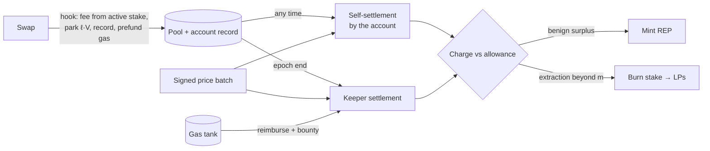

# REP-AMM: Oracle-Reconciled, L1-Viable LVR Capture with a Tokenized Reputation Layer

## Abstract

Liquidity providers in automated market makers lose value to arbitrageurs who trade against stale on-chain prices (loss-versus-rebalancing, LVR). REP-AMM is a Uniswap v4 hook that prices each swap at execution and reconciles it after the block against signed oracle prices. Arbitrage is treated as a paid job: a price-correcting swap keeps a market-discovered allowance per unit of correction, and extraction beyond it is recaptured for liquidity providers from stake posted before trading, so that paying block builders for position becomes useless. Traders who overpay mint a per-pair reputation token (REP) whose stake grants fee discounts. All value settles in each pool's own pair, and the work of settlement is paid in gas from a tank that every swap prefunds. On six months of Ethereum and Arbitrum data the mechanism recaptures 70–73% of extraction at a benign-flow overcharge below 0.1 bp, and settlement costs 0.18× the gas of the swaps it settles.

## 1. Introduction

LVR is a permanent, non-mean-reverting cost for liquidity providers (LPs), commonly estimated at 5–7% of liquidity value per year — enough to make many major pools unprofitable after fees. Arbitrage itself is necessary: it keeps the pool's price aligned with the market. The problem is its price. Arbitrageurs capture the full gap between pool and market, and on Ethereum they pass much of it to block builders in competition for position, a cost ultimately borne by LPs. Fixed fee tiers fragment liquidity without resolving the trade-off.

We pursue two goals: to return as much of the arbitrage surplus as possible to LPs while charging uninformed flow as little as possible, and to replace the hard-coded fee by a variable the system sets itself. The contributions are:

1. a per-swap quality score `q_LP`, measured against signed bid/ask prices at an empirically measured decision instant (§3);
2. a payout rule for arbitrage — a per-unit cap with an allowance discovered on-chain — under which bidding for position earns nothing (§4.2–4.3);
3. a per-pair reputation asset and a collateral design that make the charge collectable after the fact (§4.4–4.5);
4. a settlement layer that is pair-native and costs a fraction of the swaps it settles (§4.6);
5. an evaluation on Ethereum and Arbitrum covering scoring validity, recapture, payout rules, oracle error and settlement cost (§5).

## 2. Related work

Approaches to LVR either remove the information asymmetry or redistribute its surplus (Appendix A). Milionis et al. (2022) define LVR and suggest backward-looking fee adjustment and the sale of arbitrage rights as directions; REP-AMM is a concrete, farming-resistant instance of the first. Auction designs — am-AMM (Adams et al., 2024), McAMM (Josojo, 2022) and Angstrom (Sorella Labs) — sell the right to arbitrage or manage the pool and return the proceeds to LPs; Angstrom additionally clears ordinary orders at a uniform price, but relies on app-specific sequencing, whereas REP-AMM is a plain hook. Diamond (McMenamin et al., 2022) and V0LVER (McMenamin and Daza, 2023) reduce liquidity for arbitrageurs only, and argue against oracle dependence; we accept a trusted signed oracle and quantify the consequences of its error (§5.6). MEV taxes (Robinson and White, 2024) charge a fee increasing in the priority fee and capture competitive MEV under honest priority ordering; they do not hold under builder auctions on Ethereum and cannot reach extraction in the middle of a block. Reputation systems (zScore: Udupi et al., 2025; Karma: Status Network) and optimal dynamic fees (Baggiani et al., 2025; Ghasemlu, 2026) set fees or access by behaviour or market state but specify neither an oracle-reconciled scoring rule nor resistance to concentration of the discount.

## 3. Measurement model

### 3.1 Reconciliation is necessary

No blockchain finalises as quickly as a centralised order book observes prices. Even a price signed into the transaction leaves a lag between the signature and execution that can be exploited. The ground truth about a swap is therefore available only after the fact, and an AMM that prices against it must span at least two blocks: the swap, and its reconciliation.

### 3.2 The quality score

For a swap with pool-perspective token deltas (Δ₀, Δ₁),

```
q_LP = (Δ₀ + P_dir(t*)·Δ₁) / notional                                (1)
```

where `P_dir` is the directional benchmark — the liquidity-weighted bid when the pool sells the risky asset and the ask when it buys it — so that swaps executed inside the bid–ask band are never scored as extractive (Chainlink Data Streams supplies both sides). The score is invariant to the choice of numeraire, needs no sign convention by trade direction, and is evaluated at horizon zero, where extraction occurs, rather than against later prices that mix extraction with drift. Negative values are losses to LPs.

### 3.3 When a swap is priced

A block executes as one instant, so a transaction's index records ordering, not time; and under proposer–builder separation a block's timestamp labels its slot rather than the moment its content was decided. We therefore measure the decision instant *t\** = block timestamp + *L*: a swap that closes a gap stops where the pool price net of the fee meets the hedgeable external price, and minimising that residual over offsets identifies *L* (Figure 5). Every swap in a block is scored at the same instant and over a one-second window around it. A per-block anchor is position-invariant — no position maps to a more lenient benchmark — which is the property that makes buying position useless. A finer clock derived from a transaction's index within the block would be set by whoever controls ordering — the builder or sequencer — and could be sold to the swap that benefits from it; anchoring every swap to the block's timestamp removes that lever (Appendix B).

On chains whose blocks are shorter than their timestamps, such as Arbitrum (about four blocks per second), we place the *N* blocks sharing second *S* at *S* + (*k* + ½)/*N*. This orders blocks, not transactions, and on a first-come-first-served sequencer block order follows arrival; its error of at most ±1/(2*N*) s is absorbed by the scoring window.

### 3.4 Assumptions and threat model

We assume the following.

- **A1 (oracle).** Signed bid and ask prices exist for every block, are retained for a window of about a month, and are correct up to a bias and noise that the tolerance ε of §4.3 bounds (§5.6). A compromised or censored oracle is outside the model.
- **A2 (chain).** The hook executes atomically with the swap, and the chain exposes its base fee to contracts. Reorganisations beyond finality are not considered.
- **A3 (ordering).** No ordering is assumed to be honest: builders and sequencers may order, insert and exclude transactions and sell position. The only ordering property used is whether a chain runs builder auctions or a first-come-first-served sequencer, which selects the allowance controller (§4.3).
- **A4 (arbitrage).** Arbitrageurs are rational and have private, time-varying costs, and at least one is active; competition among them is not assumed (§5.4).
- **A5 (liveness).** At least one keeper settles each epoch before its deadline at the bounty the gas tank pays.

The adversary is any trader, LP, arbitrageur, builder, sequencer or keeper, or any coalition of them. It may create any number of accounts, split trades, buy position, trade REP and choose when to settle its own swaps. Accounts carry no identity: an account is known only by its stake, and a new account pays `f_max`. The mechanism is designed to provide five properties: (G1) a swap's score does not depend on its position in the block; (G2) splitting a trade reduces neither its charge nor its parked stake; (G3) charges are collected from stake posted before the trade and never from another trader's stake; (G4) outstanding REP never exceeds, at its internal rate, the surplus LPs have received (Theorem 1); and (G5) no keeper can alter a charge. Implementation errors in the contracts are outside the model.

## 4. Mechanism

REP-AMM separates the execution of a swap from its pricing. A swap executes at once, at a fee set by the stake its sender has posted; after the block, it is scored against signed prices and settled against that stake. A swap that corrects the pool's price keeps an allowance per unit of correction, and whatever it extracts beyond the allowance is charged to its stake for the LPs; traders whose payments exceed the LPs' target earn the stake that lowers their fees. The subsections follow a swap through this cycle, and Table 1 collects the notation.

| Symbol | Meaning |
|---|---|
| `q_LP`, *t\**, *L* | quality score (1); decision instant *t\** = block timestamp + *L*; measured decision latency |
| *r*, *V* | an account's staked REP and its volume in the epoch |
| `f_min`, `f_max`, ρ | fee band and capacity scale of the coverage curve (2); ρ is also the base parking rate |
| *m*, *m*₀, ε | job allowance per unit of correction (3), its starting value, and the oracle tolerance |
| ℓ, *k*, `Δ_block` | parked share of volume (5), its speed, and the pool's price move so far in the block |
| *N*, θ\*, τ | pool's net income per epoch (4), LPs' target take-rate, and protocol take |
| *P*_int, *P*_mkt, δ | internal mint and burn rate of REP, its market price, and the buyback margin (§4.8) |
| *G*, epoch | gas withheld per swap for settlement; per-pool settlement period |

*Table 1. Notation. Activation and exit delays of stake, the controller's steps and thresholds, and the keeper bounty and deadline are further parameters.*

### 4.1 Execute, then reconcile



*Figure 1. Lifecycle of a swap.*

At execution the hook reads the trader's active REP stake, charges the fee given by the coverage curve, parks part of the stake, records the swap and prefunds its share of settlement gas; no oracle is consulted, so trading remains synchronous and permissionless. At reconciliation, the swap is scored against signed prices and settled against stake only: benign surplus mints REP, and extraction beyond the job allowance is burned from stake. Because a departed counterparty's cash cannot be recalled, stake is both the fee determinant and the collateral.

### 4.2 Fees: the coverage curve

Staked reputation *r* grants discounted capacity *r*/ρ per epoch, and the fee on covered volume *V* is

```
f(r, V) = f_min + (f_max − f_min) · exp(−r / (ρ·V))                  (2)
```

The curve (Figure 2) is convex and decreasing in *r* (diminishing returns, which discourages concentration), asymptotic to `f_min` (LPs always earn a floor) and homogeneous of degree zero (it prices the coverage ratio, not wealth). Volume beyond capacity pays `f_max`.


*Figure 2. The coverage curve for three fee bands.*

### 4.3 Arbitrage as a paid job

Each price-correcting swap keeps

```
kept = ∫ min(edge(u), m) du                                           (3)
```

where `edge(u)` is the marginal gap between the oracle and the pool price, beyond the pool fee, along the trade's price path, and *m* is the job allowance per unit of correction; everything beyond is recaptured for LPs (Figure 3a). The allowance covers all of the arbitrageur's costs, gas included, so the pool never values gas in its own units. Capping rent per unit rather than on the trade's average edge stops the arbitrageur at the competitive band: under an average-edge cap, rent keeps growing past the oracle, inviting overshoot (Figure 3b). The integral is additive, so splitting a trade gains nothing, and the rule pays any correcting swap regardless of its position.


*Figure 3. (a) Rent kept and recaptured under the per-unit cap. (b) Kept rent as a function of trade size under the two caps.*

The competitive cost of rebalancing is private and changes, so *m* is discovered by a controller rather than set. It raises *m* hourly when blocks begin with uncorrected gaps beyond `f + m + ε`, and lowers it daily. Lowering requires care: when *m* falls below the cheapest arbitrageur's cost, no correction is profitable at any gap size (Figure 4), and a blind decay finds the cost only by crossing this cliff. On first-come-first-served chains the controller therefore lowers *m* only when more than a quarter of the day's correcting swaps come from senders other than the most frequent one, evidence that several arbitrageurs can still profit; it then settles between the cheapest and second-cheapest cost. Under builder auctions sender diversity under-reports competition, and blind decay is used.


*Figure 4. Number of arbitrageurs able to profit as a function of the allowance, for the cost population used in §5.4.*

### 4.4 The reputation asset

Per epoch, the pool's net income — fees and markouts, with charges recaptured — is compared with the LPs' target:

```
N = Σ fees + Σ markouts + Σ charges,     minted = (1 − τ) · max(N − θ*·ΣV, 0) / P_int     (4)
```

The surplus mints REP to the accounts whose payments exceeded the target on their own volume, pro rata to the excess, at a fixed internal rate *P*_int; extraction beyond the allowance burns stake at the same rate, so no market price of REP enters either formula. Minting is self-funding — a wash trader's mint is prepaid by its own overpayment — and self-enforcing: over-earning mints capacity that lowers fees, under-earning halts minting. REP is minted below the surplus it claims by the protocol take τ, which funds the per-pool reserve. Staked REP is a slashable trading licence, preferable to escrowed cash because it earns its holder the discount, is costly only to extractors, and appreciates with the pool's benign volume.

### 4.5 Stake, parking and collection

Only staked REP affects fees, which precludes flash-renting the discount. A trade parks `ℓ·V` of active stake until it is settled, with

```
ℓ = ρ + k · Δ_block                                                   (5)
```

where `Δ_block` is the pool's price move so far in the block: corrections after a market jump move the pool quickly and park more. Splitting a trade cannot reduce `Δ_block`, whereas rules keyed to trade size can be defeated by splitting. Charges are collected first from the trade's parked stake, then from the rest of the account's stake (which cannot be withdrawn while settlements are pending), and finally from the per-pool reserve. Charges are never taken from other traders' stake.

### 4.6 Settlement

The hook extends each swapper's record — post-trade price, active liquidity and token deltas, chained by hash in the account's storage — so that an account's unsettled swaps form a self-contained segment. An account may settle itself at any time against the signed prices for its blocks, which releases its parked stake; at the end of each epoch a keeper settles every account still in flight. Both paths advance the same pointer, and a keeper's entry for an account that has already settled is skipped rather than reverted. Flights still unsettled when the oracle's retention window expires are burned in full.

Settlement is paid in gas, not in the pool's assets. Every swap prefunds `G × block.basefee` into a gas tank — a count of gas units times a value the chain exposes, with no price involved — from which keepers are reimbursed with an escalating bounty, directly or through an ERC-4337 paymaster. Since every pool contributes in the same unit, one tank can serve many pools. Two rules keep it inexpensive: settlement is never forced into the current block, and each pool chooses its epoch length. Where charges are computed on-chain, an open race among keepers is efficient; where they are proven off-chain, a designated leader avoids duplicated proving. A leader cannot alter a charge, which is fixed by the record and the signed prices.

The per-swap work of settlement — a multiply-add against a verified price, a comparison and a state write — is smaller than executing the swap, so settlement is bounded by the pool's own execution footprint. §5.7 measures it.

### 4.7 Launch and intermediaries

At launch no account holds REP, and none needs to be issued: unstaked volume pays `f_max`, and once an epoch's surplus exceeds the LPs' target it mints the first REP. A sale of initial supply can shorten this phase; its proceeds seed the reserve. Intermediaries — solvers, RFQ desks — can hold stake and pass the discount to users. The protocol never identifies arbitrageurs: arbitrage is a role carried by a swap, and any swap that moves the pool toward the oracle is paid the allowance on it. The charge is computed per correcting swap rather than per account, so an intermediary cannot net customers' overpayments against its own extraction.

### 4.8 When REP trades below its mint rate

REP is burned for charges at the internal rate *P*_int at which it was minted, while its secondary-market price *P*_mkt may fall below it. A trader can then buy REP cheaply, stake it, and pay charges for extraction at par with collateral that cost less. Three properties bound the consequences (Appendix E).

First, the pool is solvent at par. REP is minted only from surplus above the LPs' target, and below that surplus by the take τ, so outstanding REP valued at *P*_int never exceeds the surplus LPs have already received. If every outstanding unit were eventually burned as collateral for extraction, LPs would return that surplus and end at their target θ*, not below it: a crash in REP's price removes the surplus, not the principal.

Second, extractors provide a demand floor. A unit of REP saves an extractor up to *P*_int of charges, so extractors buy it whenever *P*_mkt < *P*_int and they have extraction to cover. The floor scales with expected extraction rather than being fixed at par: if circulating REP exceeds what extraction can absorb, the price can remain below par.

Third, below par, outstanding REP is the pool's debt trading at a discount. When cheap REP covers a charge, LPs' accounting floor holds, but the value recaptured falls to roughly *P*_mkt/*P*_int of its designed level, and the difference accrues to the seller of the REP.

The reserve therefore acts as a buyer of last resort with a strictly bounded balance sheet. Funded only by the take τ, it buys REP when *P*_mkt falls below *P*_int by more than a margin δ and burns it: each unit retired at *P*_mkt extinguishes a liability of *P*_int, for the benefit of all LPs pro rata and in the pool's own assets. Its capacity is at most τ·*S*_t, the take on the surplus collected so far, so it can absorb moderate discounts but cannot hold par against a large, sustained overhang. An individual LP that extracts from its own pool to burn REP gains little by comparison, since most of that extraction is borne by the other LPs. Solvency is a property of the pool, not of each LP: LPs who join after the surplus was distributed inherit the outstanding REP without the surplus behind it, so REP outstanding per LP share is a quantity entering LPs should price.

### 4.9 A worked example

Consider an ETH/USDC pool with illustrative parameters `f_min` = 1 bp, `f_max` = 30 bp, ρ = 5 bp, θ\* = 2 bp, *m* = 2 bp, τ = 2.5%, and an internal rate of 1 USDC per REP; both swaps below are $10,000 and fall in one epoch.

*Alice*, an uninformed trader holding 5 REP, swaps in a quiet block. Her coverage ratio is 5/(0.0005 × 10,000) = 1, so by (2) she pays 1 + 29·e⁻¹ = 11.67 bp, or $11.67. Her markout before fees is zero, so her `q_LP` is +11.67 bp. With no price move in the block she parks ℓ·*V* = 5 bp × $10,000, all 5 of her REP, until settlement.

*Bob*, an arbitrageur holding 15 REP (coverage ratio 3), corrects the pool after a market move, paying 1 + 29·e⁻³ = 2.44 bp. Along his trade the edge beyond the fee falls linearly from 10 bp to zero, so he extracts 5 bp on average — $5.00 — and his `q_LP` is −5 bp. By (3) he keeps ∫ min(10(1 − *u*), 2) d*u* = 1.80 bp, and the remaining 3.20 bp, $3.20, is charged. The block had already moved by 10 bp, so by (5) with *k* = 0.5 he parked ℓ = 5 + 5 = 10 bp of his volume, $10 of stake; the charge burns 3.20 REP from it, and the other 6.80 are released at settlement.

At reconciliation, by (4), *N* = 11.67 − 5.00 + 3.20 = $9.87 against a target of 2 bp × $20,000 = $4.00, leaving a surplus of $5.87. Only Alice paid more than the target on her own volume (Bob's net is −1.8 bp), so she receives (1 − 0.025) × 5.87 = 5.72 REP. Her next $10,000 swap, with 10.72 REP staked, pays 1 + 29·e^(−2.14) = 4.40 bp. Bob kept his allowance of $1.80 and paid nothing for position, since any position would have been scored at the same instant (§3.3). The LPs received $6.67 in the pool's assets; Bob's charge was settled in REP, which retires claims on surplus the LPs already hold (Theorem 1).

## 5. Evaluation

### 5.1 Data and method

We study the Uniswap v3 ETH/USDC 5 bp pool on Ethereum mainnet and the corresponding WETH/USDC pool on Arbitrum from 1 March to 31 August 2026 (Table 2). The benchmark is Binance ETHUSDT corrected by USDCUSDT, with a touch-level bid/ask proxy built from aggressor-flagged trades. A stable–stable control pool on each chain scored a median absolute `q_LP` of 0.9–1.1 bp, well within the 38.4 bp ceiling implied by peg noise. Payout rules are compared in a block-level simulation that replays the real oracle path and non-arbitrage flow, with optimising arbitrageurs whose costs range from 0.3 to 2.5 bp and are multiplied by four or eight from June (Appendix C).

| | Ethereum mainnet | Arbitrum One |
|---|---|---|
| Swaps | 990,555 | 5,237,793 |
| Blocks (with a pool swap) | 1.32 M (595 k) | 63.4 M (1.87 M) |
| Volume | $19.6 B | $11.2 B |

*Table 2. Sample, March–August 2026.*

### 5.2 Decision latency and scoring validity

The decision latency is 1.5 s on mainnet and 0.75 s on Arbitrum (Figure 5), each bracketed by estimates biased early and late. A window trailing the block timestamp would instead score arbitrageurs against prices from before their trades, turning mainnet's measured LP loss of $1.58 M into an apparent gain of $5.26 M.


*Figure 5. Median fee-adjusted residual between the pool's post-swap price and the hedgeable external quote, by offset from the block timestamp.*

Against price-independent labels — retail routers as benign, sandwich legs and top-of-block repeat searchers as toxic — the score separates the classes with AUC 0.889 on mainnet and 0.814 on Arbitrum, rising to 0.983 and 0.897 for the largest swaps (Figure 6). Extraction follows the ordering regime: on mainnet, where builders sell position, 61% of it occurs in the first three positions of a block; on Arbitrum's first-come-first-served sequencer, 69% occurs at position ten or later (Figure 7). LPs lost $9.68 M to extraction on mainnet and ended $1.58 M down after fees; on Arbitrum they lost $1.34 M on smaller fills and ended $0.86 M up.


*Figure 6. Distribution of `q_LP` by label.*


*Figure 7. Share of extraction by transaction position in the block.*

### 5.3 Recapture

With perfect information, a schedule charging extraction beyond an allowance of 2 bp, capped at `f_max`, recaptures 73% of extraction on mainnet and 70% on Arbitrum while preserving 97–99% of profitable arbitrage and overcharging benign flow by less than 0.1 bp (Figure 8). The schedule was set a priori, not fitted; selected on March–May, it is also the best schedule on June–August.


*Figure 8. Recapture against profitable arbitrage preserved, for all schedules evaluated.*

### 5.4 Payout rule and allowance discovery

A rule must keep the pool as rebalanced as today: the share of blocks within the fee plus 1 bp of the oracle may fall by at most 0.5 points, and the price users trade against may be at most 0.1 bp staler. The per-unit cap with an on-chain controller raises LPs' net position by $4.81 M on mainnet and $0.66–0.71 M on Arbitrum in the worst cost scenario, and redirects most of the $6.57 M that mainnet arbitrageurs paid for position. An average-edge cap fails the constraint through overshoot. Blind decay stalls rebalancing whenever it crosses the cheapest cost — about every two weeks — whereas decay gated on sender diversity holds just above it (Figure 9), at 7–8% less worst-case gain. Results hold for arbitrage populations from a monopoly to ten arbitrageurs and for depth halved or doubled (Appendix C).


*Figure 9. Allowance over time under three controllers, Arbitrum, with arbitrage costs quadrupled from June.*

### 5.5 Collateral

The charge per trade is small at the median (0.17 bp) but heavy-tailed (99.9th percentile 21 bp, maximum 358 bp; trades above 50 bp carry 27% of the total), so parking alone collects 70–90% and the account's remaining stake and the reserve collect the rest. Parking keyed to the in-block price move resists splitting; parking keyed to trade size loses half its collection when a correction is split ten ways.

### 5.6 Oracle error

Scoring with a degraded oracle leaves benign flow essentially unaffected (overcharge below 0.3 bp) but makes part of the charges on arbitrage unjustified (Figure 10). The tolerance ε is the remedy: ε equal to the bias removes a bias exactly, ε of about twice the noise removes most random error, and each basis point of ε forgoes about 8% of recapture — hence ε ≈ max(|bias|, 2σ). Staleness is the binding error on fast chains: a one-second-old feed halves recapture on Arbitrum, so rollups require a sub-second pull oracle.


*Figure 10. Mainnet: (a) unjustified share of charges and (b) recapture, as functions of the tolerance ε, for four oracle errors.*

### 5.7 Settlement cost and keeper economics

We measured every component on-chain or in Foundry (Appendix D). The hook adds 17,112 gas to a v4 swap; a keeper's epoch costs 26,000 gas plus 14,300 per account; self-settlement costs 46,000 gas plus 6,000 per swap; a Groth16 proof verifies for 227,226 gas. With prices signed once per batch and settled hourly, settlement costs 0.18× the execution gas of the settled swaps on mainnet and 0.19× on Arbitrum (Figure 11). A succinct proof lowers this only to 0.14–0.15×, because the hook and the per-account writes remain; viability does not depend on proofs.


*Figure 11. Settlement gas relative to the execution gas of the settled swaps.*

Funding keepers from the gas tank requires a modest contribution per swap (Figure 12). A tank shared by seven mainnet pools stays solvent with 2.3 k gas per swap at daily epochs (1.2% of a swap's gas) and 1.4 k when keepers choose the block; Arbitrum needs 0.64 k. Alone, the smallest pool would need 80 k gas per swap at hourly epochs; within the shared tank it pays the common rate. In simulation, 2–8% of accounts preferred to settle themselves, carrying up to half of the volume and cutting their stake by 15–24%; an open keeper race settled on-chain epochs within 1.3 minutes, and a designated leader removed the duplicated proving that a race of similar keepers incurs.


*Figure 12. Smallest per-swap gas contribution that keeps the gas tank solvent.*

### 5.8 Limitations

The benchmark is a Binance touch proxy, not the signed liquidity-weighted quote, so oracle error is modelled rather than measured. The simulation assumes linear daily depth, fixed user flow, a population of arbitrage costs and a second-price auction for position; sender diversity presumes a first-come-first-served race. Labels are conservative heuristics. Gas was measured on a locally deployed v4 pool manager with mock tokens, and swaps crossing a liquidity boundary are outside the closed-form charge. Keeper costs are assumed, and the seven-pool census applies the study pool's recapture rate to the other pairs. The behaviour of REP below its mint rate is analysed (§4.8, Appendix E) but not simulated; its sufficiency as collateral relative to a plain bond remains to be tested empirically.

**Future work.** REP is issued per pair. A single reputation token shared by all pools would let standing earned in one pool count in another, but we have not found a design that satisfies our constraints in principle. REP is minted from surplus paid to a pool's LPs, so an account that is also the LP of its own pool mints at the cost of the protocol take alone; per pair this is harmless, since the LPs who bear a charge are the LPs whose surplus backs the REP, but a shared token lets REP minted against one pool's surplus be charged against another's. Per-pool valuation curves, oracle pricing and closed surplus vaults bound the loss to each pool's accumulated surplus but do not make minting costly; locking part of the backing or admitting pools by seasoning would, at the cost of the LPs' claim to their surplus or of permissionless entry. We leave a shared token to future work.

## 6. Conclusion

REP-AMM shows that loss-versus-rebalancing can be recaptured by a plain Uniswap v4 hook, without delaying execution, without consulting an oracle at trade time and without relying on honest ordering. Execution remains synchronous; pricing is completed after the block against signed prices, at a decision instant that is measured from the data and shared by every swap in the block, so that no position buys a more lenient benchmark. Arbitrage is retained as a paid job whose allowance is discovered on-chain, extraction beyond the allowance is collected from stake posted before trading, and benign traders earn the stake that lowers their fees.

On six months of Ethereum and Arbitrum data, the mechanism recaptured 70–73% of extraction while overcharging benign flow by less than 0.1 bp, raised LPs' worst-case position by $4.81 M on mainnet and $0.66–0.71 M on Arbitrum while keeping the pool as well rebalanced as today, and settled for 0.18–0.19 of the swaps' execution gas, paid from a tank that every swap prefunds. Its binding requirements are a sub-second oracle on fast chains and a tolerance matched to the feed's error. The market behaviour of REP, oracle error measured on the signed feed itself, and a reputation shared across pools remain open.

## References

Adams, A., Moallemi, C. C., Reynolds, S., and Robinson, D. (2024). am-AMM: An auction-managed automated market maker. arXiv:2403.03367.

Baggiani, L., Herdegen, M., and Sánchez-Betancourt, L. (2025). Optimal dynamic fees in automated market makers. arXiv:2506.02869.

Buterin, V., Weiss, Y., Tirosh, D., Nacson, S., Forshtat, A., Gazso, K., and Hess, T. (2021). ERC-4337: Account abstraction using alt mempool. Ethereum Improvement Proposals. https://eips.ethereum.org/EIPS/eip-4337

Chainlink. Data Streams: liquidity-weighted bid and ask prices. https://docs.chain.link/data-streams/concepts/liquidity-weighted-prices

Ghasemlu, F. (2026). Optimal dynamic fees for automated market makers: A stochastic control approach to loss-versus-rebalancing. arXiv:2606.21769.

Groth, J. (2016). On the size of pairing-based non-interactive arguments. In *Advances in Cryptology – EUROCRYPT 2016*, LNCS 9666, pp. 305–326. Springer.

Josojo (2022). MEV capturing AMM (McAMM). Ethereum Research. https://ethresear.ch/t/mev-capturing-amm-mcamm/13336

McMenamin, C., and Daza, V. (2023). An AMM minimizing user-level extractable value and loss-versus-rebalancing. arXiv:2301.13599.

McMenamin, C., Daza, V., and Mazorra, B. (2022). Diamonds are forever, loss-versus-rebalancing is not. arXiv:2210.10601; published as "An automated market maker minimizing loss-versus-rebalancing".

Milionis, J., Moallemi, C. C., Roughgarden, T., and Zhang, A. L. (2022). Automated market making and loss-versus-rebalancing. arXiv:2208.06046.

Robinson, D., and White, D. (2024). Priority is all you need. Paradigm. https://www.paradigm.xyz/writing/priority-is-all-you-need

Sorella Labs. A new era of DeFi with app-specific sequencing. https://sorellalabs.xyz/writing/a-new-era-of-defi-with-ass

Status Network. Karmic tokenomics. https://docs.status.network/overview/tokenomics/karmic-tokenomics

Succinct Labs. SP1 zero-knowledge virtual machine. https://github.com/succinctlabs/sp1

Udupi, H., Sahoo, A., Akshay, S. P., Gurukiran, S., Paul, P., and Martens, P. C. (2025). zScore: A universal decentralised reputation system for the blockchain economy. arXiv:2503.05718.

Uniswap Labs. Uniswap v4 core. https://github.com/Uniswap/v4-core

---

## Appendix A. Related work in detail

**Milionis, Moallemi, Roughgarden and Zhang (2022).** Define LVR with a closed form and propose (a) fees set by comparing LVR with fee income over a backward-looking window and (b) the sale of arbitrage rights to capture LVR for LPs. Both are directions, not specified or farming-robust mechanisms; REP-AMM's oracle reconciliation instantiates (a).

**am-AMM (Adams, Moallemi, Reynolds and Robinson, 2024).** A Harberger-lease auction for the role of pool manager, who sets the fee and may arbitrage at zero fee; surplus accrues to LPs. By its authors' account it offers fewer sandwich protections than a fixed-fee AMM and depends on a single manager; the convex coverage curve of §4.2 is in part an argument against winner-take-all structures.

**Diamond and V0LVER (McMenamin, Daza and Mazorra, 2022; McMenamin and Daza, 2023).** Reduce liquidity only for arbitrageurs and rebate a share of LVR; V0LVER extends protection to user-level MEV. The authors regard oracle dependence as unsatisfactory; REP-AMM accepts a trusted signed oracle and bounds the effect of its error (§5.6).

**Angstrom (Sorella Labs).** A live v4 hook that auctions the top-of-block arbitrage right, distributes the proceeds to in-range LPs and clears other orders at a uniform price, which removes the positions a sandwich needs. It relies on app-specific sequencing by a decentralised operator set; REP-AMM requires no sequencer.

**zScore (Udupi et al., 2025) and Karma (Status Network).** zScore scores accounts' on-chain behaviour and points to v4 hooks as a vehicle for reputation-dependent fees; it does not specify an oracle-reconciled per-swap rule or an anti-farming curve. Karma is a soulbound token for access and rate limiting, not LVR-specific pricing; REP is deliberately transferable.

**Optimal dynamic fees (Baggiani, Herdegen and Sánchez-Betancourt, 2025; Ghasemlu, 2026).** Derive optimal fees as functions of the pool's state — inventory and external price moves, or volatility through a stochastic-control formulation; they set one fee for all flow and do not address a reputation-eligibility curve that must resist concentration.

**MEV taxes (Robinson and White, 2024).** A fee increasing in the priority fee captures competitive MEV under strict priority ordering — plausible on OP-Stack sequencers, not under Ethereum builder auctions — and cannot reach extraction in the middle of a block. REP-AMM's ex-post reconciliation does not depend on honest ordering.

## Appendix B. Measurement details

**Benchmark composition.** Pair bid and ask composed from two single-asset feeds are taken as round trips: pair ask = buy-leg ask / sell-leg bid; pair bid = sell-leg bid / buy-leg ask. Liquidity-weighted quotes are conservative for large trades but lenient for small trades in volatile moments, when the touch is the true counterfactual; as pool liquidity approaches reference depth, the quotes can be extended with the pool's own liquidity into a size-aware price.

**Decision latency.** The bid/ask proxy is about 0.75 s stale at the median. Running the latency fit with the last quote before each instant biases it late, with the next quote after it biases it early; *L* is the midpoint. Mainnet bracket: 1.25–1.75 s; Arbitrum: 0–1.5 s. Timing noise inside the centred 1 s window: 0.80 bp (mainnet) and 1.72 bp (Arbitrum) at the 90th percentile.

**Index-based clocks.** Normalising transaction index into intra-block time is unsafe where position is sold: ordering by arrival gives the best-informed top-of-block traders the oldest price and forgives about 72% of top-of-block extraction; reversing the orientation moves the purchase to the cheap bottom of the block; clocks counting only the pool's own swaps can be bought with dust swaps ($0.03 of gas bought $11 of forgiveness per arbitrage in our data). Such clocks are safe only where ordering is enforced by time.

**Labels.** Benign: transactions sent to a curated set of retail routers (on Arbitrum, the curated routers present there plus contracts used by at least 300 senders with at most 20 swaps each). Toxic: sandwich attacker legs, and the first swap in a direction among a block's first four user transactions by a non-router sender with at least 100 swaps. Arbitrum blocks open with a system transaction, so positions count user transactions. The "largest swaps" slice is the top 4.55% by notional on each chain ($100 k on mainnet, $7 k on Arbitrum).

## Appendix C. Simulation design

Every block is replayed in order — mainnet's 1.32 M, and all 63.4 M Arbitrum blocks at their reconstructed sub-second times, with the oracle read at each block's own time plus *L*. Pool depth is linear within a day, estimated from real swaps. In each block, arbitrageurs with hedging costs {0.3, 0.6, 1.0, 1.5, 2.5} bp choose the trade that maximises profit under the payout rule; the winner pays the runner-up's profit for position (second-price). The block's real non-arbitrage swaps are then replayed at observed size and direction. Costs are multiplied by four or eight from 1 June.

**Rebalancing constraint.** A rule is admissible only if, in every cost scenario, the share of blocks within the fee plus 1 bp of the oracle is at most 0.5 points below today's and the volume-weighted gap at which users trade is at most 0.1 bp above today's. This test is independent of block time; a count of uncorrected blocks is not, because a standing gap is counted once per block.

**Worst-case LP gain over the three cost scenarios** (per-unit cap unless stated):

| Controller | Mainnet | Arbitrum |
|---|---|---|
| Observes competition (not implementable on-chain) | +$5.11 M | +$0.75 M |
| Blind decay | +$4.81 M | +$0.71 M |
| Decay gated on sender diversity | — | +$0.66 M |
| Fixed allowance, 5 bp | +$3.68 M | +$0.42 M |
| Reimbursing gas in addition to the allowance | +$5.07 M | +$0.71 M |

**Controller.** Hourly: if at least five blocks began with a gap beyond `f + m + ε` that the block's first swap did not correct, and they exceed 2% of such blocks, `m ← 2m`. Daily: `m ← 0.95m` if the decay condition holds (blind decay: fewer than 1% such blocks; gated decay: more than 25% of correcting swaps from senders other than the top one); otherwise hold. Under blind decay, rebalancing stalled for 0.6–3.1 h in total on mainnet and 4.7–7.1 h on Arbitrum over six months; gated decay removed the stalls when costs were stable.

**Sensitivity.** With a monopolist, two or ten arbitrageurs, all costs halved or doubled, and depth halved or doubled, every controller variant kept the pool rebalanced on both chains. A monopolist never reveals competition, so gated decay holds the allowance at its starting value `m₀`, which then bounds the rent.

**Two rejected controller variants.** Measuring staleness as the share of time a gap is open, over every block, mistook mainnet's 12 s of fresh drift for staleness and drove *m* to 21–31 bp. An allowance growing with the standing gap silenced the signal that raises *m* and lengthened stalls (20–61 h on Arbitrum).

## Appendix D. Settlement measurements

**Components.**

| Component | Gas | Source |
|---|---|---|
| Single-swap transaction (median) | 188,705 mainnet / 136,171 Arbitrum | 400 receipts per chain |
| Data Streams report verification | 55,879 mainnet / 62,544 Arbitrum (37,544 each further in a tx) | traced historical calls; no on-chain fee |
| Hook: parking, collateral check, record | +17,112 per swap | v4 pool manager, Foundry, isolated transactions |
| Self-settlement | 46,000 + 6,000 per swap | Foundry |
| Keeper epoch | 26,000 + 14,300 per account (4,400 per skipped entry) | Foundry |
| Groth16 proof verification (SP1) | 227,226 | Foundry |
| ERC-4337 sponsorship overhead | +87,000–98,000 per settlement transaction | EntryPoint v0.7 |

**Settlement designs**, six months, including the hook on every swap:

| Design | Mainnet (× execution) | Arbitrum (× execution) |
|---|---|---|
| Keeper every block, one report per block | $96.7 k (0.72) | $21.2 k (0.72) |
| Keeper hourly, batch-signed prices | $24.9 k (0.18) | $5.7 k (0.19) |
| Keeper hourly, succinct proof | $20.5 k (0.14) | $4.3 k (0.15) |
| Every account self-settles hourly | $38.7 k (0.28) | $6.8 k (0.23) |
| Execution of the swaps | $148 k | $30 k |

**Keeper market.** Five keepers with differing costs and availability, over every hourly epoch. With on-chain settlement, an open race paid $12.0 k on mainnet (no wasted work) against $12.5 k for a designated leader. With proven settlement and similar keepers, a race wasted $829 of duplicated proving — more than Arbitrum's settlement gas — whereas a leader wasted $28 at a higher payment. A colluding leader can delay the LPs' credit by at most one epoch, worth under $0.01.

**Small pools** (protocol take needed to fund keepers, hourly, at a recapture rate of 3.6 bp of volume): $19.6 B pool 0.10–0.16%; $0.24–0.67 B pools 0.5–1.2%; $13 M pool 11–16%, falling to 1.5–2.5% at daily epochs. Funded jointly, all seven pools need 0.11–0.19%.

## Appendix E. REP below its mint rate

Index epochs by *s* = 1, 2, …. In epoch *s* let *V*_s be the pool's volume, *N*_s its net income (4), *X*_s the charges covered by burning REP, and *B*_s = *X*_s/*P*_int the units burned. Write Δ*S*_s = max(*N*_s − θ\*·*V*_s, 0) for the epoch's surplus, *D*_s = max(θ\*·*V*_s − *N*_s, 0) for its shortfall, and *S*_t, *D*_t, *X*_t for cumulative sums up to epoch *t*. Let *Q*_t be the outstanding REP, with *Q*_0 = 0, and *C*_t = Σ_{s≤t} (*N*_s − *X*_s) the LPs' cumulative income in the pool's assets, charges settled in REP excluded.

**Theorem 1 (solvency at par).** For every *t*,

(i) *P*_int·*Q*_t = (1 − τ)·*S*_t − *X*_t, and hence *X*_t ≤ (1 − τ)·*S*_t;

(ii) *C*_t ≥ θ\*·Σ_{s≤t} *V*_s + τ·*S*_t − *D*_t.

In particular, if no epoch falls short of the target, LPs' income in the pool's assets is at least θ\*·Σ*V*, even if every unit of REP ever minted is burned as collateral for extraction.

*Proof.* (i) By (4), epoch *s* mints (1 − τ)·Δ*S*_s/*P*_int units and burns *B*_s; no other operation changes *Q*. Hence *Q*_t = Σ_{s≤t} [(1 − τ)·Δ*S*_s/*P*_int − *B*_s], and multiplying by *P*_int gives *P*_int·*Q*_t = (1 − τ)·*S*_t − *X*_t. Since burns are taken only from existing stake, *Q*_t ≥ 0, which gives *X*_t ≤ (1 − τ)·*S*_t. (ii) For each epoch, *N*_s − θ\*·*V*_s = Δ*S*_s − *D*_s, so Σ_{s≤t} *N*_s = θ\*·Σ*V*_s + *S*_t − *D*_t. Subtracting *X*_t and using (i), *C*_t = θ\*·Σ*V*_s + *S*_t − *D*_t − *X*_t ≥ θ\*·Σ*V*_s + τ·*S*_t − *D*_t. ∎

The bound is cumulative and pool-level, and an initial sale of REP at no less than *P*_int per unit (§4.7) preserves it, its proceeds entering the reserve. It does not hold for an LP cohort that entered after the surplus was collected and withdrawn, and it concerns extraction covered by REP; extraction beyond an account's stake is covered by the reserve (§4.5).

**Demand floor.** An extractor with expected extraction *E* beyond the allowance over the period it holds REP values a unit at min(*P*_int, *E*/*Q*_e), where *Q*_e is the REP it would hold: the full rate while extraction can absorb the units, less when it cannot. Aggregate extractor demand therefore supports *P*_mkt near *P*_int only while expected extraction is large relative to circulating REP.

**Buyback.** Let the reserve buy and burn REP whenever *P*_mkt < (1 − δ)·*P*_int, for a margin δ covering trading costs. Each unit retired at *P*_mkt removes a liability of up to *P*_int, so the reserve converts a discount on the pool's debt into LP value, and its bid adds a second floor independent of extraction demand. Because the REP market trades against the pool's own assets, the buyback requires no external numeraire. The reserve's capacity to buy is bounded by τ·*S*_t, so the buyback stabilises moderate discounts but cannot support par against a large, sustained overhang.
